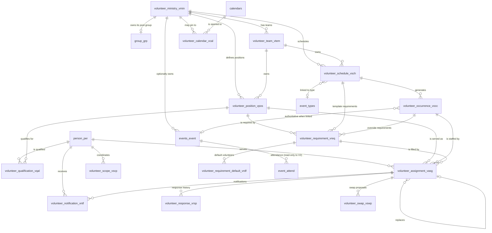

# Volunteer Management v2 — Architecture & Reuse Design

Technical design for the Volunteer Management v2 epic ([#9701](https://github.com/ChurchCRM/CRM/issues/9701)).
Moving V1 data to V2 and retiring V1 is epic [#9702](https://github.com/ChurchCRM/CRM/issues/9702) and is out of scope here.

---

## 0. Preface

### 0.1 Purpose

This document is the single technical design for Volunteer Management v2. An implementing agent
working on any child issue of #9701 (#9704–#9715) finds the product decisions, the domain model,
the authorization model and the reuse decisions here.

### 0.2 How to use this document

1. Read this file before writing code for any #9701 child issue. Then read #9701, then your own issue.
2. Find your issue in [§7 Dependency / implementation sequence](#7-dependency--implementation-sequence).
   It lists the sections that are normative for your PR and what the PR contains.
3. Copy the "reuse decisions to document in the PR" bullets for your issue into the PR
   description. Every PR answers: what existing capability was evaluated, why it is reused as-is or
   extended, and why a new implementation is necessary.
4. Where this document and a skill file disagree, this document wins for V2 work. The reliable
   references are `groups-mvc-guidelines.md`, `db-schema-migration.md`, `cypress-testing.md`,
   `timezone-handling.md`, and the source files cited here.
5. Claims about existing code cite the file and the symbol. Re-grep the symbol to find its current location.
6. A defect found in core while implementing V2 gets its own issue and its own PR. A V2 PR
   contains no workaround or private copy of core behaviour for it.

### 0.3 The product principle

> **Set it up once, then let the system run the weekly process with minimal coordinator effort.**

Every design decision below is measured against that. A screen that makes a coordinator re-enter
next week what they entered last week is a design failure.

The core workflow is:

```
Initial Setup → Schedule → Assign → Notify → Accept/Decline → Detect Gaps → Self-Service Signup → Fill → Serve
```

### 0.4 Driving use cases

These five are all representable without ministry-specific columns or code.

| # | Use case | What it forces into the model |
|---|---|---|
| **UC1** | **Coffee Bar.** One ministry with one team — the team the ministry was created with (D18). 15 volunteers in one existing ChurchCRM Group. Five positions (Setup, Cleanup, Espresso, Milk Station, Expeditor). 2–3 people needed each Sunday. Volunteers hold multiple qualifications. Assignments rotate. Weekly notification; accept/decline; declines create gaps; qualified volunteers self-sign-up. | Group-as-pool; many-to-many qualification; a *count* requirement that is not one-per-position; self-service signup. |
| **UC2** | **Sunday Worship.** "Sunday Morning Worship" is a recurring ChurchCRM calendar event, Sundays 10:30–11:45. A coordinator (not a system administrator) fills Song Leader, Communion Leader, Opening Prayer, Closing Prayer and Preacher for each occurrence, weeks ahead, from qualified people. Volunteers confirm, decline, or propose a substitute who has already agreed; the coordinator approves or rejects. | Occurrence is the **event** row; exactly-one-per-position requirements; substitution/swap as a first-class, coordinator-approved workflow; non-admin coordinator. |
| **UC3** | **Parallel ministries on the same occurrence.** The sound booth needs Audio Engineers during that same service, under a different coordinator, in a different team/ministry. | Occurrence↔event is many-to-one: several V2 occurrences (different schedules, different ministries) may point at the same `events_event` row. Authorization is per ministry/team, not per event. |
| **UC4** | **Children's Ministry.** One Ministry, several Teams, five weekly "events" (Elementary Bible Hour Sun 09:30–10:15, Nursery Bible Hour Sun 09:30–10:15, Children's Church Sun 10:30–11:45, Wednesday Night Elementary Wed 19:00–20:00, Wednesday Night Preschool Wed 19:00–20:00). A Sunday School class such as Faith City (about eight volunteers, one team leader) is a team of its own, linked to its class (D23). Each team may have its own leader, or one coordinator manages all. For class-type events the coordinator also sees **attendance** (existing event check-in) alongside who served. | Teams under a Ministry; a team linked to its class, whose Teacher role V2 writes; per-team leader scope; one schedule per weekly event; read-only reuse of `event_attend`. |
| **UC5** | **Reminder.** A reminder email goes out a configurable, system-level time before the occurrence. | A notification outbox with a due time, drained by the background timer jobs. |

Teams under Ministry is the whole hierarchy. There are no nested ministries.

### 0.5 Fixed decisions

These are settled. A PR does not reopen them.

| # | Decision |
|---|---|
| D1 | **Groups are the volunteer pool/roster.** V2 never copies membership. The reference is `group_grp.grp_ministry_id` on the Group (D19). |
| D2 | **Qualifications are not Group Roles.** Qualification is a separate many-to-many person↔position relation. |
| D3 | **Occurrences/shifts are separate from assignments.** |
| D4 | **The event is authoritative for date/time and occurrence identity** of every occurrence (D20). V2 has no second recurrence engine. |
| D5 | **Authorization is server-side and scope-based.** UI hiding is never treated as security. |
| D6 | **V1/V2 rollout is controlled independently of migration**, by a version/rollout setting (`sVolunteerVersion`: `v1`, `v2`, `both`), not a boolean. |
| D7 | **V2 never reads or writes V1 tables at runtime** (`volunteeropportunity_vol`, `person2volunteeropp_p2vo`). |
| D8 | **Teams under Ministry; no nested ministries.** Children's Ministry = one Ministry, several Teams. |
| D9 | **Ministry coordinators create and own events.** `events_event` carries a nullable ministry id. Events carrying a ministry id are editable and volunteer-assignable by that ministry's coordinator (and by global volunteer managers / administrators). Events with a null ministry id behave as core events always have. The link is optional; ministries are not the parent of events in general. |
| D10 | **Email only for the first release** (assignment, reminder, decline/gap alert, swap proposal/resolution, signup confirmation). SMS and in-app are later; the design leaves a channel extension point and builds nothing for them. |
| D11 | **Reminder lead time is one system-level setting** (`iVolunteerReminderLeadHours`), adjustable by an administrator, not per volunteer. |
| D12 | **Authorization tiers**: Administrator > Global Volunteer Manager > Ministry Coordinator > Team Leader > Volunteer. **Global Volunteer Manager** is granted by the user-editor permission **Manage Ministries** — column `user_usr.usr_ManageMinistries`, predicate `User::isManageMinistriesEnabled()`, route gate `ManageMinistriesRoleAuthMiddleware`, access-denied role code `ManageMinistries`. **Ministry Coordinator** is granted by the second user-editor permission **Manage My Ministries** — column `user_usr.usr_ManageMyMinistries`, predicate `User::isManageMyMinistriesEnabled()` — which opens the Ministries heading, the Ministry Dashboard and the ministry pages for the ministries the login holds a scope for, and grants nothing over any other ministry (no create, deactivate or delete, no coordinator grants; it may choose its own ministry's team leaders, §4.6). `isVolunteerCoordinatorEnabled()` is true for a global manager, or for Manage My Ministries with at least one scope row; a scope row alone does not open the admin shell (a team leader without the flag runs their team from the portal's My Teams). The coordinator module lives at `/ministries` (`src/ministries/`, `MvcAppFactory::create('/ministries')`): `/ministries/dashboard`, `/ministries/{id}`, `/ministries/occurrences/{id}`. The API is `/api/ministries/*` (route files in `src/api/routes/ministries/`; the member surface is `/api/ministries/me/*`, named by `AuthMiddleware`'s self-service exemption). Every V2 class lives under `ChurchCRM\Volunteer`: `Service\` (ministries, teams, positions, pool Group and help wanted in `VolunteerMinistryService`; grants, revocations, the matrix map and eligibility reads in `VolunteerQualificationService`; the assignment, schedule, notification and authorization services; the pool writer), `Middleware\` (entity middlewares, role gates, the rollout gate, the portal team-leader gate), `Email\` and `VolunteerException`. The Ministry Dashboard shows nothing from a deactivated ministry: its occurrences, gaps, responses, swaps and failed sends are dropped after scoping, and the "My ministries and teams" card lists active ministries and their teams only. |
| D13 | **Substitution/swap is core**, not optional. |
| D14 | **Volunteers are ChurchCRM members with logins** — the "Non-Admin Member Access" persona, an **EditSelf-exclusive** user. Self-service lives on authenticated member-facing pages in the Member Portal (`/portal/volunteer/*`), authorized per authenticated person. Volunteer scopes count for a self-service login: `VolunteerAuthorizationService::loadScopes()` loads grants for every account, and `User::isVolunteerTeamLeaderEnabled()` reports a held `team` grant. **A self-service-only account is never a coordinator; it may lead a team, exercised in the Member Portal (MP6/MP7).** `isVolunteerCoordinatorEnabled()` returns false for an EditSelf-exclusive account, which keeps the coordinator dashboard, the ministry pages and the sidebar's Ministries heading staff-only. Tokenized accept/decline links in email for people without logins are a documented future extension, not in scope. See §4.7. |
| D15 | **Reminders and scheduling**: ChurchCRM has no scheduler. V2 uses a **notification outbox** table (idempotent enqueue keyed by assignment + type, send log, retry-safe) drained by the existing `POST /api/background/timerjobs` mechanism. Installations wanting punctual reminders run `src/cli/timerjobs.php` from cron, or ping the endpoint with an API key — no V2 code. Best-effort delivery on page load is the fallback. See §3.6. |
| D16 | **A person may hold multiple qualifications within the same team and the same ministry**, and may be assigned to different positions on different occurrences. Multi-position on one occurrence is allowed, with a UI warning and no server-side block — one person can lead singing and serve communion in the same service (§2.7, §2.11.2 I7). |
| D17 | **Release target is 7.8.0.** The rollout flag defaults to `v1` and V1 stays fully compatible. V2 migration scripts are named `7.8.0-volunteer-v2-*.sql`; fresh installs get the schema from `Install.sql` and the test database from `seed.sql`. |
| D18 | **Every ministry has at least one team, and positions and schedules belong to a team.** Creating a ministry auto-creates its first team, named `"{Ministry name} Team"`, in the same transaction; it is an ordinary team and can be renamed. `vpos_vtem_ID` and `vsch_vtem_ID` are `NOT NULL` with `ON DELETE CASCADE` foreign keys, and the API answers `400` to a position or schedule with no `teamId`. A ministry's only team cannot be deleted (`409`, *"A ministry needs at least one team. Rename it instead."*); deleting the ministry takes its teams with it. A ministry coordinator manages every team of their ministry, a team leader their own. Where a screen shows positions from more than one team (the qualification matrix on *All teams*, a cross-team "still needed" line, a dashboard gap list), a position is labelled `"{Team} · {Position}"`; where the context is one team, the bare name stands. |
| D19 | **A ministry owns exactly one core Group — its volunteer pool — and coordinators may write it.** Creating a ministry creates that Group in the same transaction: named after the ministry, typed "Ministry", carrying the nullable core column `group_grp.grp_ministry_id` (FK → `vmin_ID`, `ON DELETE SET NULL`). Renaming the ministry renames the Group; deleting the ministry deletes it. **(a)** The `bManageGroups` model hooks have one exception: a write to a Group carrying a ministry id is allowed when the caller coordinates that ministry — decided by `VolunteerAuthorizationService` reading `volunteer_scope_vscp`, never `$_SESSION`, so API-key callers are judged identically — or when a V2 service has opened an explicit managed-write context (`VolunteerPoolWriter::run()`) after authorizing the write itself. A Group with a NULL ministry id takes the core path. **(b)** Qualification does not require pool membership: the picker may name anyone, qualifying somebody outside the pool adds them to it, revoking a qualification leaves them in the pool, and the qualification matrix's rows are the pool ∪ everyone qualified. Self-signup and `GET /me/opportunities` test qualification only. **(c)** A ministry can advertise: `vmin_HelpWanted` / `vmin_HelpWantedText` put it on the Open Opportunities page with an "I'd like to help" button that joins the pool and mails the coordinators (outbox type `help_offer`, one per coordinator per day). A ministry also advertises when **any active position has `vpos_Recruiting` on**, which lists those positions by name under "New volunteers needed for the following positions" (§5.6). Either alone is enough, and `recordHelpOffer()` shares the same test, so the button is never rendered over a `403`. The Groups module shows the Group and keeps its membership fully editable; its identity belongs to the ministry — `POST`/`DELETE /api/groups/{id}` answer `409`, the editor redirects, and the page says whose pool it is. |
| D20–D35 | **Core-reuse decisions.** Every occurrence anchored to an event, with optional time offsets; four ways for a schedule to find its events; teams linked to Sunday School classes with V2 writing the Teacher role; coordinators create one-off and recurring ministry events from the ministry page; administrators open church calendars to ministries; class meetings are events with core headcounts; portal legend toggles; a class's events change only as the coordinator chooses; the Sunday School switch; empty Generate runs explained; schedules follow existing events up to a church-wide scheduling horizon, topped up daily; default volunteers; events, schedules and occurrences created separately; staffing status words; several default volunteers per position. Full text in §0.8. |

#### D14 — rationale and the alternatives

*Rationale.* A volunteer needs to see only their own assignments, so the account that carries the
least authority and still logs in is the right one. ChurchCRM already has that persona:
`usr_EditSelf = 1` with every other flag `0`, i.e. `User::isEditSelfExclusive()`
(`src/ChurchCRM/model/ChurchCRM/User.php`). Using it needs **no new account type, no
token lifecycle, no unauthenticated surface, and no IDOR-prone `personId` request parameters** —
the acting person is `AuthenticationManager::getCurrentUser()->getId()`, which is the person id
(`User::getId()`; `user_usr.usr_per_ID` is the PK and FKs `person_per.per_ID` in `orm/schema.xml`).
It takes one narrowly-scoped exemption in `AuthMiddleware` (§4.7), which already has a precedent
(`AuthMiddleware::AUTH_FLOW_EXEMPT_PATHS`).

Least authority is about what the account type may reach; scope is about what this person was
explicitly given. A scope row therefore means the same for every account, and the account type
decides which surface exercises it:

- `loadScopes()` keeps only the `isVolunteerV2Enabled()` short-circuit, so `canManageTeam()` answers
  the same way whoever holds the grant.
- `User::isVolunteerTeamLeaderEnabled()` is true when V2 is on and the person holds at least one
  `team` scope, EditSelf flag or not. It is not a module permission: it opens no admin page.
- `User::isVolunteerCoordinatorEnabled()` returns false for an EditSelf-exclusive account. The
  Coordinator and Global Manager tiers are staff tiers.
- A team leader on a member login manages their team from the Member Portal; a member login never
  renders an admin page.

*Alternative 1.* Emit `tokens`-table links (`tokens` in `orm/schema.xml`,
`src/ChurchCRM/model/ChurchCRM/Token.php`) into `/external/`, which has no `AuthMiddleware`
and derives its subject from `reference_id`. Rejected for the first release: it doubles the response
surface, needs its own expiry/replay policy, and `tokens.valid_until_date` is a `DATE` column
(one-day granularity).

*Alternative 2.* Give volunteers a zero-permission, non-EditSelf account. Rejected: the read-default
policy then grants every volunteer read access to the whole people directory.

#### D15 — rationale and the alternative

*Rationale.* The "cron" in ChurchCRM is `src/skin/js/Footer.js` →
`window.CRM.system.runTimerJobs()` (`src/skin/js/CRMJSOM.js`) → `POST api/background/timerjobs`
(`src/api/routes/background.php`) → `SystemService::runTimerJobs()`; `src/cli/timerjobs.php` is the
cron entry point. Sending from inside the request that creates an assignment suits
assignment/decline/swap mail, but a *reminder* is due at a wall-clock time nobody is guaranteed to
be logged in for. An **outbox** decouples "decide the message is due" from "deliver it": rows are
enqueued idempotently at assignment time with a `ScheduledFor`, and every timer-job run drains
whatever is due. A church that wants punctual reminders runs `src/cli/timerjobs.php` from cron (the route also
accepts `x-api-key`, so a `curl -X POST` works too).

*Alternative.* Send synchronously from the request. Rejected: reminders would fire only when
someone logs in, and "duplicate notifications are avoided when operations are retried" (#9710)
needs a per-message record anyway.

### 0.6 Non-goals

Not designed here. Do not build them or add speculative columns for them.

- Hours tracking / service-hour reporting (it would attach at the §2.11 note on `event_attend`).
- Background-check tracking, name tags, onboarding checklists, skills-based assignment suggestions.
- SMS and in-app delivery. The notification model has a channel extension point and nothing else (D10, §3.5).
- Per-recipient email localization. See [Appendix D](#appendix-d--open-questions-for-the-maintainer).
- PDF reporting. V2 uses DataTables CSV/print.
- Migration of V1 data, V1 retirement, and the Volunteer Opportunities UI (#9702).
- A generic RBAC engine. V2 is absorbable by one later (§4.9) and does not depend on it.

### 0.7 Facts about the codebase this design relies on

Load-bearing: if one changes, the section that depends on it is revisited.

**Identity and keys**

| # | Fact |
|---|---|
| F1 | `person_per.per_ID` is `type="SMALLINT" size="9" sqlType="mediumint(9) unsigned"`, phpName `Id`. |
| F2 | `group_grp.grp_ID` is `type="SMALLINT" size="8" sqlType="mediumint(8) unsigned"`, phpName `Id`. `grp_Name` is `VARCHAR(50)`. |
| F3 | `events_event.event_id` is a plain `INTEGER` (`int(11)`), phpName `Id`, model phpName `Event`. |
| F4 | `user_usr` PK is `usr_per_ID` (phpName `PersonId`): a User is a Person, and `User::getId()` returns the person id. No user↔volunteer mapping table exists or is needed. |
| F5 | `event_types.type_id` is `INTEGER`, phpName `Id`, model `EventType`. |
| F6 | Existing FK column types do not always match their parents (`person2group2role_p2g2r.p2g2r_per_ID` is `mediumint(8) unsigned` while `person_per.per_ID` is `mediumint(9) unsigned`; `event_audience.event_id` is `mediumint(8) unsigned` while `events_event.event_id` is `int(11)`). V2 FK columns match the parent. |

**What core provides and does not provide**

| # | Fact |
|---|---|
| F7 | Events have no series identifier: no `series_id`, no `parent_event_id`, no recurrence-rule column. "Repeat" bulk-inserts N independent `events_event` rows. |
| F8 | The de-facto series key core trusts is `event_type` + a date window, used by `generateRecurringEvents`'s `skipExisting` and by `quickCreateEvent`'s find-or-create. |
| F9 | `POST /api/background/timerjobs` is fired from every authenticated page load; `src/cli/timerjobs.php` is the cron entry point. |
| F10 | Every core gate is a global boolean on `user_usr`. Object-level checks (`User::canReadFamily()/canReadPerson()/canEditPerson()/canViewFamily()`) are family-scoped. Scoped authorization for V2 lives in `volunteer_scope_vscp` (§4). |
| F11 | "Ministry" in core is only group-type list option `list_lst (lst_ID=3, lst_OptionID=1)`; "Team" is `(3,2)`. The V2 Ministry is its own entity (§2.3). |
| F12 | The project has no PHP test suite; behavioural coverage is Cypress E2E. |
| F13 | Shared UI helpers: `webpack/common/person-select.ts` (person selector) and `window.CRM.buildActionMenu()` (action menus). There is no shared confirm helper beyond bootbox and no shared DataTables init helper (§1 rows P4, U1, U3, U4). |
| F14 | `Hooks::EVENT_CREATED`, `EVENT_UPDATED` and `EVENT_DELETED` exist in `src/ChurchCRM/Plugin/Hooks.php`. V2 reads event times lazily (E11) and depends on none of them. |
| F15 | The person-view tab strip is hard-coded in `src/people/views/person-view.php`; there is no `PERSON_VIEW_TABS` filter. |
| F16 | Messaging has no queue or delivery-status storage of its own; the V2 outbox (§2.14) is the send log. |
| F17 | Services are instantiated with `new XService()`; there is no DI container. |
| F18 | DataTables are client-side; APIs return whole, hard-capped result sets. |

**Structural constraints**

| # | Fact |
|---|---|
| F19 | `person2group2role_p2g2r` has PK `(p2g2r_per_ID, p2g2r_grp_ID)`: one role per person per group. Multi-position qualification on Group Roles is structurally impossible. |
| F20 | `GroupService::deleteGroupRole()` renumbers the `lst_OptionID` of every surviving higher role, so any FK a V2 table kept to a role id would re-point. |
| F21 | `Group::preSave/preInsert/preUpdate/preDelete` and the four equivalents on `Person2group2roleP2g2r` call `AuthService::requireUserGroupMembership('bManageGroups')`. D19 adds one exception: the core check is asked first, and only when it says no is a second question asked, which only a Group carrying `grp_ministry_id` can answer yes, through the scope table (§4.6). |
| F22 | `GroupQuery::preSelect()` injects a LEFT JOIN, `COUNT()`, `GROUP BY Group.Id` and a second LEFT JOIN into every query built from `GroupQuery`. |
| F23 | `Event::preDelete()` hard-deletes child rows (`calendar_events`, `event_audience`, `event_attend`, `eventcounts_evtcnt`, `kioskassginment_kasm`) because Propel does not cascade event FKs. |
| F24 | All event DATETIMEs store naive wall-clock in `sTimeZone`, never UTC. PHP's default timezone is set to `sTimeZone` at bootstrap. The frontend keeps wall-clock strings, never JS `Date` (`timezone-handling.md`). |
| F25 | `AbstractEntityMiddleware::postEntityLoad()` is the place for "an extra permission check after the entity exists" (`FamilyMiddleware` overrides it). |
| F26 | `MvcAppFactory::create()` accepts three options: `dashboardUrl`, `dashboardText`, `roleMiddleware`. |
| F27 | `SystemConfig` defaults live in PHP, not the DB. `config_cfg` is created empty and `ConfigItem::setValue()` deletes the row when the value equals the default. Adding a setting needs no SQL on install or upgrade. |
| F28 | `event_audience` is "a prospective audience for the purpose of advertising / outreach", not an ownership relation. |
| F29 | V2 migration scripts are named `7.8.0-volunteer-v2-*.sql` (D17). |
| F31 | `i18next.t()` in a `.php` view is extracted; the JS extractor also scans `src/skin/js/**` and `webpack/**`. |
| F32 | A spec runs only if a runner config's `specPattern` matches it: `cypress/e2e/api/**`, `cypress/e2e/ui/**` and `cypress/e2e/ui-admin/**`, plus the dedicated `locale/`, `new-system/` and `upgrade/` configs. `npm run lint:cypress-spec-coverage` fails on any spec no runner config matches. |
| F33 | `src/finance/`, `src/v2/` and `src/admin/` `.htaccess` files do not block direct access to their view templates; `src/event/`, `src/groups/`, `src/people/` and `src/ministries/` do (`RewriteRule ^views/.*\.php$ - [F,L]`). A new module's `.htaccess` copies the blocking form. |


### 0.8 Core-reuse decisions

**Core owns what happens and who belongs (events, calendars, groups); V2 owns only who serves when
(positions, qualifications, schedules' staffing, assignments).**

| Core provides | V2 relies on it through |
|---|---|
| Sunday School class (a `group_grp` row of type 4) | D23: a team may be linked to the class |
| the class's Teacher role | D23: V2 writes the Teacher role from qualifications |
| calendar events | D20: every occurrence is anchored to an event |
| recurring events (`EventService::createRepeatEvents`) | D20/D24: V2 has no recurrence engine; coordinators create recurring events through core's |
| pinning an event to a calendar | D24/D25: ministry events are created from the ministry page and pinned by rule |

**Facts from the product owner.**

- Class meetings are events. Children's check-in (several simultaneous children's classes),
  the church website's feeds and adult-class headcounts are all per event in core: `event_attend`
  is per person per event, roster check-in and the kiosk read an event's Linked Group
  (`event_audience`) and a kiosk is assigned to one event (`kioskassginment_kasm.kasm_EventId`),
  public feeds are per calendar, and headcounts are `eventcounts_evtcnt` rows per event.
- The website shows a simple calendar (Bible Class Hour, Worship Hour, Evening Service — the Public
  Calendar) and a separate "Bible Classes this Sunday" page fed by one shared church calendar
  holding every class meeting. A class event has no parent/child link to Bible Class
  Hour; they share a time slot and live on different calendars.
- Teacher names are never published. V2 adds nothing to event rows or to any public feed.
- Adult classes need a total count only, no roster. Faith City (children) is a stable class with
  about eight volunteers and one team leader. Adult classes have one teacher each and change topic
  (and title) by term. Building & Grounds has no classes and needs an occasional workday event.

| # | Decision |
|---|---|
| D20 | **Every occurrence is anchored to a calendar event.** `vocc_event_id` is set on every occurrence when it is created (service-enforced; the column stays nullable only so `ON DELETE SET NULL` keeps service history when an event is deleted, E12). V2 generates no dates of its own: schedules carry no recurrence columns and occurrences carry no start/end columns. The one-off occurrence for a date that follows no calendar event is **Staff this event** (D22). The event is authoritative for every occurrence (D4). |
| D21 | **A schedule may shift its volunteers' times relative to the event.** `vsch_StartOffsetMinutes` and `vsch_EndOffsetMinutes` (signed `INT`, default `0`, each within ±720) are added to the event's start and end: Coffee Bar setup for a 10:30 service is `StartOffsetMinutes = -45`; a cleanup crew is `StartOffsetMinutes` = the event's length. Times are computed lazily from the event row, so moving the event moves the shift (§2.9). An occurrence whose event was deleted has a date and no times. |
| D22 | **A schedule finds its events in one of four ways** (`vsch_LinkMode`): `event_type` — events of a type with one title (church-wide services); `class` — events whose Linked Group is `vsch_grp_ID` (FK → `group_grp`, `ON DELETE SET NULL`); `ministry` — events this schedule's ministry owns (`events_event.event_ministry_id`) with one title; `event` — exactly one event, `vsch_event_id` (FK → `events_event`, `ON DELETE SET NULL`). The title is required in `event_type` and `ministry` modes and matched exactly, ignoring case. **Staff this event** creates a hidden `event`-mode schedule (`vsch_OneOff = 1`) with its staffing needs and one occurrence. Anchoring is a read-only reference: a coordinator may anchor to any event, not only their ministry's. |
| D23 | **A team may be linked to a Sunday School class.** `vtem_grp_ID` (nullable, `UNIQUE`, FK → `group_grp`, `ON DELETE SET NULL`; the group must have type 4, "Sunday School Class"). While V2 is on and the team is linked: (a) **qualifications are the single place teachers are entered** — granting a qualification for any position of the team makes the person a member of the class with its **Teacher** role (through `VolunteerPoolWriter`, like the pool Group of D19); revoking their last active qualification in that team removes that membership if its role is Teacher; a person who is a **Student** in the class is refused (`409`) rather than re-roled. (b) **Linking imports** the class's current Teacher-role members as qualifications for a position the coordinator chooses. (c) **Teacher-role writes to the class from outside V2** (Sunday School class page, group editor, group API) are refused with a message naming the ministry and team; student membership stays fully editable there, and the class page says where its teachers are managed. (d) A new schedule for a linked team defaults to the `class` link mode with that class. Core Sunday School reads (dashboard counts, class page, cart, Class Attendance PDF, kiosk roster) read the Teacher role as before. Unlinking leaves the class's membership as it is. |
| D24 | **Coordinators create their ministry's events, one-off or recurring, from the ministry page.** A **Calendar** tab on the ministry page lists the events the ministry owns (upcoming by default, past on demand) with each one's staffing status, and offers **New event** and **New recurring event**. The dialog takes title, event type (existing types), description, Linked Group (optional — a class), date/time or a recurrence (weekly/monthly/yearly with a date range), and the calendars to pin (D25). `POST /api/ministries/ministries/{id}/events` creates the events through core — `EventService::createRecurringEvents()` (the repeat engine, same cap) for a series, `EventService::createEvent()` (the path `POST /api/events` shares) for one event — with `event_ministry_id` set; any refusal leaves nothing behind, and `event.created` fires for each event after the commit. The dialog only creates events; staffing them is the question asked after Create (D33). Only a coordinator of the ministry (or a global manager) may: team leaders and self-service logins are refused. Editing an event stays in the core event editor, which authorizes by ministry ownership (§2.16); deleting one or several goes through core's delete path from the Calendar tab (D28). The admin calendar page is read-only for users without Add Events. |
| D25 | **Administrators open church calendars to ministries.** Table `volunteer_calendar_vcal` (`vcal_calendar_id` → `calendars`, `vcal_vmin_ID` → `volunteer_ministry_vmin`, both `ON DELETE CASCADE`, composite PK). A coordinator may pin events their ministry owns to their ministry's own calendar and to every church calendar an administrator has opened to that ministry — the shared "Bible Classes" calendar is the driving case. Managing a calendar (name, colours, public link) belongs to Add Events, and to the ministry's coordinators for its own calendar only (`CalendarWriteRoleAuthMiddleware`). The admin calendar page's calendar dialog shows "Ministries that may add events" while V2 is on. |
| D26 | **Class meetings are events; headcounts are core event counts.** A class is represented by its own events (one per class per date), each with the class as its Linked Group when it has a roster, pinned to the shared classes calendar. Adult-class totals use the event type's attendance count categories (`eventcounts_evtcnt`); the occurrence page (admin and portal) shows a read-only **Headcount** card with the anchored event's categories, values and total (added up as the core event view adds them), links to the core event editor where they are entered for a viewer who may edit the event, and for an event with a Linked Group says how many are checked in (`event_attend`) against the roster. The Calendar tab shows the total for past events. V2 writes nothing to `event_attend` or to event counts. |
| D27 | **The portal calendar's legend switches calendars on and off** (Member Portal design §5.3), remembered per browser, so a member who shares both the Public and the classes calendars can hide the 9:30 detail. |
| D28 | **A class's events change only as the coordinator chooses.** The team → class link ("this team staffs the class") and an event's Linked Group ("the class meets at this event") are different facts, so nothing happens to events implicitly. When Edit Team changes the class, the update takes `classEvents: keep \| remove \| move` (default `keep`; `move` needs a new class); Delete team takes `keep \| remove \| delete`. Either applies, in the team's transaction, to the events **this ministry owns** (`event_ministry_id`) whose Linked Group is the old class; events an administrator created are never touched, and each event is re-checked with `canWriteEvent()`. The Calendar tab has **Delete events** for ticked rows. Deleting goes through core's delete path (`EventService::deleteEvent()`, shared with `DELETE /api/events/{id}` and its checked-in and kiosk refusals), all or none, and is refused (`409`, naming them) while another ministry has volunteers assigned on one of the events, unless the caller holds Add Events. The Occurrences tab's Delete removes only staffing. A class still held by events an administrator made is freed in the class's own delete (core Sunday School). |
| D29 | **A ministry says whether it provides teachers for Sunday School.** `vmin_SundaySchool`, off by default, is asked in Add Ministry and shown in Edit ministry. Only a global manager or an administrator may change it — a coordinator sees it read-only and a different value from them is `403` — and turning it off is refused (`409`, naming the teams) while a team of the ministry is linked to a class. While it is off, its teams cannot link a class (`400`; `linkable-classes` is empty), its schedules cannot take the `class` mode and its events cannot take a Linked Group (`400` each), and the screens hide the Sunday School Class field, *A class's meetings* (admin page and portal) and the new-event Class field. A class schedule the ministry already has stays editable but cannot be re-pointed. The 7.8.0 script turns the switch on for a ministry that already has a linked team or a class schedule. |
| D30 | **Tell the coordinator why nothing was generated, and never duplicate a schedule.** A Generate run that finds no event at all answers `noEvents: true` with what it looked for (`searched`: mode, class, type and title, or ministry and title) and the dates (`from`, `through`); the screens show it as an amber warning worded for the mode, and on the ministry page offer **New recurring event** pre-filled with the class or the title (after Create, *Staff them* finds the schedule, D33). A run whose events all had occurrences already is a neutral info toast. The schedule dialog shows each class's upcoming meetings and warns about a stored class or title whose events have run out, and about a schedule saved without a title. **Staff them** (D33) adds new events to every active schedule of the ministry that already follows them instead of creating a second one: that schedule's window is widened to take the events in (first date moved back to the first new event, a last date moved on to the last one, an open end left open), it is generated through the last new event, its saved default volunteers are assigned on the occurrences that run created (D32), and its own staffing needs and offsets are kept. |
| D31 | **Schedules follow events that already exist, up to a church-wide scheduling horizon.** (a) **Horizon.** One setting on Admin → Ministry Settings, `iVolunteerSchedulingHorizonWeeks` (weeks, default 8, 1–52, PHP default, no SQL — F27). Every Generate run makes occurrences for events from today through the earlier of today + horizon and the schedule's last date; an explicit `through` may narrow that but not pass it. A payload naming `generateAheadDays` is `400`. A Staff this event schedule is not capped: its one event was picked by hand. (b) **Daily top-up.** The timer jobs (D15) run `VolunteerScheduleTopUp` at most once a day (the day is claimed atomically in `config_cfg`, `sLastVolunteerTopUpRunDate`, as the birthday mail claims its day): every active, non-one-off schedule of every active ministry is generated to the horizon, idempotent through the unique key, and each position's saved default volunteers are assigned on the occurrences it creates (D32). Ministry Settings shows the last run and the occurrences it created (`sLastVolunteerTopUpResult`), and **Run background jobs now** runs it again. (c) **"Other" event type.** Turning V2 on — `sVolunteerVersion` saved as `v2` or `both` while it was `v1` — adds an active event type named "Other" with no recurrence defaults when no type has that name (`VolunteerEventService::addOtherEventType()`); `seed.sql` carries it as type 3 for the specs. `iVolunteerDefaultEventTypeId` names the type a ministry's new event starts with — unset, inactive or deleted falls back to the active type named "Other", else none. The Calendar tab's New event dialog preselects it and it stays changeable. (d) **Must exist.** The schedule dialog (admin and portal) offers no "any event of this type" / "any of this ministry's events" choice: `event_type` and `ministry` schedules need a title (`400` without one), matched exactly, ignoring case, in generation and in D30's reuse. Creating a schedule, or changing what it follows (mode, type, title, class), is refused (`400`) unless at least one upcoming active event matches; other edits (name, needs, offsets, dates) are never refused for that. The pickers offer only titles with upcoming events; a class with none is disabled, *"add its meetings first"*. Editing a schedule saved without a title requires one; until then the D30 warning says to choose an event. (e) The Generate dialog speaks in weeks: *"Occurrences are created for events in the next {N} weeks (through {date})."*, or *"… through {date}, when this schedule ends."* A church plans a fixed season ahead, and the calendar is where the events are made. |
| D32 | **Default volunteers belong to the schedule, and every run that makes occurrences assigns them.** (a) **Stored on the staffing need.** A schedule's template requirement rows (`vreq_vsch_ID` set) own their default volunteers (D35); an occurrence's override rows take none (`400`). A default is "who fills this position on this schedule", and the requirement row already says how many of that position the schedule needs, so unchecking the position or deleting the schedule takes the default with it. Each default row records who set it: the daily top-up runs as nobody, so whoever chose the default is recorded as the assigner and, for an accepted default, as the coordinator who answered on the volunteer's behalf. (b) **Saved where it is chosen.** The schedule dialog's staffing needs show and edit the defaults per position (none allowed); the Generate dialog's *Fill by default with* saves its rows on the schedule (a blank row as none) and opens on the saved ones. A new choice must hold an active qualification (`403`); the stored one named again is kept even while its qualification is revoked, marked *"no longer qualified"*. (c) **Assigned on new occurrences only.** Every Generate run, every daily top-up, and a new schedule's Save and Staff them assign each saved default on the occurrences that run creates and never on existing ones, so changing a default reassigns nobody; an occurrence beyond the horizon gets its default when the top-up reaches it. A default who no longer holds an active qualification leaves the position open as a gap, logged and counted (`unqualified`; Ministry Settings: *"2 defaults skipped: qualification revoked"*); the assignment rules still apply (one row per person and position, nothing on an occurrence that is over or cancelled, no room past `MaxCount`), counted as `skipped`. An accepted default is recorded as accepted through the coordinator channel and asked nothing; a pending one gets the "please respond" email. (d) **A quick Save cannot blank a setting.** The shared settings panel keeps its fields and Save disabled until every current value has loaded, and says so when one cannot be (`.settings-panel-load-error`); the config API refuses (`400`) a value that is not a number, blank included, for a `number` setting whose default is not blank, while a number whose default is blank (`iVolunteerDefaultEventTypeId`) takes a blank. `horizonWeeks()` reads a blank stored some other way as the default. (e) **Remove Volunteer clears them.** Revoking one qualification keeps the default, left open as above; **Remove Volunteer** (§5.4) deletes every default naming the person on every schedule of the ministry, active or not, in the removal's transaction, and changes no occurrence or assignment beyond the upcoming ones removal already cancels. It is the only path that ends someone's part in a ministry: the portal offers a team leader no removal (the route is `403` to them), and a pool-only removal (`DELETE …/pool/{personId}`, the Groups module) revokes nothing, so it keeps the default too. |
| D33 | **Events, schedules and occurrences are created separately.** (a) **The New event / New recurring event dialog only creates events** — title, type (D31's default), class, one date and times or a recurrence, calendars, description. `POST …/events` answers a `staff` key with `400` (*"Staffing is set up after the events are created"*). (b) **A series' Last date** starts one year after its first date and follows it until it is chosen by hand; it is required — a cleared field is put back and says so — and the scheduling horizon does not cap it (core's 366-event cap does). (c) **After Create the page asks** *"{N} {title} events created. Staff them now?"* (one event: *"{title} on {date} created. Staff it now?"*) with **Staff them** / **Not now**. One event: **Staff them** opens Staff an event with it chosen. A series: `POST …/events/staff` sends it to every active, non-one-off schedule of the ministry that follows it — `class` mode on its class, `ministry` mode with exactly its title, `event_type` mode with its type and exactly its title, titles ignoring case; each is widened to cover the events as D30 describes, generated through the last event up to the horizon, and assigns its saved defaults (D32) on what that run made; the Occurrences tab then shows the new dates (its Event box set to the title) and the toast names each schedule and how many it made. When none follows the series, the Schedules tab opens **Add schedule** pre-filled: `class` mode on the class when one was chosen, otherwise `ministry` mode with exactly the title (the ministry owns its new events, so the ministry's own title picker finds them); team = the team linked to that class, else the first; name = the title. Matching is by class and title because core events carry no series id (F7). **Not now** closes and nothing else happens. (d) **A new schedule generates on Save** — Add schedule on the admin page and the portal team page, and `POST …/schedules` itself — up to the horizon, assigning its saved defaults; the response's `generated` is that run, and the page lands on the Occurrences tab narrowed to the schedule with a toast of what it made, or D30's warning (an amber toast) when it found nothing. A schedule saved inactive is paused and makes none (`generated: null`), and the daily top-up leaves it alone. Editing a schedule never generates. Each step does one thing, and the question after Create says what comes next. |
| D34 | **Staffing counts read as status words.** A count is a status word, then the range: **Needs N more** (assigned below the minimum, red; detail *"a of min–max"*, *"a of min"* when they are equal), **Covered · N more welcome** (minimum met, room left; detail *"a assigned, min needed, room for N more"*), **Optional · up to max welcome** / **Optional · a of up to max** (minimum 0; nobody assigned is neutral grey, never red), **Full · a of max** (no room left), and *"Not needed this time"* for an occurrence's Min 0 / Max 0 row. A rollup (a team on an event, an occurrence) sums the positions: **Needs N more** with the summed shortfall when any is short, else **Full** when none has room, else **Optional** when nothing is required, else **Covered · N more welcome**. The minimum drives the colour — red short, yellow while a pending answer is what meets it, green otherwise — and the maximum drives the room; "No staffing needs set" (§2.10). A NULL `MaxCount` is the minimum (§2.10), so every position has a cap. One formatter, `webpack/ministries/components/staffing-label.ts`, words every screen, admin and portal, and the core event view's Volunteers card through the `ministries-event-staffing` bundle; the numbers come from `getGaps()` — the rollups carry `openCount` (summed room) and `capacity` (summed `MaxCount ?? MinCount`), and the gap and member-opportunity rows carry `maxCount`. |
| D35 | **Several default volunteers per position; child table `vrdf`.** (a) **Stored per person.** `volunteer_requirement_default_vrdf` — `vrdf_vreq_ID` (FK → `volunteer_requirement_vreq`, `ON DELETE CASCADE`), `vrdf_per_ID` (FK → `person_per`, `ON DELETE CASCADE`), `vrdf_Accepted`, `vrdf_SetBy_per_ID` (FK → `person_per`, `ON DELETE SET NULL`), `vrdf_Sort`, `UNIQUE (vrdf_vreq_ID, vrdf_per_ID)`. Template rows only (`400` on an override). The 7.8.0 script creates it. (b) **API.** `requirements[].defaults: [{personId, accepted}]` — the whole list in assignment order, `[]` clears, absent keeps — on schedule create and update, and on Generate as `requirements: [{positionId, defaults}]` (the counts untouched there; a position left out keeps its own). A `defaults` key at the top level of Generate, and `defaultPersonId` / `defaultAccepted` on a need, are `400`. Responses list `defaults: [{personId, name, accepted, setBy, setByName, qualified}]`. Refused: more than the need's room — its Max, or its Min when Max is blank (§2.10), never more than 50 — also when Max is lowered below the stored ones (`400`); one person twice (`400`); a new choice without an active qualification (`403`). A stored one named again is kept, qualified or not; `accepted` left out keeps the stored flag. (c) **Assignment.** Every run that creates occurrences assigns every saved default, in `vrdf_Sort` order, on the occurrences it made, with D32's rules per person (unqualified: counted and logged; one row per person and position; no room past `MaxCount`; nothing on an occurrence over or cancelled). Remove Volunteer deletes the person's rows on every schedule of the ministry; the need and the other defaults stay. (d) **Screens.** The schedule dialog's staffing needs and the Generate dialog (admin and portal) show one plain select per place: Max pickers up to 10, past that (or with Max blank) one more than are chosen. A person picked in one is not offered in the others; each picker has its own *Set as Accepted* and *no longer qualified* marks. Max lowered below the chosen count keeps every choice, marks the extra ones and blocks Save — *"{position}: Max is 1 but 2 default volunteers are chosen. Remove one or raise Max."* One row per person keeps each one's accepted flag and set-by, and the requirement row stays the one place that says how many. |

Upstream follow-ups outside this epic: event series identity, a kiosk serving several
simultaneous class events, event locations/rooms, the public JSON feed's shape.

---

## 1. Reuse matrix

This is the authoritative reuse table. **Every major V2 capability named in #9701 appears here.** Row ids are stable and are referenced from later sections and from
the per-issue checklists in §7.

Legend for **Decision**:

- **Reuse** — use the existing code unchanged. No V2-owned copy is permitted.
- **Extend** — the existing code is the right home; add to it. The addition must be generic where
  the capability is generic (epic rule: "prefer a reusable/core implementation rather than a
  Volunteer-only copy").
- **Extract → reuse** — the capability is duplicated in core. Extract a shared helper, migrate at
  least one existing caller onto it in the same PR, then use it from V2. These are marked **core-reusable work** and are listed again in §7.1.
- **New** — genuinely new. Justified individually in [§8](#8-explicit-list-of-new-tables-services-and-components).
- **Do not use** — available but unsuitable; the row records why.

### 1.1 Roster, pool and person data

| Id | Capability | Existing code location | Decision | Notes |
|---|---|---|---|---|
| G1 | Volunteer pool / roster (who belongs) | `orm/schema.xml` (`group_grp`, `person2group2role_p2g2r`); `src/ChurchCRM/Service/GroupService.php` | **Reuse** | D19: the ministry OWNS a `group_grp` row, marked by `grp_ministry_id` (§2.5). V2 **never** copies membership rows — group membership remains the source of truth for who is in the pool, and the Groups module remains a working second door to it. |
| G2 | Group member list | `src/api/routes/people/people-groups.php` `GET /groups/{id}/members` | **Reuse** | Returns `Person2group2roleP2g2rs[]` with the family address merged in. The V2 pool screen calls this directly; it does not re-implement a member list. |
| G3 | Add/remove pool member | `people-groups.php` `POST /groups/{id}/addperson/{userID}` and `DELETE /groups/{id}/removeperson/{userID}` | **Reuse the MECHANISM, not the route** | Those routes stay exactly as they are and keep working for anyone with `ManageGroups`, on a managed group as on any other. V2's own `POST`/`DELETE /api/ministries/ministries/{id}/pool/{personId}` write through the same Propel membership model so `Hooks::GROUP_MEMBER_ADDED/REMOVED` still fire — a plugin cannot tell which door the member came through. The reason for a second door rather than a proxy is D19's hook exception: the V2 route is reachable by a coordinator **without** `ManageGroups`, and the core route is not (§4.6). |
| G5 | Group Roles as **team leadership** marker | `list_lst` via `grp_RoleListID`; `people-groups.php` | **Do not use** | Tempting, but rejected: role ids renumber on delete (F20), role lists are per-group with free-text names, `Install.sql` seeds no "Leader" role anywhere, and `SundaySchoolService::getClassByRole()` shows the existing resolution is by literal name string. Team Leader is a `volunteer_scope_vscp` row instead (§4.4). |
| G6 | Group Roles as **qualification** model | `person2group2role_p2g2r` PK `(PersonId, GroupId)` | **Do not use** | Structurally impossible: one role per person per group (F19). This is also the epic's explicit ruling. |
| G7 | Group **record** properties (pool metadata) | `property_pro` `pro_Class='g'` + `record2property_r2p`; `src/api/routes/people/groups-properties.php` | **Reuse** (optional) | Fine for free-form coordinator metadata on a pool group. Not a V2 domain key: values are `LONGVARCHAR`, `record2property_r2p` has no class discriminator column (must filter on `pro_Class`, cf. `src/groups/routes/view.php`), and it is not queryable. |
| G8 | Group-specific **member** properties (`groupprop_<id>`) | `GroupService.php`; `src/groups/routes/properties-form.php` | **Do not use** | Runtime `CREATE/ALTER/DROP TABLE` per group, `c1..cN` column names in `VARCHAR(5)`, `groupprop_master` has no primary key, all access is string-concatenated raw SQL, and disabling drops the table and all data. Never build qualifications on this. |
| G9 | Pool membership change notification | `src/ChurchCRM/Plugin/Hooks.php` (`GROUP_MEMBER_ADDED/REMOVED`) | **Reuse** | V2 may subscribe to invalidate cached eligibility when a coordinator edits the pool group directly. Not required for the first release. |
| G10 | `GroupService` | `src/ChurchCRM/Service/GroupService.php` | **Reuse, do not extend** | V2 calls `getGroupMembers()` (Propel-based) and the group APIs. V2 methods live in V2 services, because much of this file is string-concatenated raw SQL (against `service-layer.md`) and `addUserToGroup()` swallows `\Throwable` into a warning and still returns success. V2 logic lives in V2 services (§3.4). |

### 1.2 Person selection and search

| Id | Capability | Existing code location | Decision | Notes |
|---|---|---|---|---|
| P1 | Person typeahead API | `src/api/routes/people/people-persons.php` `GET /persons/search/{q}` | **Reuse** | Returns `[{id, objid, text, uri}]`, applies `filterByLiving()`. **Gotcha:** `limit(15)` is hardcoded with no "more results" affordance. V2 person pickers are always *additionally* constrained by qualification, so the V2 screens prefer P3 over raw typeahead. |
| P2 | Global search | `src/api/routes/search.php`; `src/ChurchCRM/Search/BaseSearchResultProvider.php` | **Extend** (future) | A `VolunteerSearchResultProvider extends BaseSearchResultProvider` plus one line in the `$resultsProviders` array would add volunteers to global search. Its results scope to `getManagedMinistryIds()` (§4.5) so it leaks no other ministry's data. V2 ships without it. |
| P3 | "Eligible people for this position" picker | — (V2-specific query, no core equivalent) | **New endpoint, reused UI** | `GET /api/ministries/occurrences/{id}/eligible?positionId=` (§3.3). Renders through the shared person-select helper (P4). The *query* is new because qualification is new; the *widget* is not. |
| P4 | Person picker UI (TomSelect) | `webpack/common/person-select.ts` (`initPersonSelect(el, opts)`); `webpack/event-checkin.js` uses it | **Reuse** (core-reusable, CR1) | The helper honours both the `.personSearch` and `.person-search` class conventions and accepts a custom `endpoint`, so V2 passes the eligible-people endpoint. See §7.1-CR1. |
| P5 | Bulk person selection (Cart) | `src/ChurchCRM/dto/Cart.php`; `src/api/routes/cart.php`; `src/skin/js/cart.js` | **Reuse** | The declarative DOM contract (`data-cart-id` + `data-cart-type` + class `AddToCart`/`RemoveFromCart`, wired at `cart.js`) means a V2 DataTable row action needs **zero new JS** — just the right markup, exactly as `GroupList.js` does. Do not build a second bulk-selection mechanism. |
| P6 | Cart **sink** for V2 | precedents: `Cart::emptyToGroup()`, `Cart::emptyToFamily()`, cart-to-event in `src/event/routes/event.php` | **Extend** | One V2 sink: `POST /api/ministries/ministries/{id}/pool/from-cart` (§3.3.1) — everyone in the cart joins the ministry's volunteer **pool**, and nothing is qualified or assigned. The loop lives in `VolunteerMinistryService::addPoolMembers()`, not in `Cart` — the route calls `Cart::getCartPeople()` and then the service. Assignment and qualification are single-person actions, so each follows the per-person rules I1–I5 (§5.4, §5.5). The cart dropdown menu HTML in `cart.js` has no extension point; adding a V2 entry there means editing that function. |
| P7 | Cart as a durable store | `$_SESSION['aPeopleCart']` | **Do not use** | Session-scoped, cleared on logout, person-ids only, shared across tabs, no size cap. It cannot be a draft-assignment store or a volunteer's self-service basket. |
| P8 | Person profile / photo | `src/ChurchCRM/Utils/...`, `window.CRM.avatarLoader` (`webpack/avatar-loader.ts`) | **Reuse** | V2 rosters render `` and call `window.CRM.avatarLoader.refresh()` — the `GroupView.js` pattern. V2 never duplicates person data. |

### 1.3 Shared UI

| Id | Capability | Existing code location | Decision | Notes |
|---|---|---|---|---|
| U1 | Action menus | `window.CRM.buildActionMenu(items, opts)` in `src/skin/js/CRMJSOM.js`, with `window.CRM.render{Person,Family,Event}ActionMenu` as thin wrappers | **Reuse** (core-reusable, CR2) | Add `renderVolunteerActionMenu` beside the wrappers, built on `buildActionMenu`. Every dropdown trigger needs `data-bs-display="static"` or it is clipped inside a scrolling table. See §7.1-CR2. |
| U2 | DataTables | `window.CRM.plugin.dataTable`, emitted as PHP-generated inline JS at `src/Include/Header.php` | **Reuse** | Canonical idiom, 29+ call sites: build the local config first, then `$.extend(dataTableConfig, window.CRM.plugin.dataTable)` **last**, then `.DataTable(...)`. Gives CSV + print export for free. Mark the Actions column `className: 'text-end w-1 no-export'`. |
| U3 | Confirmation dialogs | **bootbox 6**, a global from `src/Include/Footer.php`; canonical shape in the delegated handlers of `CRMJSOM.js` | **Reuse** (CR3 optional) | V2 uses one `bootbox.confirm({...})` per destructive action in the canonical shape and re-escapes values read via jQuery `.data()`. If the maintainer approves CR3 (`window.CRM.confirmAction({title, message, confirmLabel, confirmClass, icon})`), V2 calls it instead. See §7.1-CR3. |
| U4 | DataTables init helper | — (none; only the `window.CRM.plugin.dataTable` object) | **Reuse U2 as-is** | Do **not** invent a `initDataTable()` for V2 only. Nothing in the codebase uses server-side processing (F18); V2 lists are client-side over a capped, date-ranged API response. |
| U5 | Toasts / inline notifications | `src/skin/js/notifier.js` `window.CRM.notify`, backed by Notyf | **Reuse** | Pass `type: "danger"` for errors (`"error"` is accepted as an alias). Default delay is 3000. |
| U6 | Loading / empty / error / success states | `src/people/views/partials/attendance-tab.php` + `webpack/people/attendance-history.ts`; widget-level Tabler `.empty` block via `src/skin/js/MainDashboard.js` | **Reuse (copy the template)** | This is the best reference in the tree: `d-none` toggling, spinner re-shown at the start of each attempt, `loaded = false` in `catch` to enable retry, `finally` always hides the spinner, `data-i18n` JSON blob instead of an inline `<script>` (CSP-friendly). V2 screens copy this structure verbatim. |
| U7 | Email composer (ad-hoc coordinator mail) | `webpack/common/email-composer.ts`; declarative `data-email-composer` / `data-email-endpoint` / `data-email-title` | **Reuse, through core** | V2 adds no email button of its own: the pool Group's and the Cart's *Email* already use the composer (§3.3.2). **This is `mailto:` handoff, capped at 50 recipients — it cannot be used for automated assignment mail.** |
| U8 | Settings panel | `webpack/system-settings-panel.js`, `window.CRM.settingsPanel`; reference usage `src/groups/views/dashboard.php` | **Reuse** | Renders the `sVolunteerVersion` choice and `iVolunteerReminderLeadHours` number on the V2 dashboard, wrapped in `if ($isAdmin)`. Backing API is `GET\|POST /admin/api/system/config/{configName}` (`src/admin/routes/api/system/system-config.php`, admin-gated at). |
| U9 | API fetch / escaping helpers | `webpack/api-utils.ts` (`fetchAPIJSON<T>`); `webpack/utils/escape-html.ts` (`escapeHtml`, `escapeAttribute`); jQuery-era twins at `CRMJSOM.js` | **Reuse** | Read `window.CRM.root` **lazily** — bundles execute before `Header.php` populates `window.CRM` (`api-utils.ts`). |
| U10 | `window.CRM` TypeScript surface | `webpack/types/window.d.ts` (80 lines) | **Extend** | ~25 real members (`plugin`, `permissions`, `currency`, `cartManager`, `groups`, `render*ActionMenu`, `localesLoaded`, …) resolve only through the `[key: string]: unknown` catch-all at. Add the members V2 touches so V2's TypeScript is actually checked. Cheap, reusable. |
| U11 | Page chrome | `ChurchCRM\view\PageHeader::breadcrumbs()` (`src/ChurchCRM/view/PageHeader.php`) and `::buttons()`; `sPageTitle`/`sPageSubtitle`/`aBreadcrumbs` args | **Reuse** | Mandatory per `code-standards.md` → "Unified Page Header Standard". Never emit a second `<h2>`/`.page-header` in page content. |

### 1.4 Events, calendar, occurrences and attendance

| Id | Capability | Existing code location | Decision | Notes |
|---|---|---|---|---|
| E1 | Occurrence identity when linked | `events_event.event_id` (`orm/schema.xml`) | **Reuse** | A nullable FK from `volunteer_occurrence_vocc`. It is the only identity an event has (F7). |
| E2 | "The same weekly service" (series) | none in core (F7) | **New, V2-owned** | V2 owns the series as `volunteer_schedule_vsch`. The binding to core is the schedule's link mode (D22: `event_type`, `class`, `ministry` or `event`, with a required title where the mode needs one), resolved to concrete `events_event` rows per generation window — the same key `skipExisting` trusts (F8). V2 reads the series from event type, title and class, never from `events_event` structure. |
| E3 | Recurrence date math | `ChurchCRM\Service\RecurrenceDateGenerator` (event-free weekly/monthly/yearly generation), used by `EventService` | **Core-reusable; V2 does not use it** (D20) | V2 has no recurrence engine: every occurrence is anchored to an event, and recurring events are created through core's `createRepeatEvents` (D24). See §7.1-CR4. |
| E4 | Bulk event creation | `EventService::createRepeatEvents()` / `createRecurringEvents()`, `createEvent()` | **Reuse, from the ministry page only** (D24) | V2 creates events solely through these core methods, with `event_ministry_id` set (§2.16). V2 never manufactures `events_event` rows itself. |
| E5 | Idempotent generation | `skipExisting` scan at `events.php` | **Extend / re-express** | Express idempotency as a database `UNIQUE` key on the occurrence table (§2.9), not an application-level scan. `UNIQUE(vocc_vsch_ID, vocc_event_id)` makes double generation a no-op at the storage layer. |
| E6 | Event ⇄ group link | `event_audience` (`orm/schema.xml`) | **Reuse, read-only** | Semantics are explicitly "prospective audience for advertising / outreach" (F28), and every UI writes at most one row (`findOne()` at `events.php`) — the event editor's Linked Group. A `class` schedule reads it to find a class's meetings (D22). **V2 never writes it and never uses it as the ministry link.** |
| E7 | Event-type → default group | `event_types.type_grpid` (`orm/schema.xml`) | **Reuse, read-only** | A useful default pool suggestion when a coordinator links a schedule to an event type. |
| E8 | Ministry ownership of an event | — **nothing exists** | **New column on core** | Nullable `events_event.event_ministry_id` → `volunteer_ministry_vmin.vmin_ID`, `ON DELETE SET NULL`. Full change list in §2.16. |
| E9 | Roster-against-an-occurrence query shape | `getEventRoster` `events.php` | **Extend (copy the shape, not the endpoint)** | It already does exactly what V2's staffing view needs structurally: group members ⟕ `event_attend` for this event → per-person `checked_in` / `checked_out` / `not_checked_in` + `stats`. V2 adds its own endpoint using the same join idiom. **Do not fork or modify `getEventRoster`.** |
| E10 | "Did the volunteer actually serve?" | `event_attend` (`orm/schema.xml`, `UNIQUE(event_id, person_id)`); `Event::checkInPerson()` `Event.php`, `checkOutPerson()`; `Hooks::EVENT_CHECKIN/CHECKOUT` (`Hooks.php`) | **Reuse, read-only** | For a linked occurrence, join assignment → `event_attend(event_id, person_id)` to show attendance beside who served (UC4). **V2 never writes `event_attend` except through `Event::checkInPerson()`.** Hours tracking is a non-goal (§0.6); when it arrives, this join is where it attaches. |
| E11 | Reacting to event date/time changes | `Hooks::EVENT_UPDATED` / `EVENT_DELETED` exist (F14) | **Avoid the problem** | Read `events_event.event_start/event_end` **lazily at render time**. There is then nothing to synchronise, which is what "the event occurrence is the source of truth" means (#9713). |
| E12 | Event deletion vs volunteer history | `Event::preDelete()` `Event.php` (F23) | **Extend (one line)** | Add `VolunteerOccurrenceQuery::create()->filterByEventId($eventId)->update(['EventId' => null], $con);` — **null the link, keep the row**. #9708 requires historical occurrences to be preserved. The DB-level `ON DELETE SET NULL` is the belt; this is the braces, because Propel does not cascade and `preDelete()` is the established place. |
| E13 | Staffing status on the existing calendar | `FullCalendarEvent::$extendedProps` `src/ChurchCRM/dto/FullCalendarEvent.php` | **Reuse** | Surface `volunteerGapCount` / `volunteerStaffed` on events the caller may see, with no new feed and no new calendar. Gate on the rollout flag and on scope. |
| E14 | "My Volunteer Assignments" calendar | `SystemCalendar` interface (`src/ChurchCRM/SystemCalendars/SystemCalendar.php`) + `Hooks::SYSTEM_CALENDARS_REGISTER` (`Hooks.php`); reference impl `src/plugins/core/holidays/src/HolidaysPlugin.php` | **Reuse** (post-v1.0) | ~60 lines implementing 7 methods, with a `getId()` not colliding with 0–3. **Deferred**: `/systemcalendars/*` carries no role middleware (`src/api/routes/calendar/calendar.php`), so exposing per-person assignments there needs an authorization decision first. Not in the first release. |
| E15 | Timezone / datetime handling | `src/ChurchCRM/Utils/DateTimeUtils.php`; `.agents/skills/churchcrm/timezone-handling.md`; `window.CRM.timeZone` (`src/Include/Header.php`) | **Reuse — mandatory** | All V2 datetimes are **naive wall-clock in `sTimeZone`** (F24). Never `new \DateTime($string)` — use `DateTimeUtils::createDateTime()`. Frontend keeps wall-clock strings, never JS `Date`. |

### 1.5 Authorization

| Id | Capability | Existing code location | Decision | Notes |
|---|---|---|---|---|
| A1 | Actor identity | `AuthenticationManager::getCurrentUser(): User` (`src/ChurchCRM/Authentication/AuthenticationManager.php`); `User::getId()` (`User.php`) | **Reuse** | Returns the **person** id (F4). No mapping table. |
| A2 | Admin bypass + feature-flag gate + EditSelf short-circuit | `User::isFinanceEnabled()` `User.php` and siblings | **Reuse (the shape, verbatim)** | Every new V2 predicate uses the same three-line shape. §4.2. |
| A3 | Global "Volunteer Manager" role | `user_usr` boolean column + `User::isXxxEnabled()` + a `BaseAuthRoleMiddleware` subclass; direct precedent `usr_ManageFundraisers` added by `src/mysql/upgrade/7.4.3-manage-fundraisers.sql` | **Extend** | New `usr_ManageMinistries` column. Full checklist §4.3. Rejected alternative: a `userconfig_ucfg` row (`bManageVolunteers`, read via `isEnabledSecurity()`), which needs no migration but is the storage tier `user_usr` columns are replacing. |
| A4 | Ministry-coordinator / team-leader **scope** | — **nothing exists** (F10) | **New table** | `volunteer_scope_vscp` (§2.15). No table in `orm/schema.xml` persists a user→object scope; Group Roles cannot carry it (G5); the RBAC epic does not exist in code (§0.6). |
| A5 | Coarse role gate on a route group | `BaseAuthRoleMiddleware` (`src/ChurchCRM/Slim/Middleware/Request/Auth/BaseAuthRoleMiddleware.php`); 11 subclasses; usage `src/v2/routes/email.php` | **Extend (two subclasses)** | `ManageMinistriesRoleAuthMiddleware`, `VolunteerCoordinatorRoleAuthMiddleware`. ~20 lines each. **Never** used for ministry/team scope — the middleware runs before route args become domain objects. |
| A6 | Per-record scope check | `AbstractEntityMiddleware::postEntityLoad()` (F25); live example `FamilyMiddleware.php` | **Reuse** | One entity middleware per V2 entity; the scope decision lives in `postEntityLoad()`, returning `SlimUtils::renderErrorJSON(new Response(), gettext('Not authorized for this ministry'), [], 403)`. |
| A7 | "Self or authorized" check | `src/api/routes/people/people-attendance.php` | **Reuse (the shape)** | `if ($personId !== (int) $currentUser->getId() && !$authz->canManageAssignment(...)) { 403 }`. This is exactly #9712's requirement. |
| A8 | Per-record visibility predicate on a model | `Note::isVisibleTo(User $user): bool` `src/ChurchCRM/model/ChurchCRM/Note.php` | **Reuse (the pattern)** | `VolunteerAssignment::isVisibleTo(User): bool`. |
| A9 | Read-open / write-gated API split | `src/api/routes/people/people-groups.php` (ungated read block, then the gated write block) | **Reuse** | V2 uses the same two-block idiom inside `/api/ministries`. |
| A10 | Denial UX | `/v2/access-denied?role=…`; allow-list `$allowedRoles` in `src/v2/routes/root.php`; `RedirectUtils::securityRedirect()` | **Extend** | Add `'ManageMinistries'` and `'VolunteerCoordinator'` to the allow-list array, so the denial page renders a reason. |
| A11 | Menu visibility | `src/ChurchCRM/Config/Menu/Menu.php` (top-level registry), `MenuItem::__construct($name, $uri, $hasPermission = true, $icon = '')` (`MenuItem.php`) | **Reuse** | Permission is a plain boolean 3rd argument — **no closures**. `isVisible()` hides a parent whose children are all hidden (`MenuItem.php`). Menu visibility must mirror the route middleware exactly. |
| A12 | Model-layer (ORM lifecycle) authorization | `AuthService::requireUserGroupMembership()` called from `Group`/`Person2group2roleP2g2r` `pre*` hooks | **Do not use — one audited exception (D19)** | V2 puts no authorization of its own in Propel lifecycle hooks and defines no `pre*` hooks on its own models. The single exception is the D19 pool-group exception on the two core models, which narrows an existing hook and answers through the scope table (§4.6). |
| A13 | CSRF on API POSTs | `CSRFMiddleware` is applied on one route (`src/admin/routes/system.php`) and skips validation when `X-API-Key` is present | **Reuse the status quo** | `/api` is not CSRF-protected; V2 matches it, which keeps the Cypress API helpers working. CSRF for the whole `/api` surface is a project-wide decision. |
| A14 | Input sanitization | `InputSanitizationMiddleware`, types `text` / `html` / `int` | **Extend** | V2 needs `date`, `datetime` and `enum:a,b,c`: add those types to the shared middleware (CR5), with tests. Handlers validate with `in_array($v, [...], true)`. |

### 1.6 Notifications and messaging

| Id | Capability | Existing code location | Decision | Notes |
|---|---|---|---|---|
| N1 | Email transport, branding, template | `src/ChurchCRM/Emails/BaseEmail.php`; the single Twig template `src/templates/email/BaseEmail.html.twig` | **Reuse verbatim** | One `BaseEmail` subclass per V2 message type (Appendix C). `getCommonTokens()` supplies church name/address/logo/`sDear`/signature; the CTA button appears only when `getFullURL()` is non-empty. |
| N2 | Email kill switch | `SystemConfig::isEmailEnabled()` `SystemConfig.php` (= `bEnabledEmail` **and** `hasValidMailServerSettings()`) | **Reuse — and call it first** | `BaseEmail::send()` returns `false` identically for "email disabled" and "SMTP failed". V2 must check `isEmailEnabled()` *before* attempting so the outbox can distinguish `skipped` from `failed`; otherwise #9710's "failed delivery does not corrupt assignment state" is unimplementable because you cannot tell whether to retry. |
| N3 | Do-not-email opt-out | `SystemConfig` `iDoNotEmailPropertyId`; `PersonService::buildDoNotEmailSet()` (`PersonService.php`); `_getExcludedPersonIdSet()` (`people-groups.php`) | **Reuse — mandatory** | V2 must apply it at enqueue time or it will mail people who opted out. Outbox rows for opted-out recipients are written with status `skipped`, so the audit trail still shows the decision. |
| N4 | Multi-channel fan-out | `ChurchCRM\dto\Notification::send()` `src/ChurchCRM/dto/Notification.php` | **Reuse the *pattern*, not the class** | Copy the per-channel gate + per-channel `try/catch` + structured error log. The class itself is unusable: `setSMSText()` and `setEmailText()` are **empty no-ops**, the body is hard-coded to the kiosk pickup message, and `sendSMS()` always returns `true`. |
| N5 | SMS | Vonage core plugin: `src/plugins/core/vonage/src/VonagePlugin.php` `sendSMS()` `sendBulkSMS()`; reached via `PluginManager::getPlugin('vonage')` + `isConfigured()` | **Deferred (extension point only)** | D10: email only for the first release. `VolunteerNotificationService` takes a channel enum whose only value is `email`; adding `sms` later means one new branch and one new outbox `Channel` value, no schema change. There is no SMS-provider interface — `'vonage'` is hard-coded in 5 places — so V2 must not pretend one exists. |
| N6 | Scheduled "send due" job | `SystemService::runTimerJobs()`; precedent `BirthdayEmailService::run()` | **Extend** | Add `VolunteerNotificationService::drainOutbox();` next to `BirthdayEmailService::run()`. Idempotency lives in the outbox's unique dedupe key (N7), per recipient. |
| N7 | Notification idempotency | — **nothing reusable** (F16) | **New table** | `volunteer_notification_vntf` with a `UNIQUE` dedupe key (§2.14). Modelled on `event_attend`'s `UNIQUE(event_id, person_id)` + `findOneOrCreate()` (`Event.php`), which is how check-in already gets idempotency for free. |
| N8 | "Notify a configured set of people" | `NewPersonOrFamilyEmail.php` (explode a config CSV of person ids → `PersonQuery` → emails) | **Reuse the pattern, not the config** | V2's coordinator recipients come from `volunteer_scope_vscp`, not from a global `SystemConfig` list. |
| N9 | In-app banner notifications | `NotificationService` (`src/ChurchCRM/Service/NotificationService.php`) + `UiNotification` (`src/ChurchCRM/dto/Notification/UiNotification.php`) | **Do not use (first release)** | It is a per-request static registry seeded from `$_SESSION` at login, with no table; dismissals live in `user_settings` keyed `notification.dismissed.{id}` and `user_settings.setting_name` is `VARCHAR(50)`. The V2 coordinator dashboard's "what needs my attention" panel (§5.2) serves the same purpose with live data. |
| N10 | Reply-To on volunteer mail | `BaseEmail::setReplyTo(string $address, string $name = '')` in `src/ChurchCRM/Emails/BaseEmail.php`; `BaseEmail` wraps one PHPMailer instance | **Reuse** (core-reusable, CR6) | `BaseEmail` sets one `From` — the church address — and an optional Reply-To applied at send time, so a volunteer replying to an assignment email reaches their coordinator. A rejected Reply-To address is logged and the message is sent without the header. Routing rule in §3.6 and Appendix C. |

### 1.7 Module, API, settings, data and platform

| Id | Capability | Existing code location | Decision | Notes |
|---|---|---|---|---|
| M1 | MVC module scaffold | `MvcAppFactory::create()` `src/ChurchCRM/Slim/MvcAppFactory.php`; models `src/event/index.php`, `src/groups/index.php` | **Reuse** | `src/ministries/index.php` — 31 lines. Only three options exist (F26). Route paths are **module-relative**; `setBasePath()` supplies the prefix. |
| M2 | Module `.htaccess` | `src/ministries/.htaccess`, `src/event/.htaccess` | **Reuse (copy exactly)** | Copy the event/groups/people/ministries variant: it carries `RewriteRule ^views/.*\.php$ - [F,L]`, which blocks direct requests to view templates (F33). |
| M3 | Extra module-wide middleware the factory does not expose | `src/fundraiser/index.php` (wrapper `$app->group('', …)->add(...)`) | **Reuse** | How the rollout gate wraps the whole `/ministries` module while individual route groups keep their own role gates (§3.1). |
| M4 | API entry point / route registration | `src/api/index.php` (75 lines; 36 `require` lines at) | **Reuse** | Add `src/api/routes/ministries/*.php` plus `require` lines. Route files act on the ambient `$app`. |
| M5 | JSON rendering / error shape | `SlimUtils::renderJSON`, `renderSuccessJSON`, `renderErrorJSON` | **Reuse** | Role-middleware denials, `AuthMiddleware` and route errors share the `SlimUtils::renderErrorJSON()` shape, so V2 error messages need no special phrasing. |
| M6 | Entity load + 404 | `AbstractEntityMiddleware`; model subclass `EventsMiddleware.php` | **Reuse (subclass)** | One ~25-line subclass per V2 entity. |
| M7 | OpenAPI | swagger-php 6 `@OA\*` DocBlocks; global tag list `docs/openapi/openapi-private-info.php` | **Extend** | Annotate routes with the `Volunteer` tag, then `cd src && composer run openapi:private` and commit `docs/openapi/generated/private-api.yaml`. |
| M8 | Service layer | 29 instance services in `src/ChurchCRM/Service/`, instantiated with `new` | **Reuse** | Instance classes, Propel only (no raw SQL), `LoggerUtils` for business logic, `\RuntimeException(gettext('…'))` for validation failures caught by the route. **No DI container exists** (F17) — design V2 services to be `new`-able. |
| M9 | Pagination | — none (F18) | **New, minimally** | Do not invent a pagination protocol for one module. Coordinator lists take a mandatory `from`/`to` date range plus a hard `->limit()` cap, mirroring `events.php`. |
| S1 | V1/V2 rollout state | `ConfigItem` type `choice` (`src/ChurchCRM/dto/ConfigItem.php`); working four-state precedent `sTelemetryLevel` (`SystemConfig.php`, registered) | **Reuse** | `sVolunteerVersion` ∈ {`v1`,`v2`,`both`}, default `v1`. **No SQL needed on install or upgrade** (F27). Appendix B. |
| S2 | Rollout enforcement middleware | `BaseAuthSettingMiddleware` (`src/ChurchCRM/Slim/Middleware/Request/Setting/BaseAuthSettingMiddleware.php`) | **Extend (new sibling, not a subclass)** | The base class only understands `getBooleanValue()` and returns an **empty body** with the reason in the HTTP reason-phrase. A choice-valued gate needs its own small middleware that returns proper JSON. §3.1. |
| S3 | Reminder lead time | `ConfigItem` type `number`; `SystemConfig::getIntValue()` | **Reuse** | `iVolunteerReminderLeadHours`, default `48`. Appendix B. |
| S4 | Admin settings surface | `window.CRM.settingsPanel` (U8) vs `src/SystemSettings.php` + `buildCategories()` | **Reuse the panel** | V2 settings are `ConfigItem`s in `buildConfigs()` surfaced through the settings panel on Admin → Ministry Settings (Appendix B). |
| B1 | New tables / migration | `orm/schema.xml` + `src/mysql/upgrade/X.Y.Z-*.sql` + `src/mysql/upgrade.json` + `src/mysql/install/Install.sql` (+ `cypress/data/seed.sql`); worked example `src/mysql/upgrade/7.6.4-pledge-denominations.sql` | **Reuse the conventions** | Name the script `7.8.0-volunteer-v2-*.sql` (D17, F29). `CREATE TABLE IF NOT EXISTS`, InnoDB, `utf8mb4_unicode_ci`, index names `_idx` / `_uidx`, a leading comment naming the issue. Checklist in Appendix A. |
| B2 | Model generation | `cd src && composer run orm-gen` | **Reuse** | `npm run build:orm` runs the same composer script. `orm/propel.php` is copied from `orm/propel.php.dist` first. Appendix A. |
| L1 | Localization (PHP) | `gettext()` / `ngettext()`; bootstrapped in `Bootstrapper.php` | **Reuse** | Use `gettext()`; colons go outside the call. `locale/messages.po` changes only through the locale workflow (`git-workflow.md`). |
| L2 | Localization (JS) | `i18next` UMD global; `webpack/locale-loader.js`; `window.CRM.onLocalesReady` | **Reuse, with one hard rule** | Every `i18next.t()` call lives in a file under `webpack/`, and init is deferred behind `window.CRM.onLocalesReady(init)` or `t()` returns `undefined` on non-`en_US` locales. |
| R1 | Coordinator lists + CSV/print export | `window.CRM.plugin.dataTable` (U2) | **Reuse, unchanged** | CSV + print buttons free; `no-export` class excludes the action column. This is V2's default reporting answer. |
| R2 | Server-side CSV export | `CsvExporter` + `getContent()` | **Not used** | V2 has no server-side CSV. A Slim route that needs one calls `getContent()` and writes to the PSR-7 body (`create()` and `output()` call `exit`). |
| R3 | PDF reporting | FPDF only; mPDF framework not merged (§0.6) | **Avoid** | If a printable roster is genuinely needed, the DataTables print button covers it. Do not couple V2 to #8136. |
| R4 | Report query runner (`query_qry`) | `src/QueryList.php`, `src/QueryView.php` | **Do not use** | Admin-gated deprecated subsystem; V2 seeded queries would add raw-SQL surface to it (`code-standards.md` Reports). |
| T1 | Tests | Cypress only (F12); `cypress/e2e/api/private/admin/private.admin.volunteer-opportunities.spec.js` is the closest in-repo template | **Reuse the conventions** | §6. Specs live under a `specPattern` directory (F32). |
| V1x | V1 volunteer tables / models / editor / API | `volunteeropportunity_vol`, `person2volunteeropp_p2vo`, `src/VolunteerOpportunityEditor.php`, `src/admin/routes/api/system/volunteer-opportunities.php`, `PersonService::addVolunteerOpportunity()` | **Do not touch, do not read** | D7. The only permitted edits are the seven V1/V2 switch surfaces in §3.8, and even those are "decide whether to render", never "change behaviour". |

---

## 2. V2 domain model and relationships

### 2.0 Conventions used by every V2 table

Derived from `db-schema-migration.md` and from the newest real table in the tree
(`src/mysql/upgrade/7.6.4-pledge-denominations.sql`).

| Rule | Value |
|---|---|
| Table name | `volunteer_<entity>_<abbr>` — the core `name_abbr` convention, so that the column prefix has an obvious source and the whole family sorts together in `SHOW TABLES`. |
| Column prefix | the table's abbreviation, e.g. `vmin_`, `vasg_`. FK columns keep the **parent's** column name after the prefix where that aids grepping (`vasg_per_ID`, `vocc_event_id`). |
| PK | `<prefix>_ID`, `INTEGER`, `autoIncrement`, `phpName="Id"`. |
| Engine / charset | `ENGINE=InnoDB DEFAULT CHARSET=utf8mb4 COLLATE=utf8mb4_unicode_ci` in SQL; `<vendor type="mysql"><parameter name="Engine" value="InnoDB"/></vendor>` in `schema.xml`. |
| FK column types | **match the parent exactly** (F1/F2/F3/F5), *not* the inconsistent widths used by `person2group2role_p2g2r` / `event_audience` (F6): `per_ID` → `type="SMALLINT" size="9" sqlType="mediumint(9) unsigned"`; `grp_ID` → `type="SMALLINT" size="8" sqlType="mediumint(8) unsigned"`; `event_id` → `type="INTEGER"`; `type_id` → `type="INTEGER"`. |
| Index names | `<prefix>_<what>_idx` / `<prefix>_<what>_uidx`. |
| Enums | `type="CHAR" sqlType="enum('a','b')"` in `schema.xml`, mirrored by a PHP class constant list on the model. Booleans are `BOOLEAN` + `tinyint(1) unsigned`. |
| Timestamps | `TIMESTAMP` / `DATETIME` storing **naive wall-clock in `sTimeZone`** (F24). |
| FK constraints | V2 tables declare real `FOREIGN KEY` constraints in both `schema.xml` and the migration SQL. The parents V2 references (`person_per`, `group_grp`, `events_event`, `event_types`) are InnoDB. The exception is a polymorphic reference (`volunteer_scope_vscp.vscp_ScopeId`), enforced in the service, as `record2property_r2p` does it (`orm/schema.xml`). Where the reference is polymorphic (`volunteer_scope_vscp.vscp_ScopeId`) |
| Redundant `UNIQUE(pk)` | the primary key alone; no separate `UNIQUE(pk)`. |
| `description` attribute | required on every table and on any column whose purpose is not obvious. The newest tables do this. |

### 2.1 Entity overview

| Entity | Table | Owns | #9701 concept |
|---|---|---|---|
| Ministry | `volunteer_ministry_vmin` | organizational area (Coffee Bar, Worship, Children's Ministry) | Ministry |
| Team | `volunteer_team_vtem` | operational team inside a ministry | Team |
| Position | `volunteer_position_vpos` | a role a volunteer can serve in | Position |
| Volunteer Pool | **no table** — `group_grp.grp_ministry_id` (D19) | the ministry's own Group | Volunteer Pool |
| Qualification | `volunteer_qualification_vqal` | person ↔ position eligibility | Qualification |
| Schedule | `volunteer_schedule_vsch` | the recurring series V2 owns | (implied by #9708) |
| Occurrence | `volunteer_occurrence_vocc` | one concrete opportunity to serve | Shift/Occurrence |
| Staffing Requirement | `volunteer_requirement_vreq` | how many of which position an occurrence needs | Staffing Requirement |
| Default volunteer | `volunteer_requirement_default_vrdf` | who a schedule assigns to a need on each new occurrence | (D32, D35) |
| Assignment | `volunteer_assignment_vasg` | person + position + occurrence | Assignment |
| Assignment Response | `volunteer_response_vrsp` | append-only response history | Assignment Response |
| Open Gap | **derived, no table** | requirement minus live assignments | Open Gap |
| Substitution / Swap | `volunteer_swap_vswp` | proposed replacement + coordinator decision | (D13) |
| Notification outbox | `volunteer_notification_vntf` | idempotent enqueue + send log | (#9710, D15) |
| Scope | `volunteer_scope_vscp` | user → ministry/team authority | (#9706) |
| Calendar grant | `volunteer_calendar_vcal` | church calendar ↔ ministry allowed to pin to it | (D25) |

Plus **two nullable columns on core tables**: `events_event.event_ministry_id` (§2.16) and
`group_grp.grp_ministry_id` (§2.5, D19).

### 2.2 ER diagram



### 2.3 Ministry — `volunteer_ministry_vmin`

**Purpose.** The organizational area that owns teams, positions, schedules and scope. It is the
root of the authorization tree (D12) and the target of `events_event.event_ministry_id` (D9).

**Decision: Ministry is a new V2 table, not a `group_grp` row.** *Recommended.*

*Why.* (a) "Ministry" today is only a **group-type list option** (F11) — there is no entity to
reference. (b) V2 needs stable FKs from five tables plus a core column; pointing them at
`group_grp.grp_ID` would mean an ordinary user deleting a group silently deletes a ministry's
identity, and `Group::preDelete()` requires `bManageGroups` (F21). (c) Conflating ministry with
group collapses two different relations the epic keeps apart: *who belongs to the pool* (Group) vs
*who owns and administers the programme* (Ministry). UC3 is the proof — Worship and Sound Booth
are two ministries staffing **one** event, and their pools may be one group or three. (d) Practical
limits: `grp_Name` is `VARCHAR(50)` (F2) and `GroupQuery::preSelect()` injects a join, a `COUNT()`
and a `GROUP BY` into every query built from `GroupQuery` (F22), which a ministry list query would
inherit and could not override.

*Alternative (one line).* Make Ministry and Team `group_grp` rows of types 1 and 2 — zero new
tables and free membership UI, but no stable ownership FK, `bManageGroups` required for every
write, and every ministry query inherits `preSelect()`.

| Column | phpName | Type | Notes |
|---|---|---|---|
| `vmin_ID` | `Id` | `INTEGER` PK autoinc | |
| `vmin_Name` | `Name` | `VARCHAR(100)` required | `UNIQUE`. |
| `vmin_Description` | `Description` | `VARCHAR(255)` null | |
| `vmin_Active` | `Active` | `BOOLEAN` `tinyint(1) unsigned` required default `1` | The lifecycle gate: a ministry must be deactivated before `DELETE` is accepted; a deactivated one sits in the **Deactivated Ministries** group nested under the sidebar's Ministries heading, and its page offers Reactivate and (manager-only) Delete. |
| `vmin_CreatedDate` | `CreatedDate` | `DATETIME` required | wall-clock in `sTimeZone` |
| `vmin_CreatedBy_per_ID` | `CreatedByPersonId` | `mediumint(9) unsigned` null | FK → `person_per.per_ID`, `ON DELETE SET NULL` |
| `vmin_HelpWanted` | `HelpWanted` | `tinyint(1)` required default `0` | D19: advertise on the Open Opportunities page |
| `vmin_HelpWantedText` | `HelpWantedText` | `TEXT` null | D19: the coordinator's own prose, rendered escaped with line breaks preserved |
| `vmin_SundaySchool` | `SundaySchool` | `BOOLEAN` `tinyint(1) unsigned` required default `0` | D29: the ministry may provide teachers for Sunday School — link teams to classes, follow a class's meetings, give its events a class. A global manager's to change; off is refused while a team is linked |

Indexes: `vmin_name_uidx UNIQUE (vmin_Name)`, `vmin_active_idx (vmin_Active)`.

**A ministry always has a pool (D19).** `createMinistry()` creates its Group in the
same transaction as the ministry and its first team, so every caller gets both.

### 2.4 Team — `volunteer_team_vtem`

**Purpose.** An operational team inside a ministry (D8: exactly one level, no nesting). Team is the
finest authorization scope (Team Leader) and the usual owner of a pool and a schedule.

| Column | phpName | Type | Notes |
|---|---|---|---|
| `vtem_ID` | `Id` | `INTEGER` PK autoinc | |
| `vtem_vmin_ID` | `MinistryId` | `INTEGER` required | FK → `volunteer_ministry_vmin.vmin_ID`, `ON DELETE CASCADE` |
| `vtem_Name` | `Name` | `VARCHAR(100)` required | |
| `vtem_Description` | `Description` | `VARCHAR(255)` null | |
| `vtem_Active` | `Active` | `BOOLEAN` required default `1` | |
| `vtem_grp_ID` | `ClassGroupId` | `mediumint(8) unsigned` null | **D23.** FK → `group_grp.grp_ID`, `ON DELETE SET NULL`. The Sunday School class (group type 4) this team staffs; NULL = not linked. See "Linked Sunday School class" below. |

Indexes: `vtem_ministry_name_uidx UNIQUE (vtem_vmin_ID, vtem_Name)`, `vtem_class_group_uidx UNIQUE (vtem_grp_ID)`
(a class has at most one team; MySQL lets any number of NULLs through), `vtem_ministry_idx (vtem_vmin_ID)`.

**A ministry always has a team (D18).** `VolunteerMinistryService::createMinistry()` creates the
first one — `"{Ministry name} Team"` — inside the same transaction as the ministry. It is an ordinary row:
rename it, add more beside it. `deleteTeam()` answers `409` *"A ministry needs at least one team.
Rename it instead."* for the last one, because positions and schedules are `NOT NULL` on their team
column. Deleting the **ministry** cascades its teams away. UC1 is exactly this shape: Coffee
Bar is one ministry with the one team it was born with.

**Deleting any other team takes everything under it**: its
positions with their qualifications (revoked ones included) and staffing requirements, its schedules
and occurrences, every assignment on them with their responses, swaps and outbox rows — service
history included — and its team-leader scope rows, in one transaction. A team has no deactivate-first
gate (a ministry does); the confirmation dialog names what goes and points at **Deactivate**
as the way to keep the history. `deleteTeam()` deletes the assignments by hand first (their position
key is `RESTRICT`) and the scope rows (no FK, §2.15); the FKs cascade the rest.

#### Linked Sunday School class (D23)

A team may be linked to one Sunday School class, and a class to one team. Core keeps the class —
its roster, its Student role, attendance, the dashboard, the reports. The link hands V2 exactly one
thing: who holds the class's **Teacher** role, found by NAME in the class's role list as every core
Sunday School read finds it (`SundaySchoolService`, the class page, `ClassAttendance.php`, the cart's
"Add Teachers"). Those reads keep working unchanged. `VolunteerClassLinkService` owns the rules.

- **Linking** is part of team create/update (`classGroupId`; `null` unlinks) and is a
  coordinator's act (§4.6) — a team leader gets `403`. The ministry must provide teachers for
  Sunday School (D29, `400`). The group must exist and be type 4 (`400`),
  be linked to no other team (`409`), and have a role named Teacher (`400`). When it has teachers,
  the caller names the position of THIS team they are qualified for — `importPositionId`, or
  `importPositionName` to create one in the same transaction — or gets a `400` saying which team's
  position is needed. Each living teacher gets an active qualification granted by the actor and,
  like any qualified person, joins the pool (D19). Nobody is entered twice.
- **Qualifications then write the Teacher role** (§2.7), through `VolunteerPoolWriter::run()`.
- **Every other Teacher-role write is refused while V2 is on** — the class page, the group view,
  the role editor, cart-to-group and `/api/groups` (§4.6). Student writes keep the core path. So
  are renaming or deleting the Teacher role and changing the class's type, each of which would
  un-teacher the class behind V2's back. Deleting the class is not refused: the FK unlinks the team.
- **Lifecycle.** Unlinking, deleting the team and deactivating it leave the class's membership
  exactly as it is — the class goes on meeting; unlinking also hands its teachers back to the class
  page. Deactivating does not unlink. Deleting a position revokes as §2.7 says. A position with
  active qualifications cannot move into or out of a linked team (`409`), because that would change
  who teaches as a side effect. With the rollout at `v1` the link is inert: the V2 API is closed, so
  nothing is projected, and nothing is refused.
- **The class's events (D28).** Changing the class (to none or another) or deleting the team asks
  what happens to the events the ministry owns whose Linked Group is the old class — `classEvents`
  on the update (`keep`, `remove` the class from them, `move` them to the new class) or on the delete
  (`keep`, `remove`, `delete` them through core). `keep` is the default, so a caller that does not
  ask changes no event. `VolunteerEventService::applyClassEventsChoice()` does it inside the team's
  transaction; `GET /teams/{id}/class-events` gives the dialog its numbers.

### 2.5 Volunteer Pool — the ministry's own Group (D19)

**Purpose.** D1: a Group *is* the roster. D19: **the ministry owns one**, and says so with a
column on the Group rather than with a link table.

The link is the Group's own `grp_ministry_id`; no link table exists. A Group the ministry **owns**
has a real foreign key, needs no pool-choosing step in setup, and gives the model hooks something to
reason about (§4.6). The column:

```xml
<!-- orm/schema.xml, inside <table name="group_grp">, after grp_include_email_export -->
<column name="grp_ministry_id" phpName="MinistryId" type="INTEGER" required="false"
        description="Volunteer v2 (D19): the volunteer ministry whose pool this group is. NULL = an ordinary group."/>
<foreign-key foreignTable="volunteer_ministry_vmin" name="GroupMinistry" phpName="Ministry"
             refPhpName="PoolGroup" onDelete="setnull">
    <reference local="grp_ministry_id" foreign="vmin_ID"/>
</foreign-key>
<index name="grp_ministry_idx"><index-column name="grp_ministry_id"/></index>
```

`ON DELETE SET NULL`: a cascade from a V2 table to `group_grp` would delete a group through a foreign key nobody sees. `VolunteerMinistryService::deleteMinistry()`
removes the pool Group **explicitly**, inside the same transaction, through the managed-write
context — so the removal is a decision taken in the open, and `Group::preDelete()` refuses it
from anywhere else.

**The Group is an ordinary `group_grp` row.** It appears in the Groups module, in the cart, in
email export, in the sidebar. `grp_Name` is `VARCHAR(50)` against `vmin_Name`'s 100 (F2), so a
long ministry name is truncated for the Group rather than refused for the ministry.

**F22 applies to the lookup.** `GroupQuery::preSelect()` injects a LEFT JOIN, a `COUNT()`
and a `GROUP BY` into every query built from `GroupQuery`, so `getPoolGroup()` inherits them. It is
one indexed single-row lookup and the cost is accepted rather than worked around — the alternative
is raw SQL against `group_grp`, which would be the first place in V2 to bypass the ORM for a read.
Member **counts** are still taken from `person2group2role_p2g2r` directly (`countGroupMembers()`),
never from `preSelect()`'s virtual column.

**Pool ≠ eligibility.** Being in the pool does not make somebody assignable; a
**Qualification** does (§2.7). A qualification puts somebody *in* the pool, because a person a
coordinator has said may serve is one of that ministry's volunteers.

### 2.6 Position — `volunteer_position_vpos`

**Purpose.** A role a volunteer can serve in — Espresso, Song Leader, Audio Engineer, Nursery
Teacher. Owned by a ministry; optionally narrowed to a team.

| Column | phpName | Type | Notes |
|---|---|---|---|
| `vpos_ID` | `Id` | `INTEGER` PK autoinc | |
| `vpos_vmin_ID` | `MinistryId` | `INTEGER` required | FK → `volunteer_ministry_vmin.vmin_ID`, `ON DELETE CASCADE` |
| `vpos_vtem_ID` | `TeamId` | `INTEGER` required | FK → `volunteer_team_vtem.vtem_ID`, `ON DELETE CASCADE`. **Every position belongs to a team** (D18); there is no ministry-wide position. `CASCADE` rather than `SET NULL` because the column is `NOT NULL`, and it is how `deleteTeam()` takes the team's positions with it (§2.4). |
| `vpos_Name` | `Name` | `VARCHAR(100)` required | |
| `vpos_Description` | `Description` | `VARCHAR(255)` null | "operational requirements" per #9715 live here as prose. |
| `vpos_Active` | `Active` | `BOOLEAN` required default `1` | #9715: deactivation must not destroy history — **deactivate** is how a position is retired with its history kept; **delete** removes the history with it. |
| `vpos_Recruiting` | `Recruiting` | `tinyint(1)` required default `0` | **"Recruit Volunteers"**: advertise this position **by name** on the Open Opportunities page (§5.6). Independent of the ministry-level `vmin_HelpWanted`, and default **off**, so turning V2 on publishes no position nobody chose. An INACTIVE position is never advertised whatever this says, so `vpos_Active` is the outer gate. |
| `vpos_Order` | `Order` | `INTEGER` required default `0` | display order within the ministry |

Indexes: `vpos_ministry_team_name_uidx UNIQUE (vpos_vmin_ID, vpos_vtem_ID, vpos_Name)`,
`vpos_ministry_active_idx (vpos_vmin_ID, vpos_Active)`.

`vpos_vtem_ID` is `NOT NULL`, so the unique key catches every duplicate name within a team.
`VolunteerMinistryService::createPosition()` also checks explicitly: the index would raise a driver
error rather than a `409`, and the index is case-insensitive only by collation. The column is
`NOT NULL` because every position has a team; it takes no `NOT NULL DEFAULT 0` sentinel, which would
break the FK.

**Deleting a position** removes it with its qualifications —
revoked ones included — its staffing requirements and every assignment to it, service history
included, in one transaction; `deletePosition()` deletes the assignments by hand first because
`vasg_vpos_ID` is `RESTRICT`, and the other keys cascade. The confirmation dialog names what goes and
points at **Deactivate** as the way to keep the history. Unticking a qualification only revokes it
(§2.7), so deletion does not depend on the position having no qualification rows.

### 2.7 Qualification — `volunteer_qualification_vqal`

**Purpose.** Person ↔ Position eligibility, many-to-many. D2: **not** Group Roles (structurally
impossible, F19/G6). Coordinator-controlled: only a ministry coordinator or above may create or
remove one (a volunteer recording skills or interests never makes them
assignable by itself; the first release has no self-declared-skills surface).

| Column | phpName | Type | Notes |
|---|---|---|---|
| `vqal_ID` | `Id` | `INTEGER` PK autoinc | |
| `vqal_per_ID` | `PersonId` | `mediumint(9) unsigned` required | FK → `person_per.per_ID`, `ON DELETE CASCADE` |
| `vqal_vpos_ID` | `PositionId` | `INTEGER` required | FK → `volunteer_position_vpos.vpos_ID`, `ON DELETE CASCADE` |
| `vqal_Active` | `Active` | `BOOLEAN` required default `1` | |
| `vqal_GrantedDate` | `GrantedDate` | `DATETIME` required | |
| `vqal_GrantedBy_per_ID` | `GrantedByPersonId` | `mediumint(9) unsigned` null | FK → `person_per.per_ID`, `ON DELETE SET NULL` |
| `vqal_Notes` | `Notes` | `VARCHAR(255)` null | |

Indexes: `vqal_person_position_uidx UNIQUE (vqal_per_ID, vqal_vpos_ID)`,
`vqal_position_active_idx (vqal_vpos_ID, vqal_Active)`, `vqal_person_idx (vqal_per_ID)`.

**Multiple positions per person.** One person may hold **as many qualifications as the coordinator
grants**, with no cap and no restriction on where those positions live: several positions in the
same team, several positions in the same ministry, and positions across different ministries are
all ordinary rows. The schema already says exactly this and needs no change — the unique key is
`UNIQUE (vqal_per_ID, vqal_vpos_ID)`, i.e. *one qualification row per person per position*, not one
per person per team and not one per person per ministry. That is the whole reason qualification is
its own table rather than a Group Role: `person2group2role_p2g2r` has PK `(PersonId, GroupId)` and
permits exactly **one** role per person per group (F19/G6), which would have made multi-position
qualification structurally impossible. Concretely: Tony may be qualified for Setup, Espresso **and**
Expeditor in the Coffee Bar team (§2.17 UC1), and Rachel may be qualified for both Song Leader and
Communion Leader in the Worship team (§2.17 UC2). Assigning such a person is unconstrained across
occurrences — different positions on different weeks is the normal rotation case — and is also
permitted on a *single* occurrence; see I7 in §2.11.2 for that rule and D16 in §0.5 for the product
decision behind it.

**Revocation is deactivation** (`vqal_Active = 0`), not deletion. #9707 requires that qualification
changes affect *future* eligibility without rewriting historical assignments. Because
`volunteer_assignment_vasg` carries **no FK to the qualification** — only to person and position —
past assignments stay valid and readable no matter what happens to the qualification row. That is
the whole reason the assignment does not reference a qualification.

**Projection onto a linked class (D23).** On a team linked to a Sunday School class (§2.4), a
qualification is also what makes somebody one of its teachers:

| Qualification change on the team | The class's membership |
|---|---|
| Grant, any position of the team | joins with the Teacher role; already a Teacher: nothing. A member under **any other role** — a Student above all — is refused `409` naming the class, and nothing is written |
| Revoke of the person's LAST active qualification among the team's positions (deactivated positions count as long as the qualification is active) | removed, if and only if the role is Teacher |
| Revoke of any other; deactivating a position or the team | nothing |
| Delete a position | as revoking each of its active qualifications |
| Remove Volunteer (§5.4) | as revoking each — the Teacher role ends with the last |

The membership write is in the same transaction as the qualification row, inside
`VolunteerPoolWriter::run()`, so a team leader's grant writes the class without Manage Groups and
`Hooks::GROUP_MEMBER_ADDED` / `GROUP_MEMBER_REMOVED` fire as for a Groups-module edit.

### 2.8 Schedule — `volunteer_schedule_vsch`

**Purpose.** Which calendar events a team staffs. This is where D20–D22 are implemented: every
occurrence is anchored to an event, V2 generates **no dates of its own**, and the schedule only says
**how its events are found** (`vsch_LinkMode`) and how the volunteers' times sit relative to them
(the two offsets).

**The four link modes (D22).** There is no event series identifier in core (F7), so each mode is a
query V2 runs over `events_event` at generation time, always restricted to **active** events inside
the schedule's window and — for every mode but `event` — no further ahead than the church-wide
scheduling horizon (D31):

| `vsch_LinkMode` | Finds | Binding columns | Used for |
|---|---|---|---|
| `event_type` | events of one type with one title | `vsch_event_type_id` (required), `vsch_TitleFilter` (required, D31) | church-wide services: Sunday worship, Wednesday night |
| `class` | events whose Linked Group (`event_audience`) is the class | `vsch_grp_ID` (required) | a class's meetings: Faith City |
| `ministry` | events this schedule's ministry owns (`events_event.event_ministry_id`) with one title | `vsch_TitleFilter` (required, D31) | a ministry's own events: a Building & Grounds workday |
| `event` | exactly one event | `vsch_event_id` (required) | the hidden schedule behind **Staff this event** (`vsch_OneOff = 1`) |

The title is the de-facto series key core itself trusts (F8): the schedule dialog offers the
distinct upcoming titles of the chosen type or of the ministry's events, so a schedule follows ONE
series rather than every event that shares a type. **It is required and exact (D31):** an
`event_type` or `ministry` schedule names one title, compared ignoring case (`LOWER(event_title) =
LOWER(vsch_TitleFilter)`), so "VBS" never picks up "VBS Day 2", and there is no "any event of this type" choice. **Anchoring is a read-only
reference:** a schedule may follow, and Staff this event may anchor to, any event — not only the
ministry's own. A coordinator detaches one occurrence by cancelling it (`vocc_Status = 'cancelled'`).

**A schedule follows events that already exist (D31).** Creating a schedule, or changing what it
follows — mode, type, title or class — is refused (`400`, naming what was looked for) unless at
least one active event it would follow starts today or later. Nothing else about an edit (name,
needs, offsets, dates, Active) is ever refused for it, so a schedule whose events have run out can
still be tidied up. A type or ministry schedule saved without a title follows nothing:
generation finds no event for it, the D30 warning says to choose one, and any edit must give it a
title.

**An empty run is explained (D30), and a new series joins the schedules that follow it (D33).** A
generation run that finds no event says what the schedule looked for (§3.3.2), so the screens can say
why nothing came (§5.4) — that means its events have run out, lie beyond the horizon, or it
names no title. A new schedule's Save is such a run. **Staff them**, asked after a series is created,
never makes a schedule: every active, non-one-off schedule of the ministry that follows the new
events — `class` mode on their class, `ministry` mode with exactly their title, `event_type` mode with
their type and exactly their title, titles ignoring case
(`VolunteerScheduleService::findSchedulesFollowing()`) — takes them. Each one's window grows to cover
them (`vsch_WindowStart` moves back to the first new event, a set `vsch_WindowEnd` moves on to the
last, a `NULL` end stays open); its needs, offsets and everything else stay as they are. With none,
the coordinator adds a schedule.

| Column | phpName | Type | Notes |
|---|---|---|---|
| `vsch_ID` | `Id` | `INTEGER` PK autoinc | |
| `vsch_vmin_ID` | `MinistryId` | `INTEGER` required | FK → ministry, `ON DELETE CASCADE` |
| `vsch_vtem_ID` | `TeamId` | `INTEGER` required | FK → team, `ON DELETE CASCADE`. **Every schedule belongs to a team** (D18), so the positions its staffing plan may name are exactly that team's. |
| `vsch_Name` | `Name` | `VARCHAR(100)` required | e.g. "Sunday Morning Worship", "Coffee Bar — Sunday"; a Staff this event schedule defaults to the event's title |
| `vsch_LinkMode` | `LinkMode` | `enum('event_type','class','ministry','event')` required | the table above |
| `vsch_event_type_id` | `EventTypeId` | `INTEGER` null | FK → `event_types.type_id`, `ON DELETE SET NULL`. `event_type` mode only. |
| `vsch_TitleFilter` | `TitleFilter` | `VARCHAR(255)` null | the events' exact title, ignoring case; required in `event_type` and `ministry` modes (D31; UC4: Elementary vs Nursery Bible Hour), NULL in the other two |
| `vsch_grp_ID` | `GroupId` | `mediumint(8) unsigned` null | FK → `group_grp.grp_ID`, `ON DELETE SET NULL`. `class` mode only; any existing group (the picker offers active Sunday School classes and groups with upcoming linked events). |
| `vsch_event_id` | `EventId` | `INTEGER` null | FK → `events_event.event_id`, `ON DELETE SET NULL`. `event` mode only; set only through Staff this event. |
| `vsch_StartOffsetMinutes` | `StartOffsetMinutes` | `INTEGER` required default `0` | added to the event's start to give the volunteers' start (D21); within ±720 |
| `vsch_EndOffsetMinutes` | `EndOffsetMinutes` | `INTEGER` required default `0` | added to the event's end to give the volunteers' end (D21); within ±720 |
| `vsch_WindowStart` | `WindowStart` | `DATE` required | no occurrence is ever generated before this |
| `vsch_WindowEnd` | `WindowEnd` | `DATE` null | `NULL` = open-ended |
| `vsch_Active` | `Active` | `BOOLEAN` required default `1` | |
| `vsch_OneOff` | `OneOff` | `BOOLEAN` required default `0` | a Staff this event schedule: never listed on the Schedules tab, deleted with its only occurrence |

Indexes: `vsch_ministry_idx (vsch_vmin_ID)`, `vsch_team_idx (vsch_vtem_ID)`,
`vsch_type_idx (vsch_event_type_id)`, `vsch_group_idx (vsch_grp_ID)`, `vsch_event_idx (vsch_event_id)`,
`vsch_active_window_idx (vsch_Active, vsch_WindowStart)`.

**Invariants (service-enforced — MySQL cannot express conditional `NOT NULL`):**

- The mode's binding column is set and names an existing row; the other modes' binding columns are
  NULL (switching modes clears them), and `vsch_TitleFilter` is NULL in `class` and `event` modes
  and required in the other two (D31). A binding whose target was later deleted (the FK set it to
  NULL) simply finds nothing.
- A new binding has an upcoming active event to follow (D31, above).
- `event` mode is created only by Staff this event and never changes mode or event afterwards;
  `POST …/schedules` accepts only the other three, and refuses an `eventId`.
- A payload naming `recurType`, `recurDow`, `recurDom`, `startTime`, `endTime` (D20) or
  `generateAheadDays` (D31) is refused with `400`. How far ahead a schedule is generated is the
  church-wide `iVolunteerSchedulingHorizonWeeks` (Appendix B).

### 2.9 Occurrence — `volunteer_occurrence_vocc`

**Purpose.** One concrete opportunity to serve, **always anchored to a calendar event (D20)**. This is
the row assignments hang off.

**How date/time is stored.** Not at all. `vocc_event_id` is set on every insert, and the volunteers'
start and end are read **lazily at render time** from the event row plus the schedule's offsets
(`VolunteerScheduleService::resolveOccurrenceWindow()`: `event_start + vsch_StartOffsetMinutes`,
`event_end + vsch_EndOffsetMinutes`; a shift whose offsets cross on a short event ends at its start).
There is deliberately no denormalised copy of the times (E11): moving the event, or changing the
offsets, moves the shift — and the reminder, the emails and every page with it. `vocc_OccurrenceDate`
(`DATE`) is copied from the event's start as the sort/filter key of every list, gap count and the
reminder scan, so it follows the event: `Event::postUpdate()` moves the occurrences of the
saved event to its new day, and the daily top-up does the same for events moved by SQL or an import.
An occurrence dated before today keeps its date. After an event is deleted (E12) it is the only date
left, and the occurrence has a date and no times.

| Column | phpName | Type | Notes |
|---|---|---|---|
| `vocc_ID` | `Id` | `INTEGER` PK autoinc | |
| `vocc_vsch_ID` | `ScheduleId` | `INTEGER` required | FK → schedule, `ON DELETE CASCADE` |
| `vocc_event_id` | `EventId` | `INTEGER` null | FK → `events_event.event_id`, **`ON DELETE SET NULL`**. Nullable only so a deleted event leaves the service history behind; the service sets it on every insert. |
| `vocc_OccurrenceDate` | `OccurrenceDate` | `DATE` required | the event's start date, kept in step with it until the day passes; see above |
| `vocc_Status` | `Status` | `enum('scheduled','cancelled')` required default `'scheduled'` | a coordinator may cancel one occurrence without touching the schedule |
| `vocc_Notes` | `Notes` | `VARCHAR(255)` null | |
| `vocc_GeneratedDate` | `GeneratedDate` | `DATETIME` required | |

Indexes:

- `vocc_schedule_event_uidx UNIQUE (vocc_vsch_ID, vocc_event_id)` — idempotent generation. MySQL
  permits several `NULL`s in a unique index, so occurrences whose events were deleted never collide.
- `vocc_date_idx (vocc_OccurrenceDate)`, `vocc_event_idx (vocc_event_id)`.

**Invariants:**

- `vocc_event_id` is non-NULL on insert (service-enforced); it becomes NULL only through the FK
  when the event is deleted.
- **Generation is idempotent by construction.** Running generation twice over the same window
  inserts nothing new: the unique key rejects the duplicates. Implementation uses
  `findOneOrCreate()` in a transaction, the same idiom `Event::checkInPerson()` uses.
- **Generation reaches the scheduling horizon (D31).** A run looks at the events from the later of
  today and `vsch_WindowStart` through the earliest of today + `iVolunteerSchedulingHorizonWeeks`
  weeks, `vsch_WindowEnd` and a caller's `through` — the horizon is a cap, never exceeded. The one
  exception is a Staff this event schedule, whose single event may be any distance ahead. A new
  schedule's Save runs it once (D33, unless the schedule is saved inactive). Nobody has
  to press Generate to stay ahead: the daily top-up (§3.6) runs the same generation for every active,
  non-one-off schedule of every active ministry, so an event that comes within the horizon gets its
  occurrence by the next day. Both assign each position's saved default volunteers on the
  occurrences they create, and only on those (D32, D35, §2.10).
- **Historical occurrences are immutable.** Generation never touches an occurrence whose effective
  date is in the past, never deletes occurrences, and never changes `vocc_event_id` on an existing
  row. Changing a schedule's window or binding affects only future materialisation; changing its
  offsets moves every occurrence's reported times at once, because they are derived.
- Several occurrences from **different schedules** may point at the **same** `events_event` row
  (UC3). The unique key is per schedule, so this is allowed by design.

### 2.10 Staffing Requirement — `volunteer_requirement_vreq`

**Purpose.** What an occurrence needs: how many people, in which position. Requirements live at
**two levels**: a *template* on the schedule (the normal case — "set it up once") and an optional
*override* on a single occurrence ("this week we need four, not two").

| Column | phpName | Type | Notes |
|---|---|---|---|
| `vreq_ID` | `Id` | `INTEGER` PK autoinc | |
| `vreq_vsch_ID` | `ScheduleId` | `INTEGER` null | FK → schedule, `ON DELETE CASCADE` — template level |
| `vreq_vocc_ID` | `OccurrenceId` | `INTEGER` null | FK → occurrence, `ON DELETE CASCADE` — override level |
| `vreq_vpos_ID` | `PositionId` | `INTEGER` required | FK → position, `ON DELETE CASCADE` |
| `vreq_MinCount` | `MinCount` | `INTEGER` required default `1` | the number below which a **gap** exists |
| `vreq_MaxCount` | `MaxCount` | `INTEGER` null | `NULL` = same as `MinCount`. Capacity ceiling for self-signup. |
| `vreq_Notes` | `Notes` | `VARCHAR(255)` null | |

Indexes: `vreq_schedule_position_uidx UNIQUE (vreq_vsch_ID, vreq_vpos_ID)`,
`vreq_occurrence_position_uidx UNIQUE (vreq_vocc_ID, vreq_vpos_ID)`,
`vreq_position_idx (vreq_vpos_ID)`.

A `CHECK ((vreq_vsch_ID IS NULL) <> (vreq_vocc_ID IS NULL))` (`vreq_one_parent_chk`, SQL only — Propel cannot
express CHECK) enforces "exactly one parent" on MariaDB 10.2.1+ / MySQL 8.0.16+; MySQL 5.7 parses and
ignores it, so the service enforces it too.

**Invariants:**

- Exactly one of (`vreq_vsch_ID`, `vreq_vocc_ID`) is non-NULL. Service-enforced (§2.0 note on
  polymorphic references).
- `vreq_MaxCount IS NULL OR vreq_MaxCount >= vreq_MinCount`.
- **Effective requirements for an occurrence** = the occurrence's own rows, unioned with the
  schedule's rows for positions the occurrence does not override. One function,
  `VolunteerScheduleService::getEffectiveRequirements(int $occurrenceId): array`, is the single
  place that resolves this; nothing else may re-implement the merge.
- **Default volunteers hang off a template row only (D32, D35)** — an override row naming one is `400`.
  A need takes at most its room in defaults (`MaxCount`, or `MinCount` when it is NULL, never more than
  50), each person once. Choosing one requires an active qualification for the position; a stored one is
  kept when named again, whatever its qualification, and `qualified` on the wire says whether it still holds.
- **Remove Volunteer deletes the person's defaults (D32, D35).** `removeVolunteerFromMinistry()` deletes
  their `volunteer_requirement_default_vrdf` rows under every template row of the ministry's schedules,
  active or not, in the removal's transaction; the staffing need and its other defaults stay, and other
  ministries' schedules are untouched. Revoking one qualification and a pool-only
  removal (`DELETE …/pool/{personId}`, the Groups module) keep the default, left open while unqualified.
- **Defaults are assigned on the occurrences a run creates, never on existing ones.**
  `VolunteerAssignmentService::assignScheduleDefaults()` is the one place that does it, for a new
  schedule's Save, Generate, Staff them and the daily top-up alike: an unqualified default leaves the
  position open (`unqualified`), and `assign()`'s rules decide the rest (`skipped`) — plus the
  capacity check, so a default never lands past `MaxCount`. Several defaults on one need go on in
  `vrdf_Sort` order (D35).

This is how UC1 and UC2 are both expressed with no special-case column: Coffee Bar is **one**
requirement with `MinCount = 2, MaxCount = 3` against a generic "Coffee Bar Volunteer" position (or
five requirements of `Min 0/Max 1` if the coordinator wants named stations); Worship is **five**
requirements of `MinCount = 1, MaxCount = 1`, one per named position.

#### 2.10.1 Default volunteer — `volunteer_requirement_default_vrdf` (D35)

**Purpose.** Who a schedule assigns to one of its staffing needs on every occurrence it creates
(D32), several per need, in order.

| Column | phpName | Type | Notes |
|---|---|---|---|
| `vrdf_ID` | `Id` | `INTEGER` PK autoinc | |
| `vrdf_vreq_ID` | `RequirementId` | `INTEGER` required | FK → `volunteer_requirement_vreq`, `ON DELETE CASCADE`: unchecking the need or deleting the schedule takes it. Template rows only (service-enforced) |
| `vrdf_per_ID` | `PersonId` | `mediumint(9) unsigned` required | FK → `person_per.per_ID`, `ON DELETE CASCADE` |
| `vrdf_Accepted` | `Accepted` | `BOOLEAN` required default `0` | recorded as accepted (coordinator channel) instead of being asked to respond |
| `vrdf_SetBy_per_ID` | `SetByPersonId` | `mediumint(9) unsigned` null | FK → `person_per.per_ID`, `ON DELETE SET NULL`. Who chose it; the daily top-up assigns in their name. Changes only when the person or the accepted flag does |
| `vrdf_Sort` | `Sort` | `SMALLINT` required default `0` | assignment order within the need |

Indexes: `vrdf_requirement_person_uidx UNIQUE (vrdf_vreq_ID, vrdf_per_ID)`, `vrdf_person_idx (vrdf_per_ID)`,
`vrdf_set_by_idx (vrdf_SetBy_per_ID)`.

### 2.11 Assignment — `volunteer_assignment_vasg`

**Purpose.** Person + position + occurrence, with an explicit lifecycle.

| Column | phpName | Type | Notes |
|---|---|---|---|
| `vasg_ID` | `Id` | `INTEGER` PK autoinc | |
| `vasg_vocc_ID` | `OccurrenceId` | `INTEGER` required | FK → occurrence, `ON DELETE CASCADE` |
| `vasg_vpos_ID` | `PositionId` | `INTEGER` required | FK → position, `ON DELETE RESTRICT`, so no ordinary edit can delete a position from under a roster; `deletePosition()`, `deleteTeam()` and `deleteMinistry()` delete the assignments explicitly first (§2.6) |
| `vasg_per_ID` | `PersonId` | `mediumint(9) unsigned` required | FK → `person_per.per_ID`, `ON DELETE CASCADE` |
| `vasg_vreq_ID` | `RequirementId` | `INTEGER` null | FK → requirement, `ON DELETE SET NULL`. Which requirement this fills; nullable so an assignment survives a requirement being restructured. |
| `vasg_Status` | `Status` | `enum('pending','accepted','declined','cancelled','substituted','completed')` required default `'pending'` | §2.11.1 |
| `vasg_Source` | `Source` | `enum('coordinator','self_signup','substitute')` required default `'coordinator'` | |
| `vasg_AssignedDate` | `AssignedDate` | `DATETIME` required | |
| `vasg_AssignedBy_per_ID` | `AssignedByPersonId` | `mediumint(9) unsigned` null | FK → `person_per.per_ID`, `ON DELETE SET NULL`. NULL for self-signup. For a default the daily top-up assigns, whoever chose the default (D32) |
| `vasg_RespondedDate` | `RespondedDate` | `DATETIME` null | denormalised from the latest response |
| `vasg_Replaces_vasg_ID` | `ReplacesAssignmentId` | `INTEGER` null | self-FK, `ON DELETE SET NULL` — links a substitute back to the assignment it replaced |
| `vasg_Notes` | `Notes` | `VARCHAR(255)` null | |

Indexes:

- `vasg_occ_pos_per_uidx UNIQUE (vasg_vocc_ID, vasg_vpos_ID, vasg_per_ID)` — **one assignment per
  person per position per occurrence**. The key is not
  `UNIQUE (vasg_vocc_ID, vasg_per_ID)`, so the same person may hold rows for two **different**
  positions on the same occurrence (I7, D16).
- `vasg_occurrence_idx (vasg_vocc_ID, vasg_Status)` — the gap query.
- `vasg_person_status_idx (vasg_per_ID, vasg_Status)` — the volunteer's own list.

#### 2.11.1 Assignment lifecycle

```
                 coordinator assigns / volunteer self-signs-up
                                    │
                                    ▼
                                pending ───────────────┐
                                 │   │                 │ coordinator cancels
                   volunteer     │   │  volunteer      ▼
                   accepts       │   │  declines    cancelled  (terminal)
                                 ▼   ▼
                          accepted   declined  (terminal for this person;
                                 │              reopens the gap)
        coordinator approves a   │
        swap on this assignment  │
                                 ▼
                           substituted  (terminal; the replacement row's
                                 │       vasg_Replaces_vasg_ID points here)
        occurrence passes and    │
        the person checked in    ▼
                            completed  (terminal)
```

Legal transitions, and nothing else:

| From | To | Who | Notes |
|---|---|---|---|
| `pending` | `accepted` | the assigned person, or coordinator+ on their behalf | idempotent: accepting twice is a 200 with no second state change and no second response row |
| `pending` | `declined` | the assigned person, or coordinator+ on their behalf | reopens the gap |
| `accepted` | `declined` | the assigned person, or coordinator+ on their behalf | allowed — plans change; reopens the gap |
| `pending` / `accepted` | `cancelled` | coordinator+ | reopens the gap |
| `accepted` | `substituted` | coordinator+, only via swap approval | creates the replacement assignment in the same transaction |
| `accepted` | `completed` | system | set when the occurrence's end has passed; if linked and the person has an `event_attend` check-in, `completed` is recorded with attendance, otherwise it is recorded without. Never blocks on attendance. |
| anything | anything else | — | rejected with `409` and the current status in the body |

"On their behalf" is deliberate, not a loophole: a volunteer who phones the coordinator to say they
cannot make it is the common case, and the coordinator records it. The response row then carries
the **coordinator** as `vrsp_per_ID` and `vrsp_Channel = 'coordinator'` (§2.12), so the audit trail
shows who actually recorded it. A coordinator-recorded decline does **not** enqueue a `decline_alert`
(§3.6) — the coordinators already know. The member endpoint (§3.3.3 `…/me/…/respond`) and the
coordinator endpoint (§3.3.2 `…/assignments/{id}/status`) both call the same
`VolunteerAssignmentService::respond()`; only the actor and the channel differ.

#### 2.11.2 Invariants

| # | Invariant | Enforced by |
|---|---|---|
| I1 | One assignment per person per position per occurrence | `vasg_occ_pos_per_uidx` |
| I2 | **No assignment without an active qualification** for that position at assign time | `VolunteerAssignmentService::assign()`; `403` from the API. Re-assignment after the qualification is revoked is blocked; the *existing* row is untouched. |
| I3 | The person must be in the ministry's pool Group — *or* the coordinator explicitly overrides with `allowOutsidePool: true` (logged). **Not applied to self sign-up (D19)**, which tests qualification only | service; `409` without the flag |
| I4 | The position must belong to the occurrence's schedule's ministry (and team, if the position is team-scoped) | service; `400` |
| I5 | Assigning to an occurrence with `vocc_Status = 'cancelled'` or an end time in the past is rejected | service; `409` |
| I6 | Historical rows are immutable: once an occurrence's end has passed, only the `pending/accepted → completed` transition may write to its assignments | service |
| I7 | A person may hold assignments for **two or more different positions** on the same occurrence. **This is allowed, not merely tolerated** (D16): one person may lead singing *and* serve communion in the same service, and a coordinator who wants that must not be blocked. The UI **warns** — an inline caution on the staffing view (§5.5) naming the other position the person already holds on that occurrence — and lets the coordinator proceed; the API allows it unconditionally and returns no error. Across *different* occurrences there is nothing to warn about at all. | by design: I1 is keyed per **position**, so `vasg_occ_pos_per_uidx` never fires for a second position. Warning is UI-only; there is no server-side block, no override flag, and no setting |
| I8 | Re-assigning a person who declined the same position+occurrence **reuses the existing row**, resetting it to `pending` and appending a response row — it never inserts a second row (I1 would reject it) | service |

#### 2.11.3 Open Gap — derived, deliberately not a table

For each effective requirement `R` of occurrence `O`:

```
live(R)  = count(assignments A where A.occurrence = O
                                 and A.position   = R.position
                                 and A.status in ('pending','accepted'))
gap(R)   = max(0, R.MinCount - live(R))
open(R)  = (R.MaxCount ?? R.MinCount) - live(R)     -- remaining self-signup capacity
```

**No gap table exists.** #9705 requires gaps to be derivable "without duplicating assignment
truth", and a persisted gap is a cache that will disagree with the assignments the first time a
decline is processed outside the happy path. `declined` and `cancelled` rows deliberately do not
count as live, which is exactly how "a decline creates a gap" falls out with no extra code.
`VolunteerAssignmentService::getGaps(...)` is the single implementation; the dashboard, the
occurrence view, the self-service opportunities list and the coordinator gap alert all call it.

### 2.12 Assignment Response — `volunteer_response_vrsp`

**Purpose.** Append-only history of every response. `vasg_Status` is the denormalised *current*
state; this table is the audit trail #9709 requires ("historical assignment/response state is
preserved", "substitution/swap history must not destroy the audit of the original assignment").

| Column | phpName | Type | Notes |
|---|---|---|---|
| `vrsp_ID` | `Id` | `INTEGER` PK autoinc | |
| `vrsp_vasg_ID` | `AssignmentId` | `INTEGER` required | FK → assignment, `ON DELETE CASCADE` |
| `vrsp_per_ID` | `PersonId` | `mediumint(9) unsigned` required | who responded (the volunteer, or a coordinator acting on their behalf). FK → `person_per.per_ID`, `ON DELETE CASCADE` |
| `vrsp_Response` | `Response` | `enum('accepted','declined','cancelled','substitute_proposed','substitute_approved','substitute_rejected','substitute_withdrawn')` required | one value per swap outcome, so every `vswp_Status` transition (§2.13) leaves a row |
| `vrsp_ResponseDate` | `ResponseDate` | `DATETIME` required | |
| `vrsp_Channel` | `Channel` | `enum('web','coordinator')` required default `'web'` | `'email_token'` is reserved for the future tokenized-link extension (D14) and is **not** implemented |
| `vrsp_Comment` | `Comment` | `VARCHAR(255)` null | |

Indexes: `vrsp_assignment_idx (vrsp_vasg_ID, vrsp_ResponseDate)`, `vrsp_person_idx (vrsp_per_ID)`.

**Idempotency (#9709, #9712):** `respond()` first compares the requested response with the
assignment's current status. If they already agree, it returns `200` with the unchanged assignment
and writes **no** new row. Only a real state change appends. Rows are never updated or deleted.

### 2.13 Substitution / Swap — `volunteer_swap_vswp`

**Purpose.** D13 and UC2: the volunteer proposes a named substitute who has already agreed; the
coordinator approves or rejects.

| Column | phpName | Type | Notes |
|---|---|---|---|
| `vswp_ID` | `Id` | `INTEGER` PK autoinc | |
| `vswp_vasg_ID` | `AssignmentId` | `INTEGER` required | the **original** assignment. FK → assignment, `ON DELETE CASCADE` |
| `vswp_ProposedBy_per_ID` | `ProposedByPersonId` | `mediumint(9) unsigned` required | FK → `person_per.per_ID`, `ON DELETE CASCADE` |
| `vswp_Proposed_per_ID` | `ProposedPersonId` | `mediumint(9) unsigned` required | the substitute. FK → `person_per.per_ID`, `ON DELETE CASCADE` |
| `vswp_Status` | `Status` | `enum('proposed','approved','rejected','withdrawn')` required default `'proposed'` | |
| `vswp_ProposedDate` | `ProposedDate` | `DATETIME` required | |
| `vswp_DecidedDate` | `DecidedDate` | `DATETIME` null | |
| `vswp_DecidedBy_per_ID` | `DecidedByPersonId` | `mediumint(9) unsigned` null | FK → `person_per.per_ID`, `ON DELETE SET NULL` |
| `vswp_Comment` | `Comment` | `VARCHAR(255)` null | |

Indexes: `vswp_assignment_status_idx (vswp_vasg_ID, vswp_Status)`,
`vswp_proposed_person_idx (vswp_Proposed_per_ID)`.

**Lifecycle:** `proposed → approved | rejected | withdrawn` (all terminal). `withdrawn` is reached
only by the proposer, through `POST /api/ministries/me/swaps/{swapId}/withdraw` (§3.3.3); it appends
a `substitute_withdrawn` response row to the original assignment (§2.12) and changes nothing else —
the original stays `accepted`. Every one of the four swap states therefore has a matching response
row (`substitute_proposed` / `_approved` / `_rejected` / `_withdrawn`).

**Invariants:**

- At most one `proposed` swap per assignment at a time. MySQL has no partial unique index, so this
  is service-enforced; a second proposal returns `409`.
- The proposed substitute must hold an **active qualification** for the assignment's position
  (I2 applies to the replacement too) and must not already be assigned to that position for that
  occurrence (I1).
- **Approval is one transaction**: the original assignment goes `accepted → substituted`, a **new**
  assignment row is inserted for the substitute with `Source = 'substitute'`,
  `Status = 'accepted'` (the substitute has already agreed — that is what "propose a substitute who
  has already agreed" means), and `vasg_Replaces_vasg_ID` pointing at the original. A response row
  is appended to **both**. The original row is never edited beyond its status, so the audit trail
  survives (#9709).
- **Rejection** leaves the original assignment `accepted` and notifies the proposer; the coordinator
  may then cancel the original and assign someone else, which is the ordinary gap loop.

### 2.14 Notification outbox — `volunteer_notification_vntf`

**Purpose.** D15. Idempotent enqueue, due-time scheduling, retry-safe send log.

| Column | phpName | Type | Notes |
|---|---|---|---|
| `vntf_ID` | `Id` | `INTEGER` PK autoinc | |
| `vntf_Type` | `Type` | `enum('assignment','reminder','decline_alert','gap_alert','signup_confirm','swap_proposed','swap_resolved')` required | matches Appendix C |
| `vntf_Channel` | `Channel` | `enum('email')` required default `'email'` | D10/N5 — the extension point. Adding `'sms'` later is one enum value and one branch. |
| `vntf_per_ID` | `PersonId` | `mediumint(9) unsigned` required | recipient. FK → `person_per.per_ID`, `ON DELETE CASCADE` |
| `vntf_vasg_ID` | `AssignmentId` | `INTEGER` null | FK → assignment, `ON DELETE CASCADE` |
| `vntf_vocc_ID` | `OccurrenceId` | `INTEGER` null | FK → occurrence, `ON DELETE CASCADE` — used by `gap_alert`, which is not assignment-scoped |
| `vntf_DedupeKey` | `DedupeKey` | `VARCHAR(190)` required | **`UNIQUE`.** 190, not 255, to stay inside the InnoDB index-prefix limit for `utf8mb4`. |
| `vntf_ScheduledFor` | `ScheduledFor` | `DATETIME` required | wall-clock in `sTimeZone`; `now()` for immediate messages |
| `vntf_Status` | `Status` | `enum('pending','sent','failed','skipped')` required default `'pending'` | |
| `vntf_Attempts` | `Attempts` | `INTEGER` required default `0` | |
| `vntf_LastAttemptDate` | `LastAttemptDate` | `DATETIME` null | |
| `vntf_SentDate` | `SentDate` | `DATETIME` null | |
| `vntf_LastError` | `LastError` | `VARCHAR(255)` null | from `BaseEmail::getError()` |

Indexes: `vntf_dedupe_uidx UNIQUE (vntf_DedupeKey)`,
`vntf_due_idx (vntf_Status, vntf_ScheduledFor)`, `vntf_assignment_idx (vntf_vasg_ID)`.

**Dedupe key format** (stable, documented, never parsed — only compared):

```
assignment:{assignmentId}:{personId}
reminder:{assignmentId}:{personId}
decline_alert:{assignmentId}:{coordinatorPersonId}
gap_alert:{occurrenceId}:{coordinatorPersonId}:{yyyy-mm-dd}     ← a decline's gap: one per coordinator per occurrence per day
gap_alert:{occurrenceId}:{positionId}:{coordinatorPersonId}      ← the unfilled-position alert: one per position per coordinator, no date
signup_confirm:{assignmentId}:{personId}
swap_proposed:{swapId}:{coordinatorPersonId}
swap_resolved:{swapId}:{personId}
```

**Invariants:**

- Enqueue is `findOneOrCreate()` on `vntf_DedupeKey` inside the same transaction as the state change
  that caused it. A retried operation therefore produces no second message (#9710). This is the
  `event_attend` `UNIQUE(event_id, person_id)` + `findOneOrCreate()` idiom (`Event::checkInPerson()`).
- **Delivery failure never rolls back the assignment.** The state change commits; on a send error
  the outbox row **stays `pending`** with `Attempts + 1`, `LastAttemptDate` and `LastError`, so the
  next drain selects it again. Only when `Attempts` reaches 5 does the row move to `failed`, which
  is terminal and is surfaced on the admin dashboard (`failedNotifications`). `failed` therefore
  means "gave up", never "will retry" — the drain's selection filter (§3.6 step 1) is `pending`
  only, and there is no `retrying` state.
- `skipped` is written (not `sent`, not `failed`) when the recipient is in the do-not-email set
  (N3) or when `SystemConfig::isEmailEnabled()` is false (N2) — so "we chose not to send" is
  distinguishable from "we tried and could not".
- Rows for a past occurrence are never sent late: the drain skips any row whose occurrence has
  already ended.

### 2.15 Scope — `volunteer_scope_vscp`

**Purpose.** #9706. Persists "this person coordinates that ministry" / "this person leads that
team". See §4.4 for the authorization semantics.

| Column | phpName | Type | Notes |
|---|---|---|---|
| `vscp_ID` | `Id` | `INTEGER` PK autoinc | |
| `vscp_per_ID` | `PersonId` | `mediumint(9) unsigned` required | FK → `person_per.per_ID`, `ON DELETE CASCADE`. Keyed on the **person**, not the user, so a scope may be granted before the person has a login — and `User::getId()` already returns the person id (F4), so lookups need no join. |
| `vscp_ScopeType` | `ScopeType` | `enum('ministry','team')` required | |
| `vscp_ScopeId` | `ScopeId` | `INTEGER` required | `vmin_ID` or `vtem_ID`. Polymorphic ⇒ **no DB FK**; referential integrity is enforced in `VolunteerAuthorizationService` and by `ON DELETE` cleanup in `VolunteerMinistryService::deleteMinistry()/deleteTeam()`. |
| `vscp_GrantedDate` | `GrantedDate` | `DATETIME` required | |
| `vscp_GrantedBy_per_ID` | `GrantedByPersonId` | `mediumint(9) unsigned` null | FK → `person_per.per_ID`, `ON DELETE SET NULL` |

Indexes: `vscp_person_scope_uidx UNIQUE (vscp_per_ID, vscp_ScopeType, vscp_ScopeId)`,
`vscp_person_idx (vscp_per_ID)`, `vscp_scope_idx (vscp_ScopeType, vscp_ScopeId)`.

The unique key makes granting idempotent (`findOneOrCreate()` works), matching `event_attend`.

### 2.16 The core column — `events_event.event_ministry_id`

**Purpose.** D9: a ministry coordinator can create and edit events for their ministry, and assign
volunteers to them, without being a global event administrator.

```xml
<!-- orm/schema.xml, inside <table name="events_event"> (442-476), after secondary_contact_person_id -->
<column name="event_ministry_id" phpName="MinistryId" type="INTEGER" required="false"
        description="Optional owning volunteer ministry (volunteer_ministry_vmin.vmin_ID). NULL = no ministry owner; the event behaves exactly as before."/>
...
<foreign-key foreignTable="volunteer_ministry_vmin" name="EventMinistry" refPhpName="Ministry" onDelete="setnull">
    <reference local="event_ministry_id" foreign="vmin_ID"/>
</foreign-key>
```

Naming follows the `events_event` column style — bare, prefixed with the table's own word
(`location_id`, `primary_contact_person_id`). Type is `INTEGER` to
match `vmin_ID`. `ON DELETE SET NULL` so deleting a ministry never deletes church events.

**What the column touches.** Schema changes follow Appendix A; `Install.sql` and `seed.sql` carry
the column in their `events_event` `CREATE TABLE` (ask the user before editing `seed.sql`,
`db-schema-migration.md`), and the script is `7.8.0-volunteer-v2-event-ministry.sql` (a plain
`ALTER`, since `ADD COLUMN IF NOT EXISTS` is not portable across the supported databases, see
`src/mysql/upgrade/7.4.3-manage-fundraisers.sql`).

- **Event API — write.** `applyEventExtendedFields()` (`src/api/routes/calendar/events.php`) handles
  `MinistryId` explicitly next to `LinkedGroupId`: `updateEvent` uses `$Event->fromArray($input)`, so a
  `MinistryId` key would otherwise flow through with no authorization check.
- **Event API — read and validation.** `getEvent` returns `MinistryId` (and its OpenAPI annotation does).
  The caller must be admin, a global volunteer manager, or a coordinator of the target ministry;
  setting a ministry the caller does not manage is `403`. Clearing it (→ NULL) requires the same right
  over the **current** value.
- **Event editor UI.** `webpack/event-form.js` has a TomSelect beside `#linkedGroupSelect`, included in
  the save payload (`saveEvent()`); the same renderer powers `/event/editor` and the calendar modal.
  Options come from `GET /api/ministries/ministries?manageable=1`; the control is hidden when the
  rollout flag is off or the list is empty.
- **Per-row event authorization.** `AddEventsRoleAuthMiddleware` is a global boolean, so a coordinator
  editing their ministry's event passes a handler-level check in `updateEvent`/`setEventTime`/
  `setEventStatus`/`deleteEvent` (§4.6). `VolunteerAuthorizationService::canWriteEvent()` is that rule,
  shared by `events.php` and the occurrence page's headcount link.
- **Calendar pins (D25).** A caller without Add Events may pin an event only to calendars
  `VolunteerCalendarService::mayPin()` allows for the event's **resolved** ministry: that ministry's own
  calendar (`calendars.ministry_id`) and every church calendar opened to it in `volunteer_calendar_vcal`
  (§4.6). `eventCalendarPinGuard()` in `events.php` asks it for every pin `newEvent`/`updateEvent` adds or
  removes, and re-asks for kept pins when the ministry changes. An update without `PinnedCalendars`
  leaves the pins alone. The editor offers what `GET /api/calendars/pinnable?ministryId=` returns and
  lists pins the user cannot change under the select.
- **Ministry events (D24).** The ministry page's Calendar tab creates the ministry's own events:
  `POST /api/ministries/ministries/{id}/events` (§3.3.2) sets `event_ministry_id` to the path's
  ministry, pins by the rule above (omitted = the ministry's own calendar) and writes through
  `EventService::createEvent()` / `createRecurringEvents()`, the code `POST /api/events` and the repeat
  editor run. It only creates them (D33): `POST …/events/staff` and Staff this event staff them afterwards.
- **Deleting a ministry's events (D28).** `EventService::deleteRefusal()` / `deleteEvent()` hold
  `DELETE /api/events/{id}`'s checked-in and kiosk refusals and its delete. The Calendar tab's
  `DELETE /api/ministries/ministries/{id}/events` and Delete team's `classEvents: delete` call them per
  event inside one transaction, after `canWriteEvent()` and the other-ministries check, so a refusal
  deletes nothing.
- A user-visible field change needs a sibling documentation issue linked from the PR (`CLAUDE.md`).

### 2.17 Worked examples — the three use cases as concrete rows

Ids are illustrative. `→` means "FK to".

#### UC1 — Coffee Bar (15-person group, 5 positions, 2–3 needed, rotating)

```
volunteer_ministry_vmin   (1, 'Coffee Bar', active)
volunteer_team_vtem       (1, min=1, 'Coffee Bar Team', active)
group_grp                 (31, 'Coffee Bar', type=Ministry, grp_ministry_id=1)  -- 15 members (D19)

volunteer_position_vpos   (1, min=1, team=1, 'Setup',        active, order 1)
                          (2, min=1, team=1, 'Cleanup',      active, order 2)
                          (3, min=1, team=1, 'Espresso',     active, order 3)
                          (4, min=1, team=1, 'Milk Station', active, order 4)
                          (5, min=1, team=1, 'Expeditor',    active, order 5)

-- MULTI-POSITION QUALIFICATION (§2.7, D16): person 3 holds THREE qualification rows in the SAME
-- team and the SAME ministry — Setup, Espresso and Expeditor. Person 7 holds two. Nothing caps
-- this: UNIQUE(vqal_per_ID, vqal_vpos_ID) is per position, so each row is a distinct key.
volunteer_qualification_vqal (…, per=3, pos=1, active)  (…, per=3, pos=3, active)  (…, per=3, pos=5, active)
                             (…, per=7, pos=3, active)  (…, per=7, pos=4, active)   … ×15 people

volunteer_schedule_vsch   (1, min=1, team=1, 'Coffee Bar — Sunday',
                           LinkMode='event_type', event_type_id=1 (Church Service),
                           TitleFilter='Sunday Morning Worship',
                           StartOffsetMinutes=-45, EndOffsetMinutes=0,   -- set up before the 10:30 service (D21)
                           WindowStart=2026-09-13, active)   -- generated 8 weeks ahead: the horizon (D31)

-- "2–3 volunteers required each week", not one per station:
volunteer_requirement_vreq (1, sch=1, pos=3 'Espresso',     Min=1, Max=1)
                           (2, sch=1, pos=4 'Milk Station', Min=1, Max=1)
                           (3, sch=1, pos=5 'Expeditor',    Min=0, Max=1)   ← optional third person

-- generation resolves event_type 1 + the title inside the window to concrete events; every
-- occurrence is anchored to one (D20) and keeps no time of its own:
volunteer_occurrence_vocc (11, sch=1, event_id=501, date=2026-09-13, 'scheduled')
                          (12, sch=1, event_id=508, date=2026-09-20, 'scheduled')
-- resolveOccurrenceWindow(11) = event 501's 10:30–11:45 moved by the offsets = 09:45–11:45

volunteer_assignment_vasg (101, occ=11, pos=3, per=3,  req=1, 'pending',  source='coordinator')
                          (102, occ=11, pos=4, per=7,  req=2, 'accepted', source='coordinator')
-- person 3 declines →
volunteer_response_vrsp   (…, asg=101, per=3, 'declined', channel='web')
-- assignment 101 → 'declined'; gap(req 1) = 1 - 0 = 1  → occurrence 11 shows one open Espresso slot
-- qualified volunteer 9 self-signs-up:
volunteer_assignment_vasg (103, occ=11, pos=3, per=9, req=1, 'accepted', source='self_signup', assignedBy=NULL)
-- gap(req 1) = 0 again
```

The **rotation** the epic asks for is a consequence, not a feature: the coordinator's "eligible
people" list (§3.3) is ordered by *last served date ascending*, so the person who served least
recently is offered first. No rotation table, no rotation algorithm.

#### UC2 — Sunday Worship (5 named positions, weekly, substitutions)

```
volunteer_ministry_vmin   (2, 'Worship', active)
volunteer_team_vtem       (2, min=2, 'Worship Team', active)
group_grp                 (32, 'Worship', type=Ministry, grp_ministry_id=2)  -- the pool (D19)

volunteer_position_vpos   (10, min=2, team=2, 'Song Leader')      (11, … 'Communion Leader')
                          (12, … 'Opening Prayer')                (13, … 'Closing Prayer')
                          (14, … 'Preacher')

volunteer_schedule_vsch   (2, min=2, team=2, 'Sunday Morning Worship',
                           LinkMode='event_type', event_type_id=1, TitleFilter='Sunday Morning Worship',
                           StartOffsetMinutes=0, EndOffsetMinutes=0, WindowStart=2026-09-13, active)

volunteer_requirement_vreq (10..14, sch=2, pos=10..14, Min=1, Max=1)     -- exactly one each

-- MULTI-POSITION QUALIFICATION, same team, same ministry: person 42 is qualified for Song Leader
-- only; person 55 for Song Leader and Opening Prayer; person 70 for Communion Leader AND Closing
-- Prayer. Three rows, two rows, one row — all ordinary rows under UNIQUE(per_ID, vpos_ID):
volunteer_qualification_vqal (…, per=42, pos=10, active)
                             (…, per=55, pos=10, active)  (…, per=55, pos=12, active)
                             (…, per=70, pos=11, active)  (…, per=70, pos=13, active)

volunteer_occurrence_vocc (21, sch=2, event_id=501, date=2026-09-13)     -- SAME event row as occurrence 11
volunteer_assignment_vasg (201, occ=21, pos=10, per=42, req=10, 'accepted')

-- MULTI-POSITION ASSIGNMENT ON ONE OCCURRENCE (I7, D16): person 70 takes BOTH of their positions
-- on occurrence 21 — leads communion and closes in prayer at the same service. Two rows, two
-- distinct (vocc_ID, vpos_ID, per_ID) keys, so vasg_occ_pos_per_uidx never fires:
volunteer_assignment_vasg (210, occ=21, pos=11, per=70, req=11, 'accepted')
                          (211, occ=21, pos=13, per=70, req=13, 'accepted')
-- the staffing view warns the coordinator that person 70 is already on this occurrence; it does
-- not block, and the API returns 200 for both. A third row (…, occ=21, pos=11, per=70, …) WOULD be
-- rejected — that is I1, and it is the only thing the unique key forbids.
-- On the following week's occurrence the coordinator may give person 70 neither, either or both
-- positions again: nothing in the schema ties a person's position to an earlier occurrence.

-- person 42 proposes a substitute who has already agreed:
volunteer_swap_vswp       (1, asg=201, proposedBy=42, proposed=55, 'proposed')
volunteer_response_vrsp   (…, asg=201, per=42, 'substitute_proposed')
-- coordinator approves, in one transaction:
volunteer_assignment_vasg (201 → 'substituted')
                          (202, occ=21, pos=10, per=55, req=10, 'accepted',
                                source='substitute', replaces=201)
volunteer_swap_vswp       (1 → 'approved', decidedBy=<coordinator>)
volunteer_response_vrsp   (…, asg=201, per=<coord>, 'substitute_approved')
                          (…, asg=202, per=<coord>, 'accepted', channel='coordinator')
-- assignment 201 is never edited beyond its status; the audit trail is intact.
```

Note that occurrence 11 (Coffee Bar) and occurrence 21 (Worship) both point at `event_id = 501`.
That is **UC3**: two ministries, two coordinators, one calendar event. The sound booth adds a third
ministry with its own schedule against the same event type. Authorization is per ministry (§4), so
the Worship coordinator cannot touch Coffee Bar's assignments on the shared occurrence.

#### UC4 — Children's Ministry (one ministry, a team per class, per-team leaders, attendance visible)

```
volunteer_ministry_vmin (3, "Children's Ministry", active, SundaySchool=1)   -- may use classes (D29)
volunteer_team_vtem     (3, min=3, 'Faith City', vtem_grp_ID=41)   -- linked to its class (D23)
                        (4, min=3, 'Nursery')    (5, min=3, 'Preschool')

group_grp               (40, "Children's Ministry", type=Ministry, grp_ministry_id=3)
                        -- ONE pool for the whole ministry (D19): every team draws on the same people
                        (41, 'Faith City', type=4 Sunday School Class)
                        -- core's class: its Student rows are entered on the class page as always

volunteer_scope_vscp    (…, per=61, 'ministry', 3)   -- one coordinator over everything
                        (…, per=62, 'team',     3)   -- Faith City's one team leader
                        (…, per=63, 'team',     4)   -- Nursery has its own leader

volunteer_position_vpos (20, min=3, team=3, 'Lead Teacher')   (21, min=3, team=3, 'Helper')
                        (22, min=3, team=4, 'Nursery Teacher') (23, min=3, team=5, 'Preschool Teacher')

volunteer_qualification_vqal  -- about eight people for positions 20 and 21 …
person2group2role_p2g2r (…, grp=41, role=Teacher) × 8   -- … and V2 writes them into the class (D23)

events_event            (601, 'Faith City', 2026-09-13 09:30)   -- the class meets as events whose
event_audience          (601, 41)                               -- Linked Group is the class (D26)

-- a class's meetings, a church-wide service, and the ministry's own events (D22):
volunteer_schedule_vsch (3, min=3, team=3, 'Faith City',                LinkMode='class', grp=41)
                        (4, min=3, team=4, 'Nursery Bible Hour',        LinkMode='event_type', type=2,
                                                                         TitleFilter='Nursery Bible Hour')
                        (5, min=3, team=5, 'Wednesday Night Preschool', LinkMode='event_type', type=5,
                                                                         TitleFilter='Wednesday Night')
                        (7, min=3, team=5, 'VBS Setup',                 LinkMode='ministry', TitleFilter='VBS',
                                                                         StartOffsetMinutes=-60)
-- a one-time event staffed through Staff this event: a hidden single-event schedule, one occurrence
volunteer_schedule_vsch (8, min=3, team=5, 'Fall Festival',             LinkMode='event', event_id=733,
                                                                         OneOff=1)
volunteer_occurrence_vocc (81, sch=8, event_id=733, date=2026-10-31)
```

Faith City is a stable class with about eight volunteers and one team leader. Linking the team to
the class (§2.4) imports the class's existing teachers as Lead Teacher qualifications; from then
on the coordinator or the team leader ticks the Volunteers grid, and the class page, the Sunday
School dashboard's teacher count, the cart's "Add Teachers" and the Class Attendance PDF follow,
because they read the class's Teacher role. The class page says where its teachers are managed.
A class is its own team so that a volunteer's class is known and check-in has a roster.

Schedule 3 follows every event linked to the class, whatever its title — a class that changes topic
by term keeps its schedule. Schedules 4 and 5 share an event type with other services and name their
series by `vsch_TitleFilter`, which is required and exact (D31). Schedule 7 follows the events Children's Ministry owns (`event_ministry_id = 3`) titled "VBS"
— not "VBS Day 2" — with the crew arriving an hour early.

The coordinator makes event 601 and its Sundays on the ministry's **Calendar** tab
(D24): *New recurring event*, weekly on Sunday for the term, Class = Faith City (pre-filled by the
team's class link, D23 d), pinned to the church's Bible Classes calendar the administrator opened to
the ministry (D25). The request makes the events through the repeat engine; *Staff them* (D33) then
adds them to schedule 3 in `class` mode, generates its occurrences and assigns the default
volunteers. The VBS events behind schedule 7 are made the same way without a class, so that schedule
follows the ministry's events by title.

**Attendance beside who served (UC4)**: the occurrence view joins
`volunteer_assignment_vasg → event_attend(event_id = vocc_event_id, person_id = vasg_per_ID)`
read-only (E10) and renders `checked_in` / `checked_out` / `not_checked_in`, using the same query
shape as `getEventRoster` (`events.php`). V2 writes nothing to `event_attend`.

---

## 3. API / module boundaries

### 3.1 The `/ministries` MVC module

```
src/ministries/
  .htaccess                     ← byte-copy of src/event/.htaccess (M2)
  index.php
  routes/{dashboard,ministry,occurrence}.php
  views/{dashboard,ministry-view,occurrence-view}.php
  views/partials/ministry-create-modal.php
```

The member pages live in the Member Portal (`/portal/volunteer/*`); this module is the coordinator area.

```php
// src/ministries/index.php
require_once __DIR__ . '/../Include/LoadConfigs.php';

use ChurchCRM\Slim\Middleware\CSRFMiddleware;
use ChurchCRM\Volunteer\Middleware\VolunteerV2EnabledMiddleware;
use ChurchCRM\Slim\MvcAppFactory;
use Slim\Routing\RouteCollectorProxy;

// Every gate is applied per route group (§3.2), so the factory takes no roleMiddleware.
$app = MvcAppFactory::create('/ministries', [
    'dashboardUrl'  => '/ministries/dashboard',
    'dashboardText' => gettext('Back to Ministry Dashboard'),
]);

// Rollout gate for the whole module, using the wrapper-group idiom from
// src/fundraiser/index.php (the factory exposes no hook for this).
// LIFO: VolunteerV2Enabled runs first, then CSRF.
$app->group('', function (RouteCollectorProxy $group): void {
    $app = $group;                                  // alias so route files see $app
    require __DIR__ . '/routes/dashboard.php';
    require __DIR__ . '/routes/ministry.php';
    require __DIR__ . '/routes/occurrence.php';
})->add(new CSRFMiddleware())->add(new VolunteerV2EnabledMiddleware());

$app->run();
```

Notes:

- Route paths inside route files are **module-relative** (`$app->get('/dashboard', …)`), because
  `setBasePath()` already carries `/ministries`. Writing `/ministries/dashboard` yields
  `/ministries/ministries/dashboard`.
- Route files act on the ambient `$app`; the codebase has no controller classes and no
  `return function ($app)` convention. Follow `src/event/` and `groups-mvc-guidelines.md`.
- Helper functions inside a route file must be **closures**, not file-scope functions, or a
  double-`require` fatals with "Cannot redeclare" (rationale at
  `src/finance/routes/api/funds-api.php`).
- `new PhpRenderer(__DIR__ . '/../views/')` per handler. There is no layout (`setLayout` has zero
  hits); the **view** requires `Include/Header.php` first and `Include/Footer.php` last.
- Page args: `sRootPath`, `sPageTitle`, `sPageSubtitle`, `aBreadcrumbs` via
  `PageHeader::breadcrumbs()`, optionally `sPageHeaderButtons` and `sSettingsCollapseId` (U11).
- Views run no queries (`groups-mvc-guidelines.md`); route handlers pass data in.

**`VolunteerV2EnabledMiddleware`** — a new middleware in `src/ChurchCRM/Volunteer/Middleware/`
(D12). It cannot extend `BaseAuthSettingMiddleware`, which only reads `getBooleanValue()` and
returns an **empty body** with the reason in the HTTP reason phrase (S2). It reads
`sVolunteerVersion`, allows `v2` and `both`, and otherwise returns `403` JSON for API requests / a
`302` to the site root for browser requests, using `BrowserRequestTrait` exactly as
`BaseAuthRoleMiddleware` does.

### 3.2 Route groups and their gates

| Area | Path prefix | Gate |
|---|---|---|
| Coordinator MVC | `/ministries/dashboard`, `/ministries/{id}`, `/ministries/occurrences/{id}` | `VolunteerCoordinatorRoleAuthMiddleware` on the group. `/ministries` with no id is a 302 to the dashboard, inside the same group and behind the same gate; the sidebar's **Ministries** heading (§5.0) is the list |
| Member MVC | `/portal/volunteer/schedule`, `/portal/volunteer/opportunities` (Member Portal pages) | **no role gate** — per-record authorization only, by authenticated person (D14). The rollout flag still applies: `PortalNav::isVolunteeringVisible()` gates both the route and the nav entry |
| Coordinator API | `/api/ministries/...` | `VolunteerCoordinatorRoleAuthMiddleware` + `VolunteerV2EnabledMiddleware` on the group; per-entity middleware per route |
| Member API | `/api/ministries/me/...` | `VolunteerV2EnabledMiddleware` only — every authenticated person is potentially a volunteer |
| Global-manager-only API | `POST /api/ministries/ministries`, `DELETE /api/ministries/ministries/{id}`, `GET /api/ministries/scopes` | `ManageMinistriesRoleAuthMiddleware` on those routes |
| Scope grants | `POST /api/ministries/scopes`, `DELETE /api/ministries/scopes/{id}` | `VolunteerAdminAreaRoleAuthMiddleware` on those routes, then `VolunteerAuthorizationService::canGrantScope()` per target: a `ministry` grant (making a coordinator) is a global manager's; a `team` grant (making a team leader) is a global manager's or a coordinator's of the team's ministry (§4.6). A team leader grants nothing |

This mirrors `/v2`, which has no app-level role middleware and gates individual groups instead
(`src/v2/routes/email.php`, `text.php`). Middleware `->add()` order is **LIFO** — the
last `->add()` runs first.

### 3.3 API endpoints

Naming follows the surveyed conventions (`api-development.md` plus the real routes): **plural** for
collections, **kebab-case** for multi-word, `{id:[0-9]+}` regex constraints on numeric ids.
Registered by one `require` line per route file in `src/api/index.php`:

```php
require __DIR__ . '/routes/ministries/ministries-status.php';
require __DIR__ . '/routes/ministries/ministries-scopes.php';
require __DIR__ . '/routes/ministries/ministries-setup.php';
require __DIR__ . '/routes/ministries/ministries-schedule.php';
require __DIR__ . '/routes/ministries/ministries-events.php';   // D24, the Calendar tab
require __DIR__ . '/routes/ministries/ministries-assignment.php';
require __DIR__ . '/routes/ministries/ministries-me.php';
require __DIR__ . '/routes/ministries/ministries-dashboard.php';
```

> **Every one of those files opens its own `$app->group('/ministries', …)` (`ministries-me.php`:
> `'/ministries/me'`) and chains
> `->add(new VolunteerV2EnabledMiddleware())` on that group itself.** Slim 4 scopes `->add()` to the
> single `RouteCollectorProxy` it is chained on, so a group opened in another file needs its own
> gate to be closed in every rollout state. Role middleware is chained the same way.

All responses are `SlimUtils::renderJSON()` envelopes; all errors are
`SlimUtils::renderErrorJSON($response, gettext('…'), [], <status>, $e, $request)` — the single
error contract (M5).

#### 3.3.1 Setup surface — `ministries-setup.php`

| Method | Path | Purpose | Auth | Request → Response |
|---|---|---|---|---|
| GET | `/api/ministries/ministries` | list ministries **scoped** to the caller | Coordinator | `?manageable=1&active=1` → `{ministries:[{id,name,description,active,teamCount,openGapCount}]}` |
| POST | `/api/ministries/ministries` | create | **Manager** | `{name,description,sundaySchool?}` → `201 {ministry:{…}}`; `409` on duplicate name. Every ministry on the wire carries `sundaySchool` (D29), strictly boolean (`400` otherwise) |
| GET | `/api/ministries/ministries/{ministryId}` | detail incl. teams (with their leaders and linked class), positions, pool and the overview `summary` | Coordinator of it | `VolunteerMinistryMiddleware` → `{ministry, summary:{teamCount,volunteerCount,unfilledPositionCount}, teams[{…,leaders:[{scopeId,personId,personName}],classGroupId,classGroupName}], positions[], poolGroupId, poolGroupName, pool[]}`. `unfilledPositionCount` is scoped to the caller — §5.4 |
| POST | `/api/ministries/ministries/{ministryId}` | update | Coordinator of it | `{name?,description?,active?,helpWanted?,helpWantedText?,sundaySchool?}` → `{ministry}`. Renaming renames the pool Group (D19). Changing `sundaySchool` is a manager's (`403` for a coordinator; the current value is accepted); turning it off is `409` while a team is linked, with `teams:[{id,name}]` (D29) |
| DELETE | `/api/ministries/ministries/{ministryId}` | delete | **Manager** | `409` while the ministry is still **active** ("Deactivate this ministry before deleting it."). Once deactivated the delete is total — teams, positions, qualifications, schedules, occurrences, assignments and their responses/swaps/outbox rows, service history included — plus the scope rows (§2.15), the pool Group and the calendar, in one transaction |
| GET | `/api/ministries/ministries/{ministryId}/teams` | list | Coordinator of it | `{teams:[…]}` |
| POST | `/api/ministries/ministries/{ministryId}/teams` | create | Coordinator of it | `{name,description,classGroupId?,importPositionId?,importPositionName?}` → `201 {team}`. The class keys are D23's (§2.4); a class is `400` while the ministry's `sundaySchool` is off (D29) |
| GET | `/api/ministries/ministries/{ministryId}/linkable-classes` | Sunday School classes a team may link (D23) | Coordinator of it | `?teamId=` keeps that team's own class in the list → `{sundaySchool, classes:[{id,name,teacherCount}]}`: every type-4 group not linked to another team, with its living Teacher-role members; `[]` while `sundaySchool` is off (D29) |
| GET/POST/DELETE | `/api/ministries/teams/{teamId}` | read / update / delete | Coordinator of the parent ministry (delete: coordinator+) | `VolunteerTeamMiddleware`. Every team on the wire carries `classGroupId` and `classGroupName`. `POST` also takes `classGroupId` (`null` unlinks, absent leaves it) with `importPositionId`/`importPositionName` — `400` for a group that is not a class or has no Teacher role, or for teachers with no position to import into; `409` for a class another team holds; `403` for a team leader (§2.4); `400` for any class while the ministry's `sundaySchool` is off (D29). When the class changes, `classEvents: keep\|remove\|move` (D28, default `keep`, `move` needs a new class) says what happens to the ministry's own events of the old class. `DELETE` → `409` for the ministry's last team (D18); otherwise it takes positions, schedules, occurrences, assignments and team-leader grants with it (§2.4) — a linked class keeps its membership — and takes `{classEvents: keep\|remove\|delete}` (D28): `delete` is `409` while another ministry has volunteers on one of the events (unless Add Events) or core refuses one, and then nothing is deleted |
| GET | `/api/ministries/teams/{teamId}/class-events` | the team dialog's question (D28) | Coordinator / Team Leader of it | `{teamId,ministryId,ministryName,classGroupId,classGroupName,total,upcoming,otherStaffing:[{ministryId,ministryName,assigned,eventCount}]}` — the events the ministry owns whose Linked Group is the team's class; `upcoming` = today on; zeros for a team with no class |
| GET | `/api/ministries/ministries/{ministryId}/pool` | who is in the ministry's pool Group (D19) | Coordinator of it | `{groupId,groupName,members:[{personId,displayName,inPool,qualifications[]}]}`, alphabetical |
| POST | `/api/ministries/ministries/{ministryId}/pool/{personId}` | add to the pool | Coordinator of it — **no `ManageGroups` needed** (§4.6) | `201 {personId,added:true}`; `200 {added:false}` when already there. Writes through the Propel membership model, so `Hooks::GROUP_MEMBER_ADDED` fires (G3) |
| POST | `/api/ministries/ministries/{ministryId}/pool/from-cart` | **cart sink** (P5/P6): put everyone in the session cart in the pool | Coordinator of it | no body — the people come from `Cart::getCartPeople()` → `200 {added:int, alreadyMembers:int}`; `400` when the cart is empty. Idempotent per person; grants **no** qualification, and the cart is not emptied. This is what "Add from Cart" on S3 calls |
| DELETE | `/api/ministries/ministries/{ministryId}/pool/{personId}` | remove from the pool | Coordinator of it | `200`; `404` when they are not in it. Qualifications are **not** revoked (D19), and schedule defaults are kept (D32) |
| DELETE | `/api/ministries/ministries/{ministryId}/volunteers/{personId}` | "Remove Volunteer": revoke every qualification for a position of this ministry, cancel every live assignment on a still-to-come occurrence of it, remove them from the pool, and delete every schedule default of the ministry that names them (D32, D35) — one transaction | Coordinator of it (**ministry-level**: a team leader gets `403`) | `200 {personId,qualifications,assignments,removedFromPool,defaults}`; `404` for an unknown person. Idempotent: a second call reports zeroes. Past assignments are untouched — §5.4 |
| GET | `/api/ministries/ministries/{ministryId}/members` | the qualification matrix's rows | Coordinator of it | pool ∪ everyone qualified for a position in view (D19): `{members:[{personId,displayName,inPool,groupIds[],qualifications:[positionId],qualificationIds{}}]}` |
| GET | `/api/ministries/teams/{teamId}/members` | the same, narrowed to one team's positions | Coordinator / Team Leader | as above |
| GET | `/api/ministries/ministries/{ministryId}/positions` | list | Coordinator / Team Leader | `?active=1&teamId=` → `{positions:[…]}` |
| POST | `/api/ministries/ministries/{ministryId}/positions` | create | Coordinator of it | `{name,description,teamId?,order?,recruiting?}` → `201`; `409` duplicate. `recruiting` defaults **false** and is **strictly** boolean — `true`/`false`/`1`/`0` and their string spellings, anything else `400` (the sanitizer has no bool type, and `(bool) "no"` is `true`) |
| GET/POST/DELETE | `/api/ministries/positions/{positionId}` | read / update / deactivate-or-delete | Coordinator of the ministry | `POST {…,recruiting?}` with the same strict boolean rule; `DELETE` takes qualifications, staffing requirements and assignments with it (§2.6). Every position on the wire carries `recruiting`, so an absent key never has to be read as "off" |
| GET | `/api/ministries/positions/{positionId}/qualifications` | who is qualified | Coordinator / Team Leader | `{qualifications:[{id,personId,displayName,active,grantedDate}]}` |
| POST | `/api/ministries/positions/{positionId}/qualifications` | grant | Coordinator / Team Leader **of that position** | `{personId,notes?}` → `201`; idempotent — re-granting a deactivated row reactivates it. On a team linked to a class the person also becomes a teacher; `409` for a member of the class under another role (D23, §2.7) |
| DELETE | `/api/ministries/qualifications/{qualificationId}` | revoke (**deactivates**) | Coordinator / Team Leader | `200 {qualification}` with `active:false`. The person's last one on a linked team ends their Teacher role in the class (D23, §2.7) |
| GET | `/api/ministries/people/{personId}/qualifications` | one person's qualifications | Coordinator+, or self | scoped to the caller's ministries |
| GET | `/api/ministries/scopes` | list scope grants | **Manager** (the ministry page gets its leaders from the ministry document) | `?ministryId=&teamId=&personId=` |
| POST | `/api/ministries/scopes` | grant coordinator / team-leader authority | **Manager** (ministry scope) or coordinator of the ministry (team scope) | `{personId,scopeType,scopeId}` → `201`; idempotent |
| DELETE | `/api/ministries/scopes/{scopeId}` | revoke | same as grant | `200` |

#### 3.3.2 Schedule, occurrence and assignment surface — `ministries-schedule.php`

| Method | Path | Purpose | Auth | Request → Response |
|---|---|---|---|---|
| GET | `/api/ministries/ministries/{ministryId}/schedules` | list (never the hidden Staff this event schedules) | Coordinator / Team Leader | `{schedules:[{id,ministryId,teamId,name,linkMode,eventTypeId,eventTypeName,titleFilter,groupId,groupName,groupSundaySchool,eventId,eventTitle,eventStart,startOffsetMinutes,endOffsetMinutes,windowStart,windowEnd,horizonWeeks,generateThrough,active,oneOff,occurrenceCount}]}` — `horizonWeeks` is the church-wide scheduling horizon and `generateThrough` the last date a Generate run reaches (the horizon, or `windowEnd` when that comes first, D31); `/api/ministries/teams/{teamId}/schedules` is the team-gated twin |
| POST | `/api/ministries/ministries/{ministryId}/schedules` | create | Coordinator of it, or leader of the payload's team | `{name,teamId,linkMode:'event_type'\|'class'\|'ministry',eventTypeId?,titleFilter?,groupId?,startOffsetMinutes?,endOffsetMinutes?,windowStart,windowEnd?,active?,requirements?}` → `201 {schedule, generated}` — the new schedule generates on Save (D33): `generated` is that run up to the horizon, with its saved defaults assigned, shaped as the Generate answer below, and `null` for a schedule saved inactive; a run over the occurrence cap refuses the schedule (`400`, nothing written); `titleFilter` is required in the `event_type` and `ministry` modes and matched exactly, ignoring case (D31); `400` when the §2.8 invariants fail — a missing or unknown type or group, a missing title, no upcoming active event to follow (D31, naming what was looked for), an offset outside ±720, an `eventId`, the `event` or `standalone` mode, or a `recurType`, `recurDow`, `recurDom`, `startTime`, `endTime` or `generateAheadDays` field — and for the `class` mode while the ministry's `sundaySchool` is off (D29; an existing class schedule may be edited but not re-pointed) Each `requirements` row may carry the position's default volunteers (D32, D35): `defaults: [{personId, accepted}]`, the whole list in assignment order (`[]` clears it, absent keeps the stored ones); `400` for more than the need's room (Max, or Min when Max is blank, at most 50), a person twice or a `defaultPersonId` / `defaultAccepted` key; a new default must hold an active qualification (`403`; an unknown person `404`) |
| GET/POST/DELETE | `/api/ministries/schedules/{scheduleId}` | read / update / delete | Coordinator | `POST` takes any subset of the create payload; switching mode clears the old mode's columns; a Staff this event schedule keeps its mode and event. Changing what it follows (mode, type, title, class) is `400` unless an upcoming active event matches; nothing else is refused for that, but a type or ministry schedule with no title must be given one (D31). `DELETE` cascades occurrences **only when none has an assignment**, else `409` |
| POST | `/api/ministries/ministries/{ministryId}/staffed-events` | **Staff this event** (D22): a hidden `event`-mode schedule (`oneOff`), its staffing needs and its one occurrence, in one transaction | Coordinator of it, or leader of the payload's team | `{eventId,teamId,name?,startOffsetMinutes?,endOffsetMinutes?,requirements?}` → `201 {occurrence,schedule}`; `400` for an unknown, inactive or past event, a team of another ministry, a bad offset or need; `409` when that team already staffs that event this way. Any upcoming event may be staffed (anchoring is read-only). Deleting the occurrence deletes the schedule |
| POST | `/api/ministries/ministries/{ministryId}/events` | **a ministry's own events** (D24), one or a series, through core — `ministries-events.php` | Coordinator of it or a global manager; team leaders and self-service logins `403` | `{title, eventTypeId, description?, linkedGroupId?, calendarIds?, startTime, endTime}` plus either `{date}` or `{recurrence:{type:'weekly'\|'monthly'\|'yearly', dow?, dom?, doy?:'MM-DD'}, rangeStart, rangeEnd}` → `201 {events:[{id,title,start,end}]}`. `calendarIds` omitted = the ministry's own calendar; each must pass `mayPin()` for this ministry (`403` naming the calendar). `linkedGroupId` is `400` while the ministry's `sundaySchool` is off (D29). A series uses the repeat engine and its cap (366); `rangeEnd` is required and not capped by the scheduling horizon. It only creates events (D33): a `staff` key is `400` (*"Staffing is set up after the events are created"*). `400` for a missing or malformed field, an unknown type, class or calendar, or a recurrence with no date in the range or over the cap; nothing is written on any error |
| POST | `/api/ministries/ministries/{ministryId}/events/staff` | **Staff them** (D33): a new series goes to every schedule of the ministry that follows it | Coordinator of it or a global manager; team leaders and self-service logins `403` | `{eventIds:[int]}` → `{schedules:[{schedule, widened, created, existing, from, through, assigned, skipped, unqualified}]}`. The events must be this ministry's (`403`, unknown `404`) and one series — one title ignoring case, one type, one set of Linked Groups (`400`). Every active, non-one-off schedule of the ministry in `class` mode on their class, `ministry` mode with exactly their title or `event_type` mode with their type and exactly their title (`findSchedulesFollowing()`) is widened to cover them (D30's rule; `widened` says whether its dates moved), generated through the last event and never past the horizon, in one transaction; then each one's saved defaults go on the occurrences its run made (D32). `schedules: []` when none follows them: nothing is written, and the page offers Add schedule |
| GET | `/api/ministries/ministries/{ministryId}/events` | the Calendar tab's list (D24, D26) | Coordinator of it | `?past=1&from=&to=` → `{events:[{id,title,start,end,eventTypeId,eventTypeName,inactive,calendars:[{id,name}],linkedGroups:[{id,name}],headcount:{recorded,total},staffing:[{teamId,teamName,occurrenceIds,needed,filled,pending,gap,openCount,capacity,requirementCount,status}],otherStaffing:[{ministryId,ministryName,assigned}]}],from,to,past,limit,capped}` — events whose `event_ministry_id` is the ministry, inactive ones included. Upcoming = today to a year ahead, soonest first; `past=1` = the year before today, newest first; cap 500. `staffing` is per team of THIS ministry over its scheduled occurrences anchored to the event, from `getGaps()`; `status` is `unplanned` (no needs set), `gap`, `pending` or `filled`. `otherStaffing` (D28) is every OTHER ministry with an occurrence on the event and how many of its volunteers are assigned (pending or accepted) |
| DELETE | `/api/ministries/ministries/{ministryId}/events` | the Calendar tab's **Delete events** (D28) | Coordinator of it or a global manager; team leaders and self-service logins `403` | `{eventIds:[int]}` → `{deleted}`. `400` for an empty or malformed list, `404` for an unknown event, `403` for an event this ministry does not own. Each is re-checked with `canWriteEvent()` and deleted through `EventService::deleteEvent()` in one transaction; `409` (with `ministries`) while another ministry has volunteers assigned on one of them unless the caller holds Add Events, and `409` with core's reason (and `eventId`) when core refuses one — nothing is deleted then |
| GET | `/api/ministries/positions/{positionId}/eligible` | the schedule dialog's default volunteers (D32) | Coordinator / Team Leader of the position | `?q=` → `{people:[…]}` — `/schedules/{id}/eligible`'s list for a schedule not created yet: the position's team's pool annotates it |
| GET | `/api/ministries/event-types` | the schedule dialog's and the New event dialog's type picker | Coordinator / Team Leader | `{eventTypes:[{id,name}], defaultEventTypeId}` — active types; here because a portal team leader cannot reach `/api/events/types`. `defaultEventTypeId` (D31) is the type a ministry's new event starts with: `iVolunteerDefaultEventTypeId` when it names an active type, else the active type named "Other", else `null` |
| GET | `/api/ministries/event-series` | the title picker | Coordinator / Team Leader | `?eventTypeId=` or `?ministryId=`, `&from=` → `{series:[{title,nextStart,count}]}` — distinct titles of the upcoming active events of the type, or owned by the ministry, one per title ignoring case (as generation matches them, D31); `400` with neither |
| GET | `/api/ministries/classes` | the class picker | Coordinator / Team Leader | `?from=` → `{classes:[{groupId,name,sundaySchool,upcomingCount,nextStart}]}` — active Sunday School classes (type 4) plus any group with upcoming active linked events |
| GET | `/api/ministries/upcoming-events` | the Staff an event picker | Coordinator / Team Leader | `?q=&from=&to=&teamId=` → `{events:[{id,title,start,end,eventTypeId,eventTypeName,staffedByTeam}]}` — active events from today on, title substring (`%`/`_` literal), soonest first, at most 50; `staffedByTeam` says whether `teamId` already has an occurrence on it; `403` for a team the caller does not manage |
| POST | `/api/ministries/schedules/{scheduleId}/generate` | materialise occurrences | Coordinator | `{through?: 'YYYY-MM-DD', requirements?: [{positionId, defaults: [{personId, accepted}]}]}` → `{created:int, existing:int, from:'…', through:'…', assigned:int, skipped:int, unqualified:int, noEvents:bool, searched:{linkMode,groupId,groupName,eventTypeId,eventTypeName,titleFilter,ministryId,ministryName,eventId,eventTitle}}`. Anchors one occurrence to each active event the schedule's mode finds in the window, up to the scheduling horizon (D31: `through` may narrow the run, never pass today + `iVolunteerSchedulingHorizonWeeks`; a Staff this event schedule is not capped); never creates or changes an event. `from`/`through` are the dates actually looked at (`from` is after `through` when the window has ended or not begun); `noEvents` is true when no event was found at all, and `searched` names what was looked for, so the screen can say why (D30). **Idempotent** (§2.9). `through` defaults to today + the horizon. `requirements[].defaults` (D32, D35) is **saved on the schedule's staffing needs** first — per position the whole list, `[]` clearing it, a position left out keeping its own, the counts untouched; `400` for a position the needs do not ask for, more than its room or a person twice, `403` for a new default who is not qualified; a top-level `defaults` key is `400` — in the same transaction as the generation, so a refused default leaves nothing made. Then every **saved** default is assigned, in order, on each occurrence **this run creates** — never on rows an earlier run made — with `allowOutsidePool`; `accepted: true` records a coordinator-channel acceptance and skips the "please answer" message. A run without `requirements` assigns the saved ones unchanged. `assigned`, `skipped` (the assignment rules refused it on one occurrence) and `unqualified` (the default no longer holds an active qualification, so the position stays open) count the default assignments. |
| GET | `/api/ministries/schedules/{scheduleId}/eligible?positionId=` | who may fill a position on the occurrences about to be generated | Coordinator | The Generate Occurrences dialog's "Fill by default with" picker: the same list as `/occurrences/{id}/eligible` (rotation order, `inPool` annotated) without the double-duty annotation, since no occurrence exists yet. |
| GET | `/api/ministries/schedules/{scheduleId}/requirements` | template requirements | Coordinator / Team Leader | `{requirements:[{id,scheduleId,occurrenceId,positionId,positionName,minCount,maxCount,notes,source,defaults:[{personId,name,accepted,setBy,setByName,qualified}],…}]}` — the default volunteers per position in assignment order (D32, D35); `qualified` is `false` while one's qualification is revoked |
| POST | `/api/ministries/schedules/{scheduleId}/requirements` | upsert a template requirement | Coordinator | `{positionId,minCount,maxCount?,notes?}` → `200/201`; upsert on the unique key |
| DELETE | `/api/ministries/requirements/{requirementId}` | remove | Coordinator | `200` |
| POST | `/api/ministries/occurrences/{occurrenceId}/requirements` | upsert a **per-occurrence override** | Coordinator / Team Leader | `{positionId,minCount,maxCount?}` |
| GET | `/api/ministries/occurrences` | coordinator occurrence list | Coordinator / Team Leader | **`from` and `to` are required** (M9); `?ministryId=&teamId=&scheduleId=&text=&hasGaps=1`; hard cap 500 → `{occurrences:[{id,scheduleId,scheduleName,scheduleOneOff,ministryId,teamId,eventId,occurrenceDate,start,end,status,requiredCount,requirementCount,liveCount,gapCount,openCount,capacity,pendingCount}]}` — `openCount` is the summed room and `capacity` the summed `MaxCount ?? MinCount` (D34); `start`/`end` are the volunteers' times (event plus offsets, D21), null once the event was deleted |
| GET | `/api/ministries/occurrences/{occurrenceId}` | detail | scope | `VolunteerOccurrenceMiddleware` |
| GET | `/api/ministries/occurrences/{occurrenceId}/staffing` | **the workhorse** | scope | `{occurrence, requirements:[{positionId,positionName,minCount,maxCount,liveCount,gapCount,assignments:[{id,personId,displayName,status,source,respondedDate,attendance}]}]}` — `attendance` is present only for linked occurrences (E10) |
| GET | `/api/ministries/occurrences/{occurrenceId}/eligible` | who may be assigned | scope | `?positionId=&q=` → `{people:[{personId,displayName,inPool,lastServedDate,conflictPositionId}]}`, ordered by `lastServedDate ASC NULLS FIRST` (the rotation, §2.17) |
| POST | `/api/ministries/occurrences/{occurrenceId}/assignments` | assign | scope | `{positionId,personId,requirementId?,allowOutsidePool?}` → `201 {assignment}`; `403` I2, `409` I1/I3/I5 |
| POST | `/api/ministries/assignments/{assignmentId}/status` | coordinator status change, incl. recording a response on the volunteer's behalf (§2.11.1) | scope | `{status:'cancelled'\|'accepted'\|'declined', comment?}` → `{assignment}`; `accepted`/`declined` write a response row with `Channel='coordinator'` and the coordinator as `vrsp_per_ID`; `409` on an illegal transition |
| DELETE | `/api/ministries/assignments/{assignmentId}` | cancel (never hard-deletes once responded) | scope | sets `cancelled`; hard-deletes only a `pending`, never-notified row |
| POST | `/api/ministries/assignments/{assignmentId}/notify` | re-enqueue the assignment mail | scope | `{}` → `{notification:{status}}`; idempotent via the dedupe key unless `?force=1` |
| GET | `/api/ministries/swaps` | swap queue | scope | `?status=proposed&ministryId=` → `{swaps:[…]}` |
| POST | `/api/ministries/swaps/{swapId}/approve` | approve | scope | `{comment?}` → `{swap, originalAssignment, replacementAssignment}` — one transaction (§2.13) |
| POST | `/api/ministries/swaps/{swapId}/reject` | reject | scope | `{comment?}` → `{swap}` |
| GET | `/api/ministries/dashboard` | "what needs my attention" | Coordinator / Team Leader | `?days=28` → `{upcoming:[…], gaps:[…], pendingResponses:[…], proposedSwaps:[…], failedNotifications:int}` |
| GET | `/api/ministries/gaps` | gaps across the caller's scope | Coordinator / Team Leader | `from`,`to` required → `{gaps:[{occurrenceId,start,positionId,positionName,minCount,maxCount,liveCount,gapCount,openCount,pendingCount}]}` |

#### 3.3.3 Member surface — `ministries-me.php`

Every route derives the acting person from `AuthenticationManager::getCurrentUser()->getId()`.
**No endpoint on this surface accepts a `personId` parameter** — that is how #9712's "unauthorized
person IDs cannot be substituted into requests" is satisfied structurally rather than by a check
that can be forgotten.

| Method | Path | Purpose | Request → Response |
|---|---|---|---|
| GET | `/api/ministries/me/assignments` | my upcoming (and optionally past) commitments | `?from=&to=&includePast=0` → `{assignments:[{id,occurrenceId,start,end,ministryName,teamName,positionName,status,canRespond,canProposeSubstitute}]}` |
| POST | `/api/ministries/me/assignments/{assignmentId}/respond` | accept / decline | `{response:'accepted'\|'declined', comment?}` → `{assignment}`. **Idempotent** (§2.12). `403` if the assignment is not mine (never `404` — the record exists). |
| POST | `/api/ministries/me/assignments/{assignmentId}/propose-substitute` | propose a named substitute | `{personId, comment?}` → `201 {swap}`. `personId` here is the *substitute*, not the actor; eligibility is checked server-side. `409` if a proposal is already pending. |
| POST | `/api/ministries/me/swaps/{swapId}/withdraw` | withdraw my own pending proposal | `{comment?}` → `{swap}` with `status='withdrawn'`; appends a `substitute_withdrawn` response row (§2.13). `403` if I am not the proposer; `409` unless the swap is `proposed`. |
| GET | `/api/ministries/me/opportunities` | open gaps I am qualified for | `?from=&to=` → `{opportunities:[{occurrenceId,start,ministryName,positionId,positionName,minCount,maxCount,liveCount,gapCount,openCount}]}` — the card words the slot as D34 does (*"Needs 1 more"*, *"Covered · 1 more welcome"*) — server-side eligibility, never trusting the client. **Qualification only since D19**: pool membership is not tested here or at signup |
| GET | `/api/ministries/me/help-wanted` | ministries asking for help (D19) | `{ministries:[{ministryId,ministryName,helpWantedText,recruitingPositions:[{teamName,positionName,description}],inPool}]}` — every ACTIVE ministry whose own Help-wanted switch is on **or** which has at least one active recruiting position; `recruitingPositions` is ordered **team name, then the position's own order**, server-side, and is `[]` when there are none; not filtered by qualification |
| POST | `/api/ministries/me/help-wanted/{ministryId}` | "I'd like to help" (D19) | no body, **no `personId` anywhere** — the actor is the session (§3.3.3). Joins the pool if not already in it and enqueues one `help_offer` per coordinator per day → `{joinedPool,notified}`; `403` only when the ministry is advertising in **neither** way (the same test the listing above applies — the button is rendered for every ministry it returns, so a narrower rule here would be a dead control), `404` unknown |
| POST | `/api/ministries/me/signup` | self-sign-up | `{occurrenceId, positionId}` → `201 {assignment}` with `status='accepted'`, `source='self_signup'`. Re-validates qualification **and** capacity server-side at signup time; `403` unqualified, `409` full. |
| GET | `/api/ministries/me/qualifications` | what I am qualified for | `{qualifications:[{positionId,positionName,ministryName,teamName}]}` — read-only; volunteers cannot grant themselves anything |

#### 3.3.4 OpenAPI

Every route carries the `Volunteer` tag from `docs/openapi/openapi-private-info.php` and
`@OA\*` DocBlocks above the named function or above the `$group->get(...)` call. Then
`cd src && composer run openapi:private` and commit
`docs/openapi/generated/private-api.yaml`. Security annotations follow `api-development.md`:
`AuthMiddleware` ⇒ `security={{"ApiKeyAuth":{}}}` + `401`; a role middleware ⇒ also `403`.

#### 3.3.5 Calendar grants — core `src/api/routes/calendar/calendar.php` (D25)

They live beside the calendar routes they extend, not under `/api/ministries`; the service is
`VolunteerCalendarService`.

| Method | Path | Purpose | Auth | Request → Response |
|---|---|---|---|---|
| GET | `/api/calendars/{id}/ministries` | the ministries a church calendar is opened to | Add Events, rollout on | `{calendarId, ministries:[{id,name,active}]}` ordered by name; `404` unknown calendar |
| PUT | `/api/calendars/{id}/ministries` | replace them | Add Events, rollout on | `{ministryIds:[int]}` (`[]` closes it) → same shape; `400` not a list of positive ids or an unknown ministry, `409` for a ministry's own calendar |
| GET | `/api/calendars/pinnable` | the calendars the caller may pin an event of a ministry to | any signed-in user | `?ministryId=` (omit for none) → `{ministryId, calendarIds:[int]}`: every calendar with Add Events; otherwise the ministry's own calendar plus the calendars opened to it when the caller manages the ministry, else `[]` |

### 3.4 Service classes

All in `src/ChurchCRM/Volunteer/Service/` (D12), all **instance** classes instantiated with `new`
(F17), Propel only, `LoggerUtils::getAppLogger()` for business events,
`VolunteerException(gettext('…'), <status>)` (a `\RuntimeException` carrying the HTTP status) for
validation failures that the route converts with `renderErrorJSON()`. The classes' public methods
are the contract; read the class for signatures.

| Service | Owns |
|---|---|
| `VolunteerAuthorizationService` | tier and scope decisions (§4): `isGlobalManager`, `hasAnyScope`, `canManageMinistry/Team/Position/Occurrence/Assignment`, `canRespondToAssignment` (self only), `canWriteEvent` (Add Events, or with rollout on a coordinator of the event's ministry, §4.6), `getManagedMinistryIds` / `getManagedTeamIds` (scope list queries), `getCoordinatorPersonIds` (alert recipients), `getReplyToPersonId` (team leader, else ministry coordinator, else null, §3.6), `grantScope` / `revokeScope`; scopes memoised per request, keyed by person id |
| `VolunteerMinistryService` | ministries, teams, positions, the pool Group (D19: `getPoolGroup`, `addPoolMember`, `removePoolMember`, `isInPool`, `getPoolPersonIds`), help wanted (`listHelpWantedMinistries`, `listRecruitingPositionsByMinistry`, `isAdvertisingForHelp`, `recordHelpOffer`); `createMinistry()` creates the Group and the first team in one transaction; `deleteMinistry()` is `409` while the ministry is active, then deletes assignments explicitly (their position key is `RESTRICT`), the polymorphic `volunteer_scope_vscp` rows, the pool Group and the calendar in the same transaction |
| `VolunteerQualificationService` | `grantQualification`, `revokeQualification` (deactivates), `getQualifiedPersonIds` |
| `VolunteerClassLinkService` | the team ↔ Sunday School class link (D23, §2.4): linkable classes, Teacher-role projection, the conflict checks the core hooks and `/api/groups` ask (`findTeacherWriteConflict`, `findTeacherRoleLock`, `findClassTypeLock`), `assertMinistryTeaches` (D29) |
| `VolunteerPoolWriter` | the managed-write context for pool and class membership (D19, D23) |
| `VolunteerScheduleService` | schedules, generation and requirements: `createSchedule`, `createScheduleAndGenerate` (D33), `findSchedulesFollowing`, `staffEvent`, `generateOccurrences` (idempotent, capped at the horizon, D31), `horizonWeeks`, `hasUpcomingEvents`, `describeEventSource` (D30), `findEvents`, `resolveOccurrenceWindow` (the single source of volunteers' start/end), `getEffectiveRequirements` (the single merge of occurrence overrides and schedule templates), `upsertRequirement`, `saveDefaults`, `defaultsOf`, `cancelOccurrence` |
| `VolunteerScheduleTopUp` | D31's daily top-up from `runTimerJobs()`: every active, non-one-off schedule of an active ministry generated to the horizon, once a day (claimed in `config_cfg`), with saved defaults assigned; `lastResult()` feeds Admin → Ministry Settings |
| `VolunteerAssignmentService` | assignment lifecycle and swaps: `assign`, `respond`, `cancel`, `selfSignup`, `proposeSubstitute`, `approveSwap` (one transaction), `rejectSwap`, `getGaps` (the single gap implementation, §2.11.3), `getEligiblePeople`, `getEligiblePeopleForPosition`, `removeVolunteerFromMinistry` (Remove Volunteer), `generateWithDefaults`, `createScheduleWithOccurrences`, `assignScheduleDefaults` (D32), `markCompleted` (timer job) |
| `VolunteerEventService` | a ministry's own events (D24, D26, D28): `createMinistryEvents` (through `EventService`, pinned by `mayPin()`, one transaction, `event.created` after the commit, never staffs them), `staffOnFollowingSchedules` (D33), `listMinistryEvents`, `headcountTotals`, `headcount`, `otherMinistriesStaffing`, `summarizeOwnedClassEvents`, `applyClassEventsChoice`, `deleteOwnedEvents` (through `EventService::deleteEvent()`, all or none), `addOtherEventType` (D31) |
| `VolunteerCalendarService` | calendar grants (D25): `mayPin()` and the grant reads and writes behind §3.3.5 |
| `VolunteerNotificationService` | the outbox (§2.14, §3.6): `enqueue` (idempotent `findOneOrCreate` on the dedupe key, inside the caller's transaction), `scheduleReminders`, `scheduleGapAlerts`, cancelling pending rows of an assignment that is no longer live, `drainOutbox`; types: `assignment`, `reminder`, `decline_alert`, `gap_alert`, `signup_confirm`, `swap_proposed`, `swap_resolved`, `help_offer` (D19) |

### 3.5 Where V2 plugs into existing surfaces

| Surface | File | Change |
|---|---|---|
| Sidebar menu | `src/ChurchCRM/Config/Menu/Menu.php` (registry) | One **Ministries** heading — see §5.0 — `'Ministries' => self::getMinistriesMenu($currentUser, $isVolunteerCoordinator)`, built the way `getGroupMenu()` builds its per-group entries. Visibility booleans are computed once in `buildMenuItems()` like the others. **Menu visibility mirrors the route middleware exactly.** |
| Member menu entry | `ChurchCRM\Portal\PortalNav` | The member surface is the portal's **Volunteering** entry, built by `PortalNav::build()` and gated by `PortalNav::isVolunteeringVisible()`. A volunteer with no assignments still sees it: it is where they find open opportunities. |
| Person view tab | `src/people/views/person-view.php` (the tab nav and the Volunteer pane); route args in `src/people/routes/view.php` | **Direct edit** (F15). The route passes the rollout state; the view renders the V1 pane, the V2 pane, or both (§3.8). The V2 pane lists the person's qualifications and upcoming assignments, read-only, linking into `/ministries`. A `Hooks::PERSON_VIEW_TABS` filter is open question D-8. |
| Event editor | `webpack/event-form.js` beside `#linkedGroupSelect` | the ministry select (§2.16 item 10) |
| Event API | `src/api/routes/calendar/events.php` `applyEventExtendedFields()`, `getEvent` | §2.16 items 7–9 |
| Event roster / staffing | `src/event/views/view.php` | a "Volunteers" card on the event view showing V2 staffing for occurrences linked to this event, gated on the rollout flag **and** on scope. Read-only; the edit affordance links to `/ministries/occurrences/{id}`. |
| Calendar | `FullCalendarEvent::createFromEvent()` (`src/ChurchCRM/dto/FullCalendarEvent.php`) | add `extendedProps.volunteerGapCount` / `volunteerStaffed` for events the caller may see (E13) |
| Global search | `src/api/routes/search.php` | Open extension point (P2); V2 adds no provider. |
| Cart | `updateCartDropdown()` in `src/skin/js/cart.js` (dropdown) + `POST /api/ministries/ministries/{id}/pool/from-cart` | P6. A V2 entry in the dropdown means editing that hardcoded function; the ministry page offers "Add from Cart" on its Volunteers tab instead. |
| Timer job | `SystemService::runTimerJobs()` | `VolunteerScheduleTopUp::run()` (D31), `VolunteerNotificationService::drainOutbox();` and `(new VolunteerAssignmentService())->markCompleted(DateTimeUtils::getNowDateTime());` next to `BirthdayEmailService::run();`; `runTimerJobs()` takes `$forceScheduleTopUp`, which only an administrator's `force` on `POST /api/background/timerjobs` sets |
| Event deletion | `Event::preDelete()` (`src/ChurchCRM/model/ChurchCRM/Event.php`) | null the occurrence link (E12) |
| Access-denied page | `src/v2/routes/root.php` (`$allowedRoles`) | add `'ManageMinistries'` and `'VolunteerCoordinator'` |
| Auth entry gate | `AuthMiddleware::process()` and `isLimitedAccessAllowedPath()` (`src/ChurchCRM/Slim/Middleware/AuthMiddleware.php`) | the narrow member-path exemption (§4.7) |
| Group membership writes | `Person2group2roleP2g2r` hooks; `src/api/routes/people/people-groups.php` (`addperson`, `removeperson`, `userRole`, role rename/delete, group update); `src/groups/routes/member-role.php`; `src/groups/routes/cart.php` | D23: a Teacher-role write on a linked class is refused while V2 is on — `409` with `ministryId/ministryName/teamId/teamName` from the API, a flash message from the two pages (§4.6) |
| Sunday School class page, group view | `src/groups/views/sundayschool/class-view.php`, `src/groups/views/group-view.php`, `src/skin/js/GroupView.js` | D23: while V2 is on and the class is linked, a note "Teachers of this class are managed in Ministries → {Ministry} → {Team}" (the ministry is a link only for a viewer who may open it), and no control adds, removes, re-roles, copies or moves a teacher; student controls are unchanged |

### 3.6 Notification delivery (D15) in detail

**Enqueue** happens inside the transaction that changes state:

| Trigger | Type | Recipient | `ScheduledFor` |
|---|---|---|---|
| `assign()`, and a pending default a run assigns (D32) | `assignment` | the volunteer | now |
| `assign()` / `selfSignup()` accepted | `reminder` | the volunteer | occurrence start − `iVolunteerReminderLeadHours` |
| `respond('declined')` **by the volunteer** (`Channel='web'`) | `decline_alert` | `getCoordinatorPersonIds(ministry, team)` | now — a coordinator-recorded decline (`Channel='coordinator'`) enqueues nothing |
| `selfSignup()` | `signup_confirm` | the volunteer | now |
| `proposeSubstitute()` | `swap_proposed` | coordinators | now |
| `approveSwap()` / `rejectSwap()` | `swap_resolved` | proposer **and** substitute | now |
| `respond('declined')`, when the occurrence is left short (`notifyGapOpened()`) | `gap_alert` | `getCoordinatorPersonIds(ministry, team)` | now (dedupe key includes the date, so at most one per coordinator per occurrence per day) |
| every timer pass, a position still short on an occurrence starting within the lead window | `gap_alert`, one per position, naming only that position | `getCoordinatorPersonIds(ministry, team)` | now (dedupe key per occurrence, position and coordinator, no date: an open gap is alerted once; none to a coordinator who already has the occurrence's decline `gap_alert`) |

`cancelPendingFor()` deletes `pending` outbox rows when an assignment stops being live, so a
cancelled assignment never produces a reminder.

**Reply-To (N10 / CR6).** Every V2 message sets a `Reply-To` so that hitting *reply* reaches a
human who can act, instead of the church office. The address is resolved **at send time, in the
drain**, not at enqueue time — the outbox stores no address, so a coordinator handover between
enqueue and delivery is picked up automatically.

| Outbox type | Direction | `Reply-To` |
|---|---|---|
| `assignment`, `reminder`, `signup_confirm`, `swap_resolved` | volunteer-facing | the **responsible coordinator** — see the resolution order below |
| `decline_alert` | coordinator-facing | the volunteer who declined (`vasg_per_ID` of `vntf_vasg_ID`) |
| `swap_proposed` | coordinator-facing | the volunteer who proposed the swap (`vswp_ProposedBy_per_ID`) |
| `gap_alert` | coordinator-facing | **none** — the row is occurrence-scoped (`vntf_vasg_ID IS NULL`, §2.14) and names no single volunteer, so there is nobody to reply to |

**Responsible-coordinator resolution order**, for the occurrence's schedule (`vsch_vmin_ID`,
`vsch_vtem_ID`):

1. the **team leader** — the oldest `volunteer_scope_vscp` row with `ScopeType = 'team'` and
   `ScopeId = vsch_vtem_ID`, ordered by `vscp_GrantedDate` then `vscp_ID` so the choice is
   deterministic — if the schedule has a team and that person has an email;
2. otherwise the **ministry coordinator** — the same query with `ScopeType = 'ministry'` and
   `ScopeId = vsch_vmin_ID`;
3. otherwise **no `Reply-To` at all**: `setReplyTo()` is simply not called, PHPMailer leaves the
   header off, and replies fall back to the `From` address — the church address set in
   `BaseEmail::__construct()`. This is the existing behaviour, so "no coordinator" degrades to exactly
   today's mail rather than to a broken header.

One method owns this: `VolunteerAuthorizationService::getReplyToPersonId(int $ministryId, ?int
$teamId = null): ?int`, a narrowing of the existing `getCoordinatorPersonIds()` (§3.4). Nothing
else may re-derive it.

**Where the address comes from.** `Person::getEmail()`
(`src/ChurchCRM/model/ChurchCRM/Person.php`) — which falls back to the **family** email
when the person has none, the same caveat already documented for recipients in Appendix C. The
display name is `Person::getFullName()`. A candidate is skipped (and the next step in the order
tried) when `getEmail()` returns `null` or an empty string, or when the person is in
`PersonService::buildDoNotEmailSet()` (N3) — a `Reply-To` invites mail to an address its owner
asked not to be mailed at, so the opt-out is honoured here too.

> **`bEmailMailto` is not consulted here.** `User::isEmailEnabled()`
> (`src/ChurchCRM/model/ChurchCRM/User.php` → `isEnabledSecurity('bEmailMailto')`, with an
> `isEditSelfExclusive()` short-circuit) gates whether **the acting
> user** may drive the ad-hoc mailto/composer surfaces (U7). It says nothing about whether a *third
> party's* address may appear in a header, and a perfectly valid coordinator may be
> EditSelf-exclusive or have no login at all — scope is keyed on the person, not the user (§2.15).
> The only email gate that applies to the outbox is `SystemConfig::isEmailEnabled()` (N2); note that
> the two carry the same method name in different classes and mean different things.

**Drain** — `VolunteerNotificationService::drainOutbox()`, called from
`SystemService::runTimerJobs()`:

1. Select up to `$batchSize` rows with `Status = 'pending'` and `ScheduledFor <= now()`, ordered by
   `ScheduledFor`.
2. For each: if `!SystemConfig::isEmailEnabled()` → `skipped` (N2). If the recipient is in
   `buildDoNotEmailSet()` → `skipped` (N3). If the person has no email → `skipped`. If the row is
   about an occurrence that has already ended → `skipped`.
3. Otherwise build the `BaseEmail` subclass (Appendix C) and `send()`. On success record `sent`
   and `SentDate`. On failure record `Attempts + 1`, `LastAttemptDate` and `LastError`, and set
   `Status` to `failed` **only if `Attempts` is now 5**; otherwise leave it `pending` so step 1
   picks it up on the next drain. Each send is wrapped in its own `try/catch (\Throwable)` with a
   structured log, copying `dto\Notification::send()`'s per-channel isolation (N4) so one bad
   address cannot stop the batch.
4. Retry is therefore implicit in step 1: a row that failed fewer than 5 times is still `pending`
   and still due. `failed` is terminal (§2.14) and is never re-selected.

**The daily schedule top-up (D31)** runs in the same timer jobs, before the reminders:
`VolunteerScheduleTopUp::run()` claims today in `config_cfg` (`sLastVolunteerTopUpRunDate`, the
same single-statement claim `BirthdayEmailService` makes, so concurrent page loads run it once) and
generates every active, non-one-off schedule of every active ministry up to the scheduling horizon
(§2.9). On the occurrences it creates it assigns each position's saved default volunteers (D32,
D35, §2.10) in the name of whoever chose the default — the assigner, and the coordinator-channel responder
of an accepted default — so a pending default's `assignment` message is queued and sent by the same
run's drain; an unqualified default is logged and left open. The occurrence unique key makes it
idempotent. Its result (`{ranAt, schedules, created, failed, assigned, skipped, unqualified}`) is
stored in `sLastVolunteerTopUpResult`, logged, and shown on Admin → Ministry Settings. A schedule that fails
(the occurrence cap) is logged and skipped; the others still run. Nothing happens while V2 is off:
with `sVolunteerVersion` = `v1`, `runTimerJobs()` skips all five V2 jobs (top-up, reminders, gap
alert, drain, completion) and the rows wait for V2 to come back.
**Run background jobs now** on Ministry Settings (`force: true`, administrators only) runs it again
the same day; the command-line runner and the page-load trigger run it at most once a day.

**The unfilled-position alert** runs on every timer pass, after the reminders and
before the drain, so a gap is reported soon after it comes inside the window (a new event, a
shorter lead). `VolunteerNotificationService::scheduleGapAlerts()` takes every scheduled
occurrence of an active ministry whose start (`resolveOccurrenceWindow()`) is after now and within
`iVolunteerReminderLeadHours` — there is no lead setting of its own, so a lead of 0 turns it off
with the reminders — and enqueues one `gap_alert` per position `getOpenGaps()` reports short (D34's
*Needs N more*), per coordinator, with `vntf_Context = {"positionId": …}` so the message names that
position alone. Its dedupe key carries no date, so an open gap is alerted once however often the
scan runs. A coordinator who already has the occurrence-wide `gap_alert` of a decline
(`notifyGapOpened()`, no context) gets none for that occurrence: that alert listed every short
position. A position filled and later reopened by a decline is reported by `notifyGapOpened()`
under its own dated key. The drain skips one of these rows when its position was filled after it
was queued, and applies the usual email-off, do-not-email and no-address rules.

**Punctuality.** Because the drain runs on page loads (F9), reminders are best-effort by default.
Installations that need them on time add a real cron with **no code change**:

```
*/15 * * * * curl -fsS -X POST -H "x-api-key: <a ChurchCRM API key>" https://example.org/api/background/timerjobs > /dev/null
```

The user docs describe this cron line, and the Ministry Settings panel hints at it.

### 3.7 "V2 never touches" list

Hard boundary: these change only at the seven switch surfaces in §3.8.

- Tables `volunteeropportunity_vol`, `person2volunteeropp_p2vo`
- Models `VolunteerOpportunity(Query)`, `PersonVolunteerOpportunity(Query)`
- `src/VolunteerOpportunityEditor.php`
- `PersonService::addVolunteerOpportunity()` / `removeVolunteerOpportunity()`
- The person-delete cascade in `Person::preDelete()`
- `src/admin/routes/api/system/volunteer-opportunities.php` (`/admin/api/volunteer-opportunities`) and its registration in `src/admin/index.php`
- Seeded `query_qry` rows 25 and 100 and their `queryparameters_qrp` rows
- The five existing V1 Cypress specs
- **No V2 table may declare a foreign key to a V1 table, and no V2 code path may read one** (D7).

### 3.8 The seven V1/V2 switch surfaces

These are the only places the rollout flag has to be threaded. Everything else is net-new V2 UI.

| # | Surface | Path | What the flag does |
|---|---|---|---|
| 1 | People → Admin → "Volunteer Opportunities" menu item | `Menu::getPeopleMenu()` (`src/ChurchCRM/Config/Menu/Menu.php`) | visibility becomes `$isAdmin && User::isVolunteerV1Enabled()`; a new top-level Volunteer menu appears when `isVolunteerV2Enabled()` |
| 2 | Person view "Volunteer" tab | `src/people/views/person-view.php` (tab nav and pane) | `v1` → today's pane; `v2` → the V2 pane; `both` → **two clearly-labelled tabs**, "Volunteer (Legacy)" and "Volunteer", because #9704 requires the active experience to be obvious. The route (`src/people/routes/view.php`) passes the version in. |
| 3 | Person-view assign `POST` / `RemoveVO` `GET` | `src/people/routes/view.php` (the `VolunteerOpportunityIDs` `POST` and the `RemoveVO` `GET`) | **handlers untouched.** The flag only decides whether the form that posts to them is rendered; V2 writes live in V2 services. |
| 4 | V1 editor page | `src/VolunteerOpportunityEditor.php` | in `v2`-only mode, a server-side redirect to `/ministries/dashboard`. This is the "enforce the rollout server-side" requirement of #9704, which explicitly permits changes "required to expose/disable the experience". |
| 5 | V1 REST API group | `src/admin/routes/api/system/volunteer-opportunities.php` | **enabled in every state.** It is admin-only, and #9702's migration tooling uses it. |
| 6 | `QueryView` empty-state admin link | `src/QueryView.php` | links to `VolunteerOpportunityEditor.php`, which redirects in `v2`-only mode (surface 4); left as is for #9702. |
| 7 | Reports menu → `QueryList.php` | `Menu::getReportsMenu()` (`src/ChurchCRM/Config/Menu/Menu.php`) | the two seeded V1 volunteer queries stay listed in every state. Acceptable — they are V1 data reports and #9702 owns their retirement. |

---

## 4. Authorization model

Everything here follows patterns in the tree. V2 does not depend on a generic RBAC engine (§0.6); §4.9 explains how one absorbs V2 later.

### 4.1 The five tiers and where each is decided

| Tier | Decided by | Persisted where |
|---|---|---|
| **Administrator** | `User::isAdmin()` | `user_usr.usr_Admin` — **unchanged** |
| **Global Volunteer Manager** | `User::isManageMinistriesEnabled()` | `user_usr.usr_ManageMinistries` column (§4.3) |
| **Ministry Coordinator** | `VolunteerAuthorizationService::canManageMinistry($user, $id)`, and the admin-shell area itself by `User::isVolunteerCoordinatorEnabled()` = **Manage My Ministries** (`User::isManageMyMinistriesEnabled()`) **and** at least one scope row | `user_usr.usr_ManageMyMinistries` (may the login use the coordinator area) + `volunteer_scope_vscp` row, `ScopeType = 'ministry'` (§2.15) (which ministries) |
| **Team Leader** | `VolunteerAuthorizationService::canManageTeam($user, $id)` | `volunteer_scope_vscp` row, `ScopeType = 'team'` |
| **Volunteer** | `$assignment->getPersonId() === $user->getId()` | **nothing** — identity only (F4) |

Authority short-circuits downward in exactly one place, the same discipline as the
`isAdmin() || …` shape used by every `isXxxEnabled()`:

```
Administrator  → true for everything
Global Manager → true for every ministry and every team
Coordinator    → true for their ministries and every team under them
Team Leader    → true for their teams only
Volunteer      → true only for rows whose person id is their own
```

```php
// The canonical implementation — every other predicate calls canManageMinistry/canManageTeam.
public function canManageMinistry(User $user, int $ministryId): bool
{
    if ($this->isGlobalManager($user)) {           // admin bypass lives here, and only here
        return true;
    }
    return in_array($ministryId, $this->getManagedMinistryIds($user), true);
}

public function canManageTeam(User $user, int $teamId): bool
{
    if ($this->isGlobalManager($user)) {
        return true;
    }
    return in_array($teamId, $this->getManagedTeamIds($user), true);
}
```

### 4.2 What is persisted, and why not something else

| Thing | Storage | Why not the alternative |
|---|---|---|
| Rollout state | `SystemConfig` `sVolunteerVersion` (`choice`: `v1`\|`v2`\|`both`, default `v1`) | An explicit version/rollout state rather than a boolean (#9704). `sTelemetryLevel` is a multi-state precedent (`SystemConfig::getTelemetryLevelChoices()` and its `buildConfigs()` entry). `sVolunteerVersion` is the only rollout flag; two flags would drift. Needs no SQL (F27). |
| Global Volunteer Manager | `user_usr.usr_ManageMinistries` (Tier 1 boolean column) | Alternative: a `userconfig_ucfg` row `bManageVolunteers` read via `isEnabledSecurity()` — no migration, but it is the tier `user_usr` columns are replacing (the two-tier storage note in `User.php`) and it costs a per-request loop over `getUserConfigs()`. Every first-class permission since `usr_ManageFundraisers` uses Tier 1. |
| Coordinator / Team Leader scope | `volunteer_scope_vscp` | Alternative: **Group Roles** — rejected. Reasons: `Group::preInsert()` allocates a fresh `lst_ID` per group and seeds it with a single `'Member'` option, **`Install.sql` seeds no "Leader" role anywhere**, `GroupService::deleteGroupRole()` renumbers surviving option ids so any stored reference silently re-points (F20), `SundaySchoolService::getClassByRole()` resolves roles by **literal name string**, and a person can hold **one** role per group (F19) so they could not lead two teams sharing a pool. |
| Volunteer identity | nothing | `User::getId()` *is* the person id (F4). |

### 4.3 Adding a user permission (`usr_ManageMinistries`) — checklist

The pattern is `usr_ManageFundraisers` (`src/mysql/upgrade/7.4.3-manage-fundraisers.sql`). A new
`user_usr` permission touches:

1. `orm/schema.xml` after `usr_ManageFundraisers`: `<column name="usr_ManageMinistries" phpName="ManageMinistries" type="BOOLEAN" size="1" sqlType="tinyint(1) unsigned" required="true" defaultValue="0"/>`.
2. An upgrade script (`7.8.0-volunteer-v2-manager-permission.sql`): `ALTER TABLE \`user_usr\` ADD COLUMN \`usr_ManageMinistries\` tinyint(1) unsigned NOT NULL DEFAULT 0 AFTER \`usr_ManageFundraisers\`;` as a plain `ALTER`, not `IF NOT EXISTS` (`7.4.3-manage-fundraisers.sql`). Registered in `upgrade.json` by the epic PR (D17, F29).
3. `src/mysql/install/Install.sql` and `cypress/data/seed.sql` (a seeded manager and coordinator, §6.4; ask the user before editing `seed.sql`).
4. ORM regeneration: `cd src && composer run orm-gen`, then `npm run build:php:validate:orm`.
5. `User.php`: the predicates, beside `isManageFundraisersEnabled()` (`isVolunteerV2Enabled()`, `isManageMinistriesEnabled()`, `isManageMyMinistriesEnabled()`, `isVolunteerCoordinatorEnabled()`, `isVolunteerTeamLeaderEnabled()`).
6. `UserService::extractModulePerms()` (`'manageMinistries' => …`) and the `$permissions` array in `src/admin/views/user-editor.php`.
7. `$allowedRoles` in `src/v2/routes/root.php`: `'ManageMinistries'` and `'VolunteerCoordinator'`.
8. `ManageMinistriesRoleAuthMiddleware` and `VolunteerCoordinatorRoleAuthMiddleware` in `src/ChurchCRM/Volunteer/Middleware/` (§4.5).

`isManageMinistriesEnabled()` returns false for an EditSelf-exclusive account first, then
`isVolunteerV2Enabled() && ($this->isAdmin() || $this->isManageMinistries())`.

The `isEditSelfExclusive()` short-circuit is mandatory on every module permission
(`isManageFundraisersEnabled()` and its siblings in `User.php`) — without it an EditSelf user gains manager access. It is
deliberately **not** applied to the member self-service surface, which is precisely the
EditSelf-exclusive persona's home (D14, §4.7).

Two members of this family differ (D14):

- `isVolunteerCoordinatorEnabled()` **keeps** the short-circuit. The coordinator area is a staff
  surface; a self-service login is never a coordinator however many grants it holds.
- `isVolunteerTeamLeaderEnabled()` **has none**, because it is not a module permission. It
  reports one fact — "this person holds a `team` grant" — opens no page by itself, and is how the
  Member Portal knows to offer its team pages (MP7). `canManageTeam()` still decides every
  individual action.

### 4.4 Scope semantics

- A `ministry` scope row grants authority over that ministry **and everything under it**: its teams,
  positions, qualifications, schedules, occurrences, assignments, swaps, and its ministry-linked
  events.
- A `team` scope row grants authority over that team only: its positions and their
  qualifications, its schedules, and the assignments on occurrences of those schedules. A team
  leader may **not** create ministries or teams, may not touch another team's positions (D18 leaves
  no position outside a team, so "another team's" is the whole of what is out of reach), and may not
  manage ministry-linked events.
- `getManagedTeamIds()` returns own team scopes **∪** every team under a managed ministry. This is
  what makes the hierarchy real rather than two independent lists.
- **Read scoping happens in the query, not in PHP.** Every list endpoint filters with
  `->filterByMinistryId($authz->getManagedMinistryIds($user))` (or the team equivalent) before
  hydration, so "read APIs do not expose data outside the caller's authorized scope" (#9706) holds
  for counts and pagination headers too. This is the `_getExcludedPersonIdSet()` idiom
  (`people-groups.php`) inverted into an allow-list.
- `getManagedMinistryIds()` returns `[]` for a plain volunteer. A query filtered by an empty array
  must return **no rows**: an empty array short-circuits to an empty result before the query is built.
- Scope is cached per request in `$scopeCache`, keyed by person id (avoids the N+1 that
  `service-layer.md` warns about).

### 4.5 Three-layer enforcement

The codebase already uses three layers, and V2 uses the same three — no more, no fewer.

| Layer | Answers | V2 use |
|---|---|---|
| **Role middleware** (`BaseAuthRoleMiddleware`) | "Does this user have the coarse capability at all?" | `ManageMinistriesRoleAuthMiddleware` on global-manager routes; `VolunteerCoordinatorRoleAuthMiddleware` on the coordinator area. Ministry/team scope belongs to the entity layer, because the middleware runs before route args are resolved into domain objects. |
| **Entity middleware** (`AbstractEntityMiddleware::postEntityLoad()`) | "This specific record exists — may this user touch it?" | `VolunteerMinistryMiddleware`, `VolunteerTeamMiddleware`, `VolunteerPositionMiddleware`, `VolunteerScheduleMiddleware`, `VolunteerOccurrenceMiddleware`, `VolunteerAssignmentMiddleware`, `VolunteerSwapMiddleware`, `VolunteerQualificationMiddleware`. |
| **Handler / service** | "Is this *particular operation* on this record allowed, is the payload in scope, and is the volunteer eligible?" | self-or-authorized checks, eligibility and capacity at signup time, and **list-query scoping**, which no middleware can do. |

`VolunteerCoordinatorRoleAuthMiddleware::hasRole()` is `isVolunteerCoordinatorEnabled() || isVolunteerTeamLeaderEnabled()`
(D12, portal team leaders); its role name `VolunteerCoordinator` also exists in `$allowedRoles` in `src/v2/routes/root.php`.
Each entity middleware's `postEntityLoad()` (the `FamilyMiddleware` shape) asks
`VolunteerAuthorizationService::canManageMinistry($currentUser, $id)` (or the team/position/occurrence
equivalent) and returns `SlimUtils::renderErrorJSON(new Response(), gettext('Not authorized for this ministry'), [], 403)` when it says no.

V2 models carry no `pre*` authorization hooks (A12/F21); Propel lifecycle hooks calling
`AuthService::requireUserGroupMembership()` are core's fourth layer and V2 leaves them as they are.

### 4.6 Rules matrix — action × tier

`✓` allowed, `✗` denied, `own` limited to the actor's own rows, `scope` limited to their scope.

| Action | Administrator | Global Volunteer Manager | Ministry Coordinator | Team Leader | Volunteer |
|---|---|---|---|---|---|
| Create ministry | ✓ | ✓ | ✗ | ✗ | ✗ |
| Edit / deactivate ministry | ✓ | ✓ | scope | ✗ | ✗ |
| Set whether a ministry provides teachers for Sunday School (D29) | ✓ | ✓ | ✗ (read-only; the current value is accepted) | ✗ | ✗ |
| Delete ministry (only once deactivated) | ✓ | ✓ | ✗ | ✗ | ✗ |
| Grant ministry scope (make a coordinator) | ✓ | ✓ | ✗ | ✗ | ✗ |
| Grant team scope (make a team leader) | ✓ | ✓ | scope | ✗ | ✗ |
| Create / edit team | ✓ | ✓ | scope | ✗ | ✗ |
| Link / unlink a team to a Sunday School class (D23) — only while the ministry provides teachers (D29) | ✓ | ✓ | scope | ✗ | ✗ |
| Keep / remove / move / delete the ministry's own events of a team's class on class change or team delete (D28) | ✓ | ✓ | scope | ✗ | ✗ |
| Teacher-role write on a linked class outside V2 (Groups module, `/api/groups`, cart) while V2 is on | ✗ | ✗ | ✗ | ✗ | ✗ |
| Student-role write on a linked class | Manage Groups, unchanged | | | | |
| **Add/remove people in the pool Group** | ✓ | ✓ | scope | ✗ (ministry-level route) | ✗ |
| Edit / delete the pool Group itself | ✗ — it is the ministry's | ✗ | ✗ | ✗ | ✗ |
| Set "Help wanted" on a ministry | ✓ | ✓ | scope | ✗ | ✗ |
| Offer to help a ministry that is asking | ✓ | ✓ | ✓ | ✓ | **✓** |
| Create / edit position | ✓ | ✓ | scope | scope (own team) | ✗ |
| Deactivate position | ✓ | ✓ | scope | scope (own team) | ✗ |
| Grant / revoke qualification | ✓ | ✓ | scope | scope (own team's positions) | ✗ |
| Create / edit schedule | ✓ | ✓ | scope | scope (own team) | ✗ |<!-- gate: see "Team-leader schedules" below -->
| Staff this event (D22) | ✓ | ✓ | scope | scope (own team) | ✗ |
| Set staffing requirements (template) | ✓ | ✓ | scope | scope (own team) | ✗ |
| Set per-occurrence requirement override | ✓ | ✓ | scope | scope | ✗ |
| Generate occurrences | ✓ | ✓ | scope | scope | ✗ |
| Cancel an occurrence | ✓ | ✓ | scope | scope | ✗ |
| Assign a volunteer | ✓ | ✓ | scope | scope | ✗ |
| Cancel / change an assignment | ✓ | ✓ | scope | scope | ✗ |
| Approve / reject a swap | ✓ | ✓ | scope | scope | ✗ |
| Respond to **own** assignment | own | own | own | own | **own** |
| Propose a substitute for **own** assignment | own | own | own | own | **own** |
| Self sign-up for an open requirement | ✓ (if qualified) | ✓ (if qualified) | ✓ (if qualified) | ✓ (if qualified) | **✓ (if qualified)** |
| View another person's assignments | ✓ | ✓ | scope | scope | ✗ |
| View attendance beside the roster | ✓ | ✓ | scope | scope | ✗ |
| Create / edit an event **with** a ministry id | ✓ | ✓ (their ministries) | scope | ✗ | ✗ |
| Create a ministry's events (and staff them) from its Calendar tab (D24) | ✓ | ✓ | scope — never a self-service login | ✗ | ✗ |
| Delete a ministry's own events from its Calendar tab (D28) — refused while another ministry has volunteers there, unless Add Events | ✓ | ✓ | scope — never a self-service login | ✗ | ✗ |
| Create / edit an event with **no** ministry id | existing `AddEvent` rules, unchanged | | | | |
| Pin a ministry's event to its own calendar, or to a church calendar opened to that ministry | ✓ | ✓ | scope | ✗ | ✗ |
| Open a church calendar to ministries (D25) | ✓ | ✗ unless they hold Add Events | ✗ | ✗ | ✗ |
| Change the rollout setting / reminder lead time | ✓ | ✗ | ✗ | ✗ | ✗ |

The next four notes explain rows of the matrix.

**Team-leader schedules.** "scope (own team)" on the schedule rows is not something a
single middleware can say, because `POST /ministries/{ministryId}/schedules` is keyed on
the MINISTRY while the thing it creates belongs to the TEAM the payload names. The gate is
therefore the union of the two readings, in this order:

```
allowed = canManageMinistry(user, ministryId)                       // unchanged for everyone above
       || (body.teamId !== null
           && canManageTeam(user, body.teamId)
           && team(body.teamId).ministryId === ministryId)          // the team-leader clause
```

`VolunteerScheduleCreateMiddleware` applies it from the raw payload — on
`POST /ministries/{ministryId}/staffed-events` too — and `VolunteerScheduleService` applies it again
from the resolved row (`createSchedule()`, `staffEvent()`), because a
middleware that read a body is never the last word on a write (§4.5, layer three). The second
conjunct of the team clause is load-bearing: without it a leader of a team could create a schedule
naming their own team under a ministry they have nothing to do with.

Every other schedule verb is team-scoped: editing, deleting, generating
and setting requirements all go through `VolunteerScheduleMiddleware`, and a schedule row names its
team.

Reading is the same shape. The ministry-keyed list and qualification matrix stay ministry-gated —
a ministry-wide screen is a coordinator's — and the team-keyed twins serve a team leader: `GET /api/ministries/teams/{id}/schedules` and
`GET /api/ministries/teams/{id}/qualification-matrix`, both behind `VolunteerTeamMiddleware`, both
serving exactly the document the ministry route serves with `?teamId=` set.

**Pool membership (D19).** Every `/api/groups` write requires the global
`ManageGroups` flag (`ManageGroupRoleAuthMiddleware` in `people-groups.php`) **and** the Propel hooks on `Group` /
`Person2group2roleP2g2r` require it too (F21) — the ORM throws regardless of what V2's middleware
decides. D19 changes the hooks, narrowly:

```php
// Group::assertGroupWritable() and Person2group2roleP2g2r::assertMembershipWritable()
if (AuthService::hasUserGroupMembership('bManageGroups')) { return; }          // V1, unchanged, FIRST
if (VolunteerPoolWriter::mayWriteMinistryGroup($ministryId)) { return; }       // the one exception
AuthService::requireUserGroupMembership('bManageGroups');                      // V1's throw, unchanged
```

Three properties make this safe in a lifecycle hook, which A12 otherwise rules out:

1. **The V1 answer is asked first and wins immediately.** A group with a NULL `grp_ministry_id` —
   every group in an installation that has never made a ministry — takes byte-for-byte the path it
   always took: same flags, same administrator bypass, same thrown 401 with the same message, and
   no extra query. Only a caller V1 would have *refused* reaches the second question.
2. **The exception reads the scope table, not `$_SESSION`.** That is the precise defect A12/F21
   named: `requireUserGroupMembership()` degrades to admin-only for API-key callers because
   `APITokenAuthentication` never sets the flags. `VolunteerAuthorizationService::canManageMinistry()`
   answers identically for both.
3. **It is per-GROUP, never per-user.** The same coordinator who may write their ministry's pool
   may write nothing else — not another ministry's pool, not an ordinary group.

The managed-write context (`VolunteerPoolWriter::run(callable)`, a depth counter with
`try`/`finally`) is the second half: it is how a V2 service says "I have already authorized this",
and it is what lets a volunteer's own "I'd like to help" add them to a Group they have no
permission over. The caller authorizes first — opening a context without deciding would be
exactly the silent bypass `GroupService::addUserToGroupInternal()` is.

Coordinators hold no global `ManageGroups` flag (it grants edit rights over every group in the
church), and V2 services write membership through the managed-write context, never through
`addUserToGroupInternal()` (auth-free).

**Deleting** a managed group is nobody's: `Group::preDelete()` throws for a group with a ministry
id unless the managed-write context is open, so `VolunteerMinistryService::deleteMinistry()` is the
only path, and the `409` from `DELETE /api/groups/{id}` is a statement about the model rather than
a UI convention.

**Linked Sunday School classes (D23).** The same hooks carry a refusal the other way round: a
Teacher-role write on a class linked to a team, from outside V2, is refused for everyone —
administrators and Manage Groups included, because the rule is one source of truth, not a
permission.

```php
// Person2group2roleP2g2r::preInsert / preUpdate / preDelete, AFTER assertMembershipWritable()
$conflict = VolunteerClassLinkService::findTeacherWriteConflict($groupId, $fromRoleId, $toRoleId);
if ($conflict !== null) { throw $conflict; }   // 409, naming the ministry and team
```

1. **Free at `v1`.** The managed-write check and the rollout check come before any query; while
   V2 is on it costs one indexed lookup on `vtem_class_group_uidx` per membership write, and a
   `preUpdate` that does not touch the role asks nothing.
2. **Asked after the permission check**, so a caller who may not write the group learns nothing
   about links.
3. **The managed-write context is the only way through, and D19's exception widens by exactly one
   case:** `VolunteerPoolWriter::mayWriteLinkedClass()` lets a V2 service inside `run()` write a
   class a team is linked to — the qualification service giving or taking the Teacher role after
   authorizing the qualification change. A coordinator gets no standing write access to a class,
   unlike to their ministry's pool.

`/api/groups` asks the same predicate before writing and answers `409` with
`ministryId/ministryName/teamId/teamName`, because `GroupService::addUserToGroup()` swallows the
model's refusal and would report a success; the role editor and cart-to-group turn it into a flash
message. Renaming or deleting the Teacher role and changing the class's type answer `409` the same
way (`findTeacherRoleLock()`, `findClassTypeLock()`).

**Ministry-linked events.** `AddEventsRoleAuthMiddleware` is a global boolean
(`canManageEvents()`); core has no per-row event authorization. The rule V2 adds, in
the handlers of `newEvent` / `updateEvent` / `setEventTime` / `setEventStatus` / `deleteEvent`:

```
allowed = isAdmin()
       || canManageEvents()                                            // existing global right, unchanged
       || (rollout on && event.MinistryId !== null
                      && authz->canManageMinistry(user, event.MinistryId))
```

Setting or clearing `MinistryId` additionally requires authority over the **new** value and over the
**current** value respectively. A coordinator with no `AddEvent` permission can therefore create
and edit events for their ministry and nothing else — which is exactly D9. The rule is
`VolunteerAuthorizationService::canWriteEvent()`, which `events.php` and the occurrence page's
Headcount link both ask.

The Calendar tab's `POST /ministries/{id}/events` (D24) is gated by `VolunteerMinistryMiddleware`
(coordinator of the path's ministry, a global manager or an administrator — so a team leader gets
`403`), and `VolunteerEventService` refuses a self-service (EditSelf-exclusive) login with `403` even
when it holds a ministry scope: a member login never writes church events. The ministry is the path's,
so the only other decision is the pins, each asked of `mayPin()` below.

Deleting or changing a ministry's events from V2 (D28 — the Calendar tab's Delete events and a
team's `classEvents`) is narrower still: only events whose `event_ministry_id` is the ministry, each
asked `canWriteEvent()` again, never from a self-service login, and — because another ministry's
volunteers would be left serving at an event that no longer exists — refused while another ministry
has a pending or accepted assignment on one of them, unless the caller holds Add Events:

```
allowed = !editSelfExclusive && every event: event.MinistryId === path ministry && canWriteEvent(user, event.MinistryId)
       && (canManageEvents() || no other ministry has a live assignment on any of them)
       && EventService::deleteRefusal(event) === null            // delete only; core's checked-in / kiosk guards
```

**The Sunday School switch (D29)** is a global manager's: `updateMinistry()` refuses a coordinator a
different value (`403`) and accepts the current one, so a form that always sends the field works for
both. The class link, the `class` schedule mode and an event's Linked Group all ask
`VolunteerClassLinkService::assertMinistryTeaches()` (`400`), whoever the caller is.

**Calendar pins (D25).** Which calendars such an event may be pinned to is one rule,
`VolunteerCalendarService::mayPin()`, judged against the event's **resolved** ministry (after
`resolveEventMinistryId()`), never the calendar's:

```
allowed = canManageEvents()
       || (rollout on && eventMinistry !== null && canManageMinistry(user, eventMinistry)
           && (calendar.ministry_id === eventMinistry
               || (calendar.ministry_id === null && volunteer_calendar_vcal has (calendar, eventMinistry))))
```

`eventCalendarPinGuard()` asks it only for pins that change: an added pin under the resolved
ministry, a removed pin under the current or the resolved one, and — when the ministry changes —
every pin that stays, under the new one. So a pin somebody with Add Events made survives a
coordinator's edit and cannot be removed by it, and a coordinator of two ministries cannot carry an
event onto a calendar opened only to the other. The repeat editor, quick-create and
`generate-recurring` stay Add Events only. Administering a calendar (name, colours, public link,
delete) is unaffected: `CalendarWriteRoleAuthMiddleware` still allows Add Events, or a coordinator
of the calendar's **own** ministry, and a grant confers nothing there.

### 4.7 The EditSelf-exclusive volunteer — the one core auth change

D14 makes volunteers EditSelf-exclusive users, and `AuthMiddleware` lets them reach exactly the
member surface:

- **Session branch** (`AuthMiddleware::process()`): EditSelf-exclusive browser requests are redirected
  to `/portal/` (`/external/limited-access` is a 302 to it); API requests get `403`, except on the
  paths `isLimitedAccessAllowedPath()` allows.
- **API-key branch** (same method): EditSelf-exclusive users get `403` except on the same allowed paths.

`isLimitedAccessAllowedPath()` lists `AUTH_FLOW_EXEMPT_PATHS` (`changepassword`, `manage2fa`,
`enroll2fa`), the Member Portal's `/portal` and `/api/portal` prefixes, and — while
`isVolunteerV2Enabled()` — exactly one volunteer entry, `/api/ministries/me/`, because the portal's
volunteering templates load bundles that call that API. The member MVC pages are
`/portal/volunteer/schedule` and `/portal/volunteer/opportunities`. Both branches consult the
function, so the member surface is reachable by session and by API key (`cy.makePrivateEditSelfAPICall()`, §6.6).

**Why this is safe.** The allowed paths are matched literally with `str_starts_with()`, anchored at
the install's root path (`SystemURLs::getRootPath()`), so `/api/person/1/api/ministries/me/…` or a
future catch-all route cannot match. They sit behind the rollout flag, derive the acting person from
the session (no `personId` parameter), and are gated by `VolunteerV2EnabledMiddleware`. The
exemption grants *reachability*, not authority: every one of those routes authorizes per record.

**Alternative.** Give volunteers zero-permission non-EditSelf accounts — no core change, but the
read-default policy (#9003) then hands every volunteer read access to the whole directory.

### 4.8 Negative cases the tests must cover

Every row here needs a Cypress spec (§6.5).

| Scenario | Expected |
|---|---|
| No API key, no session → any `/api/ministries/*` | `401`, `SlimUtils::buildErrorPayload()` with `error` and `message` "No logged in user" (`AuthMiddleware::process()`) |
| Authenticated user with no manager flag and no scope → `GET /api/ministries/ministries` | `403` from `VolunteerCoordinatorRoleAuthMiddleware` |
| Authenticated coordinator → `POST /api/ministries/ministries` | `403` — creation is manager-only |
| Coordinator → `POST /api/ministries/scopes` with `scopeType: ministry`, their own ministry included | `403` — making a coordinator is manager-only |
| Coordinator of ministry A → grant or revoke a `team` scope on a team of ministry B | `403` from `canGrantScope()` |
| Coordinator of ministry A → `POST /api/ministries/ministries/{B}` | `403` from `VolunteerMinistryMiddleware::postEntityLoad()` |
| Coordinator of ministry A → `GET /api/ministries/ministries` | `200`, contains A, **never** B |
| Coordinator of ministry A → `GET /api/ministries/occurrences?from=…&to=…` | `200`, contains no occurrence of ministry B |
| Team leader of team T → any ministry-level write | `403` |
| Team leader of team T → assign on an occurrence of another team's schedule | `403` |
| Volunteer X → `POST /api/ministries/me/assignments/{Y's id}/respond` | **`403`, not `404`** — the record exists; leaking existence is acceptable, leaking content is not |
| Volunteer → sign up for a position they are not qualified for | `403` from server-side eligibility, regardless of what the UI offered |
| Volunteer → sign up for a requirement already at `MaxCount` | `409` from the server-side capacity check |
| Coordinator → assign an unqualified person | `403` (I2) |
| Coordinator → assign the same person to the same position on the same occurrence twice | `409` (I1) |
| Coordinator → assign to a cancelled or past occurrence | `409` (I5) |
| Anyone → `POST /api/ministries/assignments/{id}/status` with an illegal transition | `409`, body reports the current status |
| Second identical `respond('accepted')` | `200`, one state change, **one** response row |
| Second `POST /schedules/{id}/generate` over the same window | `200` with `created: 0` |
| Second identical notification enqueue | one outbox row |
| Rollout `v1` → any `/api/ministries/*` or `/ministries/*` | `403` / redirect from `VolunteerV2EnabledMiddleware` |
| Rollout `v1` → V1 surfaces | unchanged and working |
| EditSelf-exclusive volunteer → `GET /api/ministries/me/assignments` | `200` (the §4.7 exemption) |
| EditSelf-exclusive volunteer → `GET /api/ministries/ministries` | `403` (not exempt) |
| EditSelf-exclusive volunteer → `/ministries/dashboard` in a browser | `302` to `/portal/` |
| EditSelf-exclusive volunteer holding a `team` scope → `GET /api/ministries/me/permissions` | `200`, `isTeamLeader: true`, `isCoordinator: false` (D14) |
| Administrator → everything | `200` |

### 4.9 Traps and forward compatibility

**The API-key trap (two of them).**

1. `AuthService::requireUserGroupMembership()` asks the `User` model
   (`AuthService::currentUserHasRole()`), so ORM-hook authorization is the same for session and
   API-key callers (F21). V2 puts no authorization in Propel lifecycle hooks (A12); every V2
   decision is taken in middleware or in a service, which use `AuthenticationManager::getCurrentUser()`
   and work identically for session and API-key callers.
2. In Cypress, sending a session cookie **and** `x-api-key` on the same request makes PHP overwrite
   `$_SESSION['AuthenticationProvider']` with `APITokenAuthentication` and breaks subsequent browser
   page loads in that session — which is why `makePrivateAPICall` sets `withCredentials: false`
   (`cypress/support/api-commands.js`). V2 specs call the `makePrivate*APICall` helpers for API-key requests.

**One error shape.** Role-middleware denials, `AuthMiddleware` and
`SlimUtils::renderErrorJSON()` all answer with `SlimUtils::buildErrorPayload()`:
`{"success": false, "message": …, "error": …, "code": …}`.

**Forward compatibility with RBAC.** `VolunteerAuthorizationService` is shaped so a
future `AuthorizationService` absorbs it without call-site churn: every predicate takes the entity
id, exactly as `User::canReadPerson(int $personId)` does today with a body that ignores it
(its docblock in `User.php` explains this is a deliberate ABAC hook). When RBAC lands, `canManageMinistry()`
becomes a thin delegate and no caller changes.

---

## 5. UI / workflow boundaries

Design rule for this whole section: **the coordinator UI is a workflow, not a set of CRUD pages**
(#9711). Every screen below answers a question a coordinator actually asks. Where a CRUD editor is
unavoidable (positions, qualifications) it is reached from inside the workflow, not from a menu of
tables.

### 5.0 Navigation — one heading in the sidebar, one entry in the portal

Member-facing volunteer functionality lives only in the Member Portal, and the admin sidebar has
one **Ministries** heading, so each audience has one place. Staff who also volunteer reach their own
schedule through the Member Portal, which their user menu links to.

| Where | Heading / entry | Icon | Shown to | Entries |
|---|---|---|---|---|
| Member Portal nav | **Volunteering** | `fa-solid fa-handshake-angle` | every member, while `PortalNav::isVolunteeringVisible()` — the rollout flag `User::isVolunteerV2Enabled()` **and** the administrator's `bPortalShowVolunteer` switch (read defensively: undeclared means on, MP3 declares it) | links to *My schedule* (S5); the page's own tab bar carries *Find something to do* (S6). The route and the entry ask the same predicate, so the portal never offers a page it will then 404 |
| Member Portal nav | **My Teams** | `fa-solid fa-people-group` | a member who holds an explicit `team` grant (`User::isVolunteerTeamLeaderEnabled()`), while volunteering is visible at all. A coordinator, manager or administrator is **not** a team leader (§4.4) and gets no entry — their way into a team is the ministry page | `/portal/teams`, then one team page each with Positions · Volunteers · Schedules · Dates, and an occurrence page under it (Member Portal §5.5). The route is more generous than the entry: it also admits a coordinator-or-above who opens the portal as themselves |
| Admin sidebar | **Ministries** | `fa-sitemap` | a volunteer coordinator-or-above (`User::isVolunteerCoordinatorEnabled()` — the same predicate `VolunteerCoordinatorRoleAuthMiddleware` asks; **false** for a self-service login, D14) | *Dashboard* (S1), then **one entry per ministry the viewer may administer**, by name, linking to `/ministries/{id}` (S3) — the administration surface |

The per-ministry entries are built exactly the way the Groups heading builds its per-group
entries: one cheap id-and-name query per request, memoised in
`VolunteerAuthorizationService::getManageableMinistries()`. Who gets which entries follows
§4.6 with no new rule:

- **administrator / global volunteer manager** — every ministry;
- **ministry coordinator** — exactly the ministries they hold a `ministry` scope on;

  In both cases the **active** ministries are direct entries of **Ministries**
  and the deactivated ones sit in a group **nested under it**, after them: **Deactivated
  Ministries** (`fa-box-archive`, the Groups heading's per-type sub-groups are the precedent),
  which `MenuItem::isVisible()` drops whenever it would be empty. Same memoised query, split by
  the `active` flag it now carries;
- **team leader on a STAFF account** — *Dashboard* alone. Leading a team is not administering
  the ministry above it, and `/ministries/{id}` would refuse them. Their teams are
  named on the dashboard's "My ministries and teams" card, which is their entry point;
- **team leader on a SELF-SERVICE account** (D14) — no sidebar at all: that
  login never sees the admin shell. Their team pages are in the Member Portal (MP7), reached
  from its own navigation;
- **manager with no ministry yet** — *Dashboard* alone, and its **New ministry** quick action.

The current ministry's entry is highlighted on `/ministries/{id}` — `MenuItem::isActive()`
matches the path — and on `/ministries/occurrences/{id}`, where the menu builder resolves
occurrence → schedule → ministry with two single-column primary-key lookups and marks the
entry with `MenuItem::setActiveOverride()`. That resolution runs on that route and no other.

**The same ministries appear twice in the sidebar, by the same names, and that is correct.**
A ministry is created with its own pool **Group** (D19), so *Groups → Ministry* lists
"Coffee Bar" as a Group at the same time *Ministries* lists it as a ministry. They are two
doors onto the same people: the Groups entry manages *membership*, the Ministries entry
manages the *programme* — teams, positions, qualifications, schedules and who is on for
Sunday.

### 5.1 Screen inventory

| # | Screen | Route | Gate | Bundle |
|---|---|---|---|---|
| S1 | Coordinator dashboard — "what needs my attention" | `/ministries/dashboard` | Coordinator | `ministries-dashboard` |
| S3 | Ministry detail — overview, volunteers, positions, schedules, occurrences, calendar, help wanted | `/ministries/{id}` | scope | `ministries-ministry` |
| S4 | Occurrence / staffing view | `/ministries/occurrences/{id}` | scope | `ministries-occurrence` |
| S5 | My schedule (member) | `/portal/volunteer/schedule` | authenticated person | `portal-volunteer-schedule` |
| S6 | Open opportunities (member) | `/portal/volunteer/opportunities` | authenticated person | `portal-volunteer-opportunities` |

Webpack entries are **bare, module-prefixed keys** mapping to `src/skin/v2/<key>.min.js`
(`entry` in `webpack.config.js`); views include them with
`<script nonce="<?= SystemURLs::getCSPNonce() ?>" src="<?= SystemURLs::assetVersioned('/skin/v2/ministries-dashboard.min.js') ?>"></script>`.
Views include bundles with the nonce and `assetVersioned()`.

**S5 and S6 are Member Portal pages** (Member Portal design §5.4, P15): the Twig templates
`volunteer/schedule.html.twig` and `volunteer/opportunities.html.twig` in
`src/Include/themes/default/templates/` load their bundles with
`<script nonce="{{ nonce() }}" src="{{ asset('/skin/v2/portal-volunteer-schedule.min.js') }}"></script>`.
The scripts are `webpack/portal/{volunteer-schedule,volunteer-opportunities,member-ui}.ts` and call
`/api/ministries/me/*`. Inside the portal the two pages are one nav entry, **Volunteering**, with a
secondary tab bar between them; the `.volunteer-touch-target` rules live in
`src/skin/scss/_portal-volunteer.scss` and ship in `portal.min.css`.

### 5.2 S1 — Coordinator dashboard

Answers, in this order, top to bottom:

1. **Gaps that need filling** — the primary card. Grouped by occurrence, newest deadline first,
   each row `date · time · ministry/team · position · "Needs N more"` (D34) with a primary action
   **Fill** → S4 anchored on that position. Red `badge bg-danger-lt text-danger` for the count.
2. **Pending responses** — assignments still `pending` whose occurrence is inside the reminder
   window. Each row has an action-menu (U1) with *Send reminder now*, *Cancel assignment*,
   *Replace*.
3. **Proposed swaps** — one card per proposal: who, for what, who they propose, with
   **Approve** / **Reject** buttons behind a `bootbox.confirm` (U3).
4. **Upcoming occurrences** — a DataTable (U2) over `GET /api/ministries/occurrences?from=today&to=+28d`,
   columns `Date · Time · Ministry/Team · Schedule · Staffed · Status · Actions`. Staffed is the
   occurrence's rollup in D34's words (*"Needs 2 more"*, *"Covered · 1 more welcome"*, *"Full"*), green
   when met, amber when `pending` meets it, red when short, grey for an optional slot nobody took.
5. **Notification-health card**: the failed-send count for every viewer, with a link to **Admin → Ministry Settings** for an administrator and an "ask an administrator" hint for anyone else. The settings themselves — `sVolunteerVersion`, `iVolunteerReminderLeadHours`, `iVolunteerSchedulingHorizonWeeks` and `iVolunteerDefaultEventTypeId` — the cron hint, the queued count, the last timer-job run, the last schedule top-up and the recent-failure list live on that admin page (`src/admin/routes/ministry-settings.php`, `src/admin/views/ministry-settings.php`; the `ministries-settings` bundle puts its times in ChurchCRM's locale, §5.10), which exists in every rollout state and is the one home of those settings (they are absent from `buildCategories()`). The page also explains V1, V2 and Both in prose.

The dashboard makes exactly **one** API call (`GET /api/ministries/dashboard`) and renders all five
panels from it.

### 5.3 Creating a ministry

There is no guided setup flow. A ministry's teams, positions, qualifications, schedules and
staffing needs are edited on the ministry page itself: teams and their leaders on Overview,
positions on the Positions tab, qualifications on the Volunteers tab, schedules and staffing needs
in the schedule editor, occurrence generation on a schedule's row.

Creation is a **"New ministry" button** in the dashboard's quick actions — and in the "My ministries
and teams" card's empty state, where a manager with no ministry yet is looking — rendered for a
volunteer manager only (§4.6). It opens a modal asking for a name, a description and the Sunday
School switch (D29). On success it navigates to the new ministry's page, where the team and the pool
Group it was created with already exist (D18/D19). The endpoint is `POST /api/ministries/ministries`,
gated by `ManageMinistriesRoleAuthMiddleware`.

A ministry is created with its own pool Group (D19), so setup has no pool-choosing step. People
arrive in the pool three ways: a qualification (which adds them), the Groups module, or their own
"I'd like to help".

### 5.4 S3 — Ministry detail

Seven tabs, all lazily loaded on activation (the `attendance-history.ts` pattern, U6), in
this order:

**Overview · Positions · Volunteers · Schedules · Occurrences · Calendar · Help Wanted**

The card header names the ministry, shows the **Inactive** badge when `Active = 0`, and
carries the **lifecycle buttons**:

- **Edit** (D29), offered to anyone who may open the page: name, description and *"Can this
  ministry provide teachers for Sunday School?"* — a switch a volunteer manager may change and
  everyone else sees disabled with *"Only a volunteer manager can change this."* Saving reloads the
  page. The dashboard's **New ministry** dialog asks the same question, off by default.
- on an **active** ministry: **Deactivate**, offered to anyone who may open the page (a
  coordinator may deactivate their own ministry — §4.6 "Edit / deactivate: scope"). It
  confirms, sets `active:false` through the ordinary update and reloads: the ministry leaves
  the Ministries heading's active entries for the nested **Deactivated Ministries** group, and the
  header now shows —
- on a **deactivated** ministry: **Reactivate** (same audience, `active:true`, reload) and, for
  an administrator or Manage Ministries user only (`$bIsManager`), **Delete**. Delete confirms
  with the ministry's all-time `occurrenceCount` and `assignmentCount` from the document's
  `summary`, says that past service records go with it, calls
  `DELETE /api/ministries/ministries/{id}` and lands on the Ministry Dashboard. The API refuses
  an active ministry with `409` whatever is rendered (D5), and a refusal is shown as the toast.

- **Overview** carries, top to bottom: a strip of exactly three counts — **Teams**,
  **Volunteers** (members of the ministry's pool Group) and **Unfilled Positions** — then
  the ministry description, then the **Teams card**, then the **Ministry Coordinators**
  card.

  *Unfilled Positions* is the sum of the open slots (`max(0, required − live)` per
  effective requirement) across every **future, scheduled** occurrence of the ministry,
  computed server-side **with the viewer's scope**: a ministry coordinator, a global
  manager or an administrator is counted over the whole ministry; a team leader only over
  the occurrences whose schedule belongs to a team they lead, unioned across every such
  team. `GET /ministries/{id}` returns the three numbers in a `summary` block, and the
  arithmetic is `VolunteerAssignmentService::getGaps()` — the one gap implementation
  (§2.11.3) — never a second derivation in the route.

  The **Teams card** is the team list, with its Add team
  button and its Edit / Delete row actions, plus a **Team Leader** column naming the
  leader as a link to `/people/view/{id}` (blank when there is none). The leader is a
  field of the Add/Edit team dialog — the shared person picker, with a × that clears it.
  Saving grants a `team` scope through `POST /api/ministries/scopes` and revokes the one
  the dialog opened with through `DELETE`. The field is offered to everyone who may open
  the page: a coordinator chooses the leaders of their own ministry's teams (§4.6), and only making a coordinator is a manager's. The leader NAMES ride on the
  ministry document, so the column needs no `/scopes` listing, which stays manager-only. A
  team is treated as having at most one leader; if the API ever holds more, all are named
  and clearing the field revokes them all.

  **Sunday School class (D23).** A linked team's name cell names its class — a link to the
  class page for a viewer with Manage Groups, plain text otherwise. The Add/Edit team dialog has
  an optional **Sunday School Class** select filled from `/linkable-classes`; choosing a class
  that is not the team's current one and has teachers shows **"Qualify its current teachers
  for"** with the team's positions and, when none is named Teacher, "New position: Teacher" —
  the only choice while adding a team — and "Teachers to import: N" under it. Clearing the
  select unlinks. The Member Portal's team page shows the class read-only. **The field is hidden**
  while the ministry does not provide teachers for Sunday School (D29).

  **The class's events (D28).** When Edit Team moves away from a class the ministry created events
  for (`GET /teams/{id}/class-events`, fetched on open), the dialog says *"{Ministry} created N events
  for {old class} (M upcoming)."* and asks **Keep them on {old class}** (default) / **Remove the class
  from them** / **Move them to {new class}** (only when a new class is chosen); the answer rides on the
  save as `classEvents`. The Delete team confirmation asks the same with **Keep / Remove the class from
  them / Delete those events**, and names other ministries whose volunteers serve at some of them.

  The **Ministry Coordinators** card (renamed from "Coordinators and team leaders") is
  ministry-coordinator grants and nothing else — no team-leader section, modal or copy.
  Same visibility rule as before: rendered for a global volunteer manager, because the
  listing and a `ministry` grant are manager-only.

- **Volunteers** is the matrix: people down the side, positions
  across the top, a checkbox per cell. Its team select has **no "All teams" option** and
  defaults to the **first team**, so the grid always shows exactly one team's positions
  and the "{Team} · {Position}" column prefix never appears. Rows are pool members ∪
  everyone qualified for a position in view, with the "In the pool, not qualified yet" and
  "Not in the pool" hints. It must handle 15–200 people without re-fetching per cell (one
  `GET /ministries/{id}/qualification-matrix` carries every row, column and tick).

  A right-hand **Actions** column carries **"Remove Volunteer"**, offered to ministry
  coordinators and above and never to team leaders. It confirms, then calls
  `DELETE /api/ministries/ministries/{id}/volunteers/{personId}`, which in one transaction
  revokes every qualification of that person for a position of this ministry, cancels
  every live assignment of theirs on a still-to-come occurrence of it through the ordinary
  cancel path (so pending outbox rows are cancelled and the response trail is kept),
  removes them from the pool Group through the managed-write context, and deletes every
  default volunteer entry naming them on the ministry's schedules (D32, D35). Past assignments are
  left alone. The confirm lists all four; the response carries the counts and the toast
  reports them. The page's `isMinistryCoordinator` flag is advisory; the route authorizes
  with the ministry-level entity middleware (D5).

  **A tick confirms itself in a toast.** Each checkbox is its own write and there is no
  Save button, so the hint *"Ticks save as you make them."* sits above the grid and the
  save answers in the standard top-right `notifySuccess` notification — *"{Position}:
  {name} qualified"* / *"{Position}: {name} no longer qualified"*. A failure rolls the
  box back and shows the red one. A cell is the checkbox and nothing else, so nothing in
  the grid moves when a write lands.

  **Add Volunteer** and **Add from Cart** sit beside the filters. Both put people in the
  ministry's pool Group and grant **nothing**: being in the pool is candidacy and a tick is
  eligibility (§2.5), so qualifying is a separate, deliberate click. *Add Volunteer* is the shared person search, Cancel and Add, titled *"Add
  Volunteer to {selected team}"*, calling the idempotent
  `POST /ministries/{id}/pool/{personId}`; *Add from Cart* is one line of prose, Cancel
  and Add All, titled *"Add Everyone in Cart to {selected team}"*, calling
  `POST /ministries/{id}/pool/from-cart` once for the whole cart. Both force-refresh the
  grid so the new rows appear with no ticks, which is the prompt to make the second
  statement.

  Because the last column holds an action menu, the wrapper is the mandatory
  `overflow-x: clip; overflow-y: visible` pair rather than `.table-responsive`: a
  horizontal scroller would clip the dropdown (table-action-menu.md). A ministry with very
  many positions therefore wraps its columns rather than scrolling them.

- **Schedules** lists each schedule with a **Which events** column saying, in words, where its
  dates come from (D22) — *"Church Service events titled {title}"*, *"Sunday School: {class}"*
  (*"Meetings of {group}"* for a group that is not a Sunday School class), *"This ministry's events
  titled {title}"*; a schedule saved without a title reads *"Church Service events (no
  event chosen yet)"* / *"This ministry's events (no event chosen yet)"* — with the offsets under it
  in muted text when there are any. Staff this event's hidden
  schedules are never listed. **Add schedule / Edit** opens one dialog: name, team, **Where the
  dates come from** (*Church events of a type* → event type + Event title picker, the distinct
  upcoming titles of that type; *A class's meetings* → class picker, from
  `GET /ministries/classes`; *This ministry's events* → the same title picker over the ministry's
  own events; an event is required — there is no *"any event of this type"* / *"any of this
  ministry's events"* choice, and the picker offers only titles with upcoming events, D31), the two
  **Volunteer times** rows — *"Volunteers start [n] [minutes before / after
  the event starts]"* and *"Volunteers finish [n] [minutes after / before the event ends]"*,
  stored as signed minutes within ±720 — first and last date, Active, and the staffing needs, each
  with its **Default volunteers** (D32, D35): one picker per place — Max of them up to 10, past that (or
  with Max blank) one more than are chosen — over the position's qualified people (pool first) with
  *None*, and *Set as Accepted* once somebody is chosen; a person picked in one is not offered in the
  others. A stored default whose qualification was revoked stays selected as *"{name} (no longer
  qualified)"* with the note that their place is left open on new occurrences; unchecking the position
  disables its defaults. Max lowered below the chosen count keeps every choice, marks the extra ones
  and blocks Save (*"{position}: Max is 1 but 2 default volunteers are chosen. Remove one or raise Max."*).
  There are no weekly-pattern or time fields: V2 generates no dates of its own (D20). A stored
  class or title the picker no longer offers is kept as its own option rather than dropped.
  Each class in the picker shows its upcoming meetings (*"Faith City (12 upcoming)"*); a class with
  none is **disabled** (D31) — *"Faith City (no upcoming meetings — add its meetings first)"* — and a
  hint under the picker says to add its meetings with New recurring event on the Calendar tab (on the
  portal: that a coordinator of the ministry adds them). The server refuses the same (§2.8). A stored
  class whose meetings have run out stays selectable, labelled *"(no upcoming meetings)"*, with the
  amber D30 note; the Event picker warns the same way when a stored title, or the type or the ministry
  as a whole, has nothing upcoming. Saving without an event or a class says so in the dialog.
  **Generate occurrences** (row menu) opens the *Fill by default with* dialog. Its first line says
  how far the run reaches, in weeks (D31): *"Occurrences are created for events in the next 8 weeks
  (through Nov 25)."*, or, when the schedule's last date comes first, *"Occurrences are created for
  events through Oct 20, when this schedule ends."* — from the schedule's `horizonWeeks` and
  `generateThrough`. Nobody has to come back to generate more: the daily top-up keeps every schedule
  filled to the horizon (§3.6) and assigns the saved defaults on what it makes. The rows open on the
  schedule's saved defaults, one picker per place as in the schedule dialog, and the run saves what the
  dialog shows, a position with every picker on *Leave open* as none (D32, D35);
  the toast adds how many were left open because the default is no longer qualified. Its answer is a green
  toast when occurrences were made, a neutral info toast when every event already had one, and — when
  no event was found at all — an amber warning inside the dialog in the schedule's own terms: *"No
  events on the calendar use Faith City as their class between Oct 4 and Nov 29."*, *"No Church
  Service events titled Worship Hour between …"*, *"Children's Ministry has no events titled VBS
  between …"*, that its dates have ended or not begun, or — for a schedule saved without a title —
  *"{name} does not name the event it follows, so it has nothing to staff."* (D30, D31). For a class or a ministry schedule a
  coordinator also gets **New recurring event for {class}** / **New recurring event titled {title}**,
  which switches to the Calendar tab and opens its dialog pre-filled (class, or title); after Create,
  *Staff them* finds the schedule (D33). The portal shows the warning without the button.
  **A new schedule generates on Save (D33)** — here and on the portal's team page — up to the horizon,
  assigning its saved defaults: the page switches to the Occurrences tab narrowed to it (Event box =
  the schedule's name, Team = its team, From today) with a green toast — *"Schedule "{name}" created:
  {N} occurrences"* plus the default counts — or, when the run found nothing, stays here with D30's
  words as an amber toast. A schedule saved inactive makes none and says so. Editing never generates.
  **A new schedule for a team linked to a class (D23 d)** starts on *A class's meetings* with that
  class; picking another team undoes only that default, and a source chosen by hand stays.
  *A class's meetings* is not offered while the ministry does not provide teachers for Sunday School
  (D29), except to a schedule that already follows a class.
  The same dialog and table serve the portal's team page (MP7).

- **Occurrences** carries a compact search form above the table — **Team · Event · From ·
  To** — laid out like the Volunteers tab's controls, with every field live: a change
  re-runs `GET /occurrences` (the text box debounced ~300 ms, and the DataTable destroyed
  before the `<tbody>` is rewritten). *Team* offers **All Teams** first and defaults to
  it; *Event* matches the occurrence's title case-insensitively — the schedule's name, or
  for an event-linked occurrence the linked event's title — and is a `?text=` parameter
  narrowing the query server-side, never a filter over rows already drawn; *From* defaults
  to today and *To* is empty. The endpoint's `from`/`to` window is mandatory (M9), so an
  empty *To* is sent as **From + one year**. The past is reached by moving *From* back.

  **Staff an event** (D22) sits beside Delete. Its dialog
  searches upcoming events by title and date (`GET /ministries/upcoming-events`, debounced), shows
  each as *"{start} — {title} ({type})"* with *"· already staffed by this team"* when the chosen
  team already has an occurrence on it, and takes the team, an optional name (the event's title
  by default), the two Volunteer times rows and the staffing needs. Save calls
  `POST /ministries/{id}/staffed-events`; a `409` is shown inside the dialog. The new row carries
  a *single event* badge; deleting it deletes its hidden schedule.

  **This table has no DataTables "Search:" box.** It is the one table in V2 initialised with
  `searching: false`, because the form above narrows the query SERVER-side and a second box
  filtering only the drawn page would answer a different question. **Export CSV and Print sit
  ABOVE the form**, in a small right-aligned toolbar row of their own, built explicitly from the
  shared `window.CRM.plugin.dataTable.buttons` config (so `:not(.no-export)` and the `no-export`
  Actions column apply) and moved there; the shared DataTables defaults are unchanged.

- **Calendar** (D24) lists the events the ministry owns (`GET /ministries/{id}/events`) —
  upcoming by default, soonest first; a **Show past events** switch lists the year before today,
  newest first. Columns: **Date and time**, **Event** (a link to `/event/view/{id}`, the type under
  it, an *Inactive* badge), **Calendars** and **Class** (badges), **Staffing** — one badge per team
  of this ministry with occurrences on the event, *"{Team}: {status}"* in D34's rollup words
  (*"Faith City: Covered · 1 more welcome"*; *"no staffing needs set"* when unplanned), red for a gap,
  yellow while an answer is pending, green when met and confirmed, the numbers in its tooltip, each linking to the occurrence page; *"Not staffed"* when none — and for a past
  event its headcount total (*"Headcount: 42"* / *"No headcount recorded yet"*, D26). The row menu
  offers **Staff this event** (upcoming, active events: the Occurrences tab's Staff an event dialog
  with the event already chosen), **Edit event** (`/event/editor/{id}`) and **View event**. The
  table sits in `.volunteer-scroll-x` with the unclipped row menus; empty, loading and error states
  per §5.8, with separate empty texts for upcoming and past.

  **New event** and **New recurring event** open one dialog with a *One-time / Recurring* switch:
  title, event type (`/ministries/event-types`, starting on its `defaultEventTypeId` — "Other" unless
  Ministry Settings names another type, and still changeable, for a class that needs headcount
  categories, D31), description, **Class** (optional — the Linked
  Group, from `/ministries/classes`), then either a date or *Repeats* weekly (day of the week) /
  monthly (day of the month; a day the month lacks falls on its last day) / yearly (month and day)
  with a first and last date, the start and end times, and the **Calendars** the ministry may pin to
  (`/api/calendars/pinnable?ministryId=`, named from `/api/calendars`), its own calendar ticked. A
  series shows a preview computed with the repeat engine's rules — *"Creates 13 events, every
  Sunday from Sep 6 to Nov 29"* — or says no date matches or that the range is over the cap. The
  **Last date** starts one year after the first date and follows it until it is chosen by hand; it is
  required, and clearing it puts it back with *"A recurring event needs a last date, so it is back to
  {date}."* (D33). The dialog creates events and nothing else (D33). The dialog goes full screen below
  `sm`. The Class field is hidden while the ministry does not provide teachers for Sunday School (D29).

  **After Create the page asks** (D33) — *"{N} {title} events created. Staff them now?"*, or for one
  event *"{title} on {date} created. Staff it now?"* — with **Staff them** and **Not now** (which closes
  and does nothing else). For one event, Staff them opens the Occurrences tab's **Staff an event** with
  it chosen. For a series it calls `POST …/events/staff`: the schedules that follow the series take it,
  and the page switches to the Occurrences tab with the Event box set to the title and the toast
  *""{schedule}": N occurrences created"* per schedule (an info toast when the events all lie past the
  horizon, made later by the daily top-up). When no schedule follows it, the Schedules tab opens **Add
  schedule** pre-filled — *A class's meetings* on the class when one was chosen, otherwise *This
  ministry's events* with exactly the title; the team linked to that class, else the first team; the
  title as the name — and its Save lands on the Occurrences tab as above.

  **Delete events** (D28): the table's first column is a checkbox with **Select all** in its header
  (kept in step across the header copies DataTables makes), and the button above the table reads
  *"Delete events (N)"* while rows are ticked. The confirmation says what goes with the events and
  names the other ministries whose volunteers are assigned to some of them; the server refuses those
  unless the user manages the calendar, and a refusal — theirs or core's (checked in, kiosk) — is the
  toast, with nothing deleted. The Occurrences tab's Delete stays staffing-only.

- **Positions** has a **Recruiting** column between *Team* and
  *Status*: a green check (`fa-solid fa-check text-success`, labelled *"Recruiting"* for
  a screen reader) when the position advertises itself, and an **empty cell** when it
  does not (most positions are not advertised, so crosses would read as faults). Sortable like every other column. The **Add position** and **Edit
  position** dialogs carry the matching switch, **"Recruit Volunteers"**, under *Active*
  and off by default, hinted *"Advertise this position on the Open Opportunities page."*
  Under *Active* on purpose: an inactive position is never advertised whatever the switch
  says, so the order on screen matches the order of the rules.

- **Help Wanted** is a tab of its own (D19, §5.6): a switch and a textarea saved with one
  button. A ministry also reaches Open Opportunities by having a recruiting position, so a
  coordinator who has named the roles they need does not need this tab as well.

**Teams live on the Overview card and the page has no pool panel.** The V2 pool endpoints and
the Groups module own the roster, and qualifying somebody brings them into the pool —
"Remove Volunteer" is the only place membership ends from this screen.

**The Groups module's side of it.** A Group carrying a ministry id stays visible everywhere
and its membership stays editable by anyone with `ManageGroups`; only its identity moves.
`/groups/view/{id}` shows an alert — *"This group is the volunteer pool of {Ministry}. It is
managed from that ministry."* — with a link to the ministry; Edit and Delete are **rendered
disabled** (`disabled` + `aria-disabled` + a `title` saying why) on the page and in the group
list's row action menu, rather than hidden, so somebody looking for Edit learns why it is unavailable;
and `/groups/editor/{id}` redirects back to the group, because every write that editor makes
answers `409`.

### 5.5 S4 — Occurrence / staffing view

The single most important coordinator screen.

- **Header**: date, the volunteers' time (resolved by
  `VolunteerScheduleService::resolveOccurrenceWindow()`: the event's plus the schedule's offsets),
  ministry/team, schedule name, and a link to the anchored event (`/event/view/{id}`) with a
  "Times come from this event" note and, when the schedule has offsets, the sentence that says how
  they move the shift (*"Volunteers start 45 minutes before the event starts."*) — which is how
  D20/D21 are made visible. An occurrence whose event was deleted shows its date and no link.
- **Cancel / Restore** in the header's action menu beside the status badge, through
  `POST /occurrences/{id}/status`. The cancel confirm names everyone still assigned (pending or
  accepted) and says it tells nobody: no email is sent, assignments are kept, no reminders are
  scheduled while it is cancelled, and nobody can be assigned until it is restored (I5). The API
  does not refuse a past occurrence, so the menu is offered there too.
- **Headcount card (D26)**, below the staffing, for an occurrence with an event, read-only and
  server-rendered by `VolunteerEventService::headcount()`: the event type's count categories with
  the event's values and the **Total** (the core event view's sum), or *"No headcount recorded
  yet"*; an **Enter counts** button to `/event/editor/{id}` for a viewer who may edit the event
  (`canWriteEvent()`) and is not a self-service login; and for an event with a Linked Group,
  *"Checked in: N of M on the class roster"* from `event_attend`. The portal's team occurrence page
  (`teams/occurrence.html.twig`) shows the same card.
- **One card per position**, each showing its D34 status (*"Needs 1 more"*, *"Covered · 1 more
  welcome"*, *"Optional · 1 of up to 2"*, *"Full · 3 of 3"*) with the numbers on a second line, the assigned people (avatar + name +
  status badge), and an **Assign** control that opens the shared person selector (P4) bound to
  `GET /occurrences/{id}/eligible?positionId=` — so the picker can only ever offer qualified people.
  In-pool members are listed first; an out-of-pool qualified person appears under a
  "Not in the pool" divider and assigning them requires the `allowOutsidePool` confirm (I3).
- **Double-duty warning (I7, D16)**: a qualified person who already holds *another* position on
  this occurrence still appears in the picker — never filtered out, never disabled — annotated with
  the position they already hold. Choosing them renders a non-blocking inline caution ("Already
  serving as Song Leader on this occurrence") with the assignment proceeding on confirm. It is a
  Tabler `alert-warning`, not a `bootbox.confirm` gate and not a server error: multi-position on one
  occurrence is a supported arrangement, and the warning exists so a coordinator notices an
  *accidental* double-booking, not so the system can refuse an intentional one.
- Status badges: `pending` → `bg-yellow-lt text-yellow`, `accepted` → `bg-green-lt text-green`,
  `declined` → `bg-red-lt text-red`, `substituted` → `bg-azure-lt text-azure`,
  `cancelled`/`completed` → `bg-secondary-lt text-secondary`.
- **Attendance column** appears only for linked occurrences (E10): `checked in` / `not checked in`,
  read-only.
- Row actions via the shared action-menu (U1): *Send reminder*, *Cancel assignment*, *Replace*,
  *View person*.
- A ministry's volunteers are emailed and exported from its pool Group and the Cart (§3.3.2). Assignment
  is per person and carries per-person rules (I1–I5), so the picker offers only assignable people.
  The Cart feeds V2 on S3, where it fills the ministry's volunteer pool (P6).

### 5.6 S5 / S6 — Volunteer self-service

> **S6 has a help-wanted section** (D19). Above the shift list, *"Ministries looking for help"*: every active
> ministry with its Help-wanted switch on, showing its coordinator's prose (escaped, line breaks
> preserved) and one **"I'd like to help"** button. It is not filtered by qualification or by pool
> membership — reaching people the ministry does not know yet is the point, and a volunteer
> with no qualifications sees something to act on. The whole section is
> omitted when nothing is advertising; a heading over nothing is worse than silence. The button
> stays for members and non-members alike, because offering again is a real thing to do; the toast
> is *"Thanks — the coordinator has been told you'd like to help."* or, for somebody already in the
> pool, *"…you'd like to help again."*
>
> **Who appears, and what a card holds.** A ministry appears
> when its Help-wanted switch is on **OR** when it has at least one ACTIVE position with *Recruit
> Volunteers* on — either alone is enough, and a ministry with neither still never appears. Each
> card is four independent pieces in this fixed order:
>
> 1. the **ministry name**;
> 2. the **help-wanted description**, when it is non-empty — escaped, line breaks preserved, exactly as before;
> 3. when the ministry has recruiting positions, the subheading **"New volunteers needed for the
>    following positions"** followed by one row per position, formatted
>    `{Team name} - {Position name} - {Position description}` with the trailing `" - "` dropped when
>    there is no description (a line ending in a dangling dash reads as truncated text, not as an
>    absent field), ordered **team name then the position's own order** — the order the coordinator
>    sees in the Positions table, decided SERVER-side so every client agrees;
> 4. the **"I'd like to help"** button, with exactly the behaviour above.
>
> An inactive position is never listed, whatever its switch says: deactivation is how a role is
> retired without destroying its history (§2.6), and advertising a retired role would be the one
> place that history leaked onto a member screen. Because the button is rendered for every ministry
> the listing returns, `POST /me/help-wanted/{id}` answers `403` only when NEITHER advert is on —
> the two share one test, `isAdvertisingForHelp()`.

> Both screens are Member Portal pages (§5.1): the portal layout, one **Volunteering** nav entry
> with a tab bar, at `/portal/volunteer/schedule` and `/portal/volunteer/opportunities`.

Deliberately plain. A volunteer must never see the word *ministry hierarchy*, *requirement*,
*occurrence* or *schedule*.

**S5 — My schedule.** A vertical list of cards, soonest first:

```
┌────────────────────────────────────────────────────────┐
│ Sunday, 13 September · 10:30 AM                        │
│ Worship Team — Song Leader            [Needs response] │
│                                                        │
│ [ ✔ I'll be there ]  [ ✘ I can't ]  [ Find a sub ]     │
└────────────────────────────────────────────────────────┘
```

- Accept/decline post to `POST /api/ministries/me/assignments/{id}/respond`; both are idempotent, so
  a double tap on a phone is harmless.
- Decline asks for an optional reason in a `bootbox.prompt`, then shows a success toast
  (`window.CRM.notify(msg, {type: "success"})`) and re-renders the card as *Declined*.
- **Find a sub** opens the shared person selector restricted to people qualified for that position;
  it creates a swap proposal and the card becomes *Substitute proposed — waiting for your
  coordinator*.
- Past assignments are behind a "Show past" toggle, default off.

**S6 — Open opportunities.** The same card shape over
`GET /api/ministries/me/opportunities`, each with a single **Sign up** button. An empty list is a
first-class state, not an error: Tabler `.empty` block, "Nothing open right now — we'll email you
when something needs filling."

### 5.7 Component reuse per screen

| Screen | Reuses |
|---|---|
| S1 | Tabler cards + badges, DataTables (U2), action menu (U1), bootbox confirm (U3), `window.CRM.notify` (U5), settings panel (U8), `PageHeader` (U11) |
| New ministry (§5.3) | Tabler forms + one modal, `window.CRM.notify` (U5) |
| S3 | DataTables (U2), person selector (P4), avatar loader (P8), lazily-loaded tabs (U6), Cart sink (P6, "Add from Cart" into the pool); the Calendar tab reuses the Staff an event dialog and, through Staff them (D33), the Schedules tab's Add schedule dialog |
| S4 | person selector (P4), action menu (U1), avatar loader (P8) |
| S5/S6 | Tabler cards + badges, bootbox confirm/prompt (U3), `window.CRM.notify` (U5), person selector (P4, for "find a sub") |

V2 uses the existing UI components and the shared action-menu builder; §1.3 says where each shared piece lives.

### 5.8 State handling (mandatory on every screen)

Follow the structure of `src/people/views/partials/attendance-tab.php` and `webpack/people/attendance-history.ts`:

| State | Markup |
|---|---|
| **Loading** | `.volunteer-loading text-center py-4` + `spinner-border spinner-border-sm text-secondary me-2` + `role="status" aria-hidden="true"`; re-shown at the start of **every** attempt; `finally` always hides it |
| **Empty** | Tabler `.empty` / `.empty-icon` / `.empty-title` / `.empty-subtitle` with a FontAwesome icon (`fa-solid fa-calendar-check fa-2x text-muted`) and an action where one makes sense |
| **Error** | `.alert.alert-danger[role="alert"]` + `fa-solid fa-circle-exclamation me-1`, with a Retry button; the controller sets `loaded = false` in `catch` so retry works |
| **Success** | `window.CRM.notify(i18next.t("…"), { type: "success" })` |
| **Failure toast** | `window.CRM.notify(i18next.t("…"), { type: "danger" })` (U5) |

Also required: `$.fn.dataTable.ext.errMode = "none"` before initialising a DataTable
(as `MainDashboard.js` does) so a failed ajax renders the inline empty block instead of a browser
alert.

### 5.9 Responsive rules

Per `responsive-design-guidelines.md`:

- Coordinator tables: wrap in `.table-responsive`; give every dropdown trigger
  `data-bs-display="static"` or it is clipped inside the scroll container.
- The occurrence view collapses from three position-cards-per-row (`col-lg-4`) to one
  (`col-12`) below `md`.
- S5/S6 are **mobile-first**: single column at every width, minimum 44 px touch targets on the
  accept/decline buttons, buttons full-width below `sm`. #9712 and #9711 both require mobile to work.
- Icons: Font Awesome (`fa-solid`, `fa-regular`, `fa-brands`); `@tabler/icons-webfont` is not a dependency.
- Use logical CSS properties (`margin-inline-start`) in any V2 SCSS: a module shipping its own
  `.min.css` through a webpack entry is not RTL-flipped by `churchcrm-rtl.min.css`.

### 5.10 Localization rules

| Context | Rule |
|---|---|
| PHP views, route page args, service messages, email subjects/bodies | `gettext('…')`. Plurals: `ngettext($one, $many, $n)` + `sprintf` — prefer PHP for anything count-sensitive; the i18next plural path is demonstrably fragile (`src/locale/i18n/fr_FR.json` hedges with a manual "(s)"). |
| JavaScript / TypeScript | `i18next.t('…')`, **and the call must live in a file under `webpack/`** |
| PHP views | `gettext()` only; `i18next.t()` lives in `webpack/` files |

The JS extractor reads `src/skin/js/**` and `webpack/**` (and `src/**/*.php` through
`php-inline-i18next-plugin`, `locale/scripts/i18next.config.ts`); V2 keeps its JS strings in its bundles.

Rules the pre-commit hook enforces (`.githooks/pre-commit` →
`scripts/locale-check.js`): no trailing colon inside the call (`gettext('Position') . ':'`), no HTML
inside a translatable string, no decorative em-dash wrappers. Also:

- Defer any module-scope `i18next.t()` behind `window.CRM.onLocalesReady(init)` or it returns
  `undefined` on non-`en_US` locales (see the `onLocalesReady` guard at the end of `email-composer.ts`).
- One parameterised string, never concatenated fragments:
  `i18next.t("{{count}} volunteers needed", { count: n })`.
- `locale/messages.po`, `locale/messages.json`, `src/locale/i18n/*` and `src/locale/textdomain/*` are generated by CI (`git-workflow.md`); commits leave them alone.
- Every date and time a V2 page shows is in ChurchCRM's configured locale (`window.CRM.locale`),
  never raw `YYYY-MM-DD HH:MM:SS` and never the browser's locale: `shortDate()`, `shortDateTime()`,
  `shortTime()` and `shortDateTimeRange()` in `webpack/ministries/components/ui.ts`, all through
  `formatWallClock()`, which formats the stored wall-clock parts in UTC so the browser's zone cannot
  shift them (F24). The server has no `intl`, so a PHP or Twig view renders
  `<time datetime="{stored}" data-format="date|datetime|time">{stored}</time>` and the page's bundle
  calls `formatTimeElements()` (the portal's on every portal page). A sortable cell keeps the stored
  value in `data-order`, and Export CSV / Print carry that value (`exportButtons()`). Input values, CSV/print exports, API payloads and emails
  (`DateTimeUtils::formatDate()`) are not affected. Money — not applicable to V2 — would go through
  `CurrencyFormatter`.

---

## 6. Testing strategy

### 6.1 The reality: Cypress only

Coverage is Cypress (F12). PHP-side validation is syntax-level, via Node (`npm run build:php:validate`).

**Consequence for V2:** every authorization rule in #9706, every invariant in §2.11.2 and every
idempotency guarantee in #9710/#9712 must be proven through an API spec hitting a live stack.
Proposing PHPUnit is a project-level change, not a V2 change —
[Appendix D](#appendix-d--open-questions-for-the-maintainer).

### 6.2 Where specs live

Only three globs are wired into a Cypress config (F32):

| Directory | Config | CI leg |
|---|---|---|
| `cypress/e2e/api/**/*.spec.js` | `docker.config.ts` | `test-root` / `test-subdir`, `test-type.name == api` |
| `cypress/e2e/ui/**/*.spec.js` | `docker.config.ts` locally, `docker-ui.config.ts` in CI | `ui-shard-{0,1,2}`, PHP 8.4 |
| `cypress/e2e/ui-admin/**/*.spec.js` | `docker-admin.config.ts` | `test-type.name == admin-ui` |

> V2 specs live under `cypress/e2e/api/private/...`, `cypress/e2e/ui/` or `cypress/e2e/ui-admin/`:
> a directory no `specPattern` matches never runs, and `npm run lint:cypress-spec-coverage` fails on one.
> Every `docker*` config matches only `*.spec.js`; a `.spec.ts` or `.cy.ts` file under `e2e/ui/` is ignored.

### 6.3 Spec files for V2

Specs are named `private.volunteer.<area>.spec.js` (API, under `cypress/e2e/api/private/standard/`;
the rollout spec is under `.../admin/`), `admin.volunteer-v2.<area>.spec.js` (`ui-admin/`) and
`volunteer-v2.<area>.spec.js` (`ui/`). List them with `ls cypress/e2e/**/*volunteer*`. Together they cover:

- setup CRUD (ministry, team, pool, position, qualification) with duplicate `409`s and cascading deletes;
- schedules (§2.8 invariants), the four link modes, offsets, generation idempotency, range, cap and horizon, requirements and overrides, default volunteers (D32, D35);
- Staff this event, a ministry's own events, Staff them, and a new schedule's generate-on-Save (D22, D24, D33);
- assignment lifecycle and I1–I8, swaps (propose / approve / reject, one-transaction approval), self-service;
- the whole §4.8 authorization matrix, team leaders, EditSelf-exclusive volunteers, rollout states;
- team ↔ class link, class events and the Sunday School switch (D23, D28, D29), calendar grants (D25);
- notifications (outbox idempotency, `skipped` vs `failed`, drain, reminders, gap alerts);
- screens: ministry page, occurrence page, staffing labels (D34), member portal pages, empty states and mobile viewport.

### 6.4 Fixtures

`cypress/data/seed.sql` carries no volunteer rows. **V2 specs create everything they need through the API and clean
up after themselves.**

V2 sample data lives in the demo import instead (#10354): `src/admin/demo/volunteers.json` builds
Worship, Hospitality and Children's Ministry through the services, with the events option, and
records every message it would queue as `skipped` (`README-events.md`).
`cypress/e2e/new-system/02-demo-import.spec.js` covers it.

Reusable seed objects (verified in `seed.sql`):

| Object | Id | Use |
|---|---|---|
| Admin | person 1, `admin.api.key` | setup and teardown |
| Standard user (all flags but Admin) | person 3, `user.api.key` | coordinator once granted a scope |
| Notes-only user | person 900, `plainauth.api.key` | the "no volunteer rights" negative case |
| Zero-permission user | person 901 | **its seeded API key has no env var in any config** — use `plainauth` instead, or add the env var |
| EditSelf-exclusive user | person 99, `selfedit.api.key` | **the volunteer persona** (D14) |
| EditSelf + Notes | person 100, `selfedit.plus.notes.api.key` | second volunteer, for the swap counterparty |
| Group "Angels class" | grp 1 (type 4, Teacher/Student roles) | a pool group with real members |
| Group "Worship Service" | grp 10 (**type 1 = Ministry**) | the natural pool for a Worship fixture |
| Family Riley | fam 18 (8 members) | bulk pool members |
| Event types | 1 `Church Service` (weekly Sun 10:30), 2 `Sunday School` (weekly Sun 09:30) | linked schedules |
| Events | 1, 2, 3 (`Summer Camp` is the only one with an `event_attend` row, person 104) | attendance assertions |

**If V2 needs a new seeded user** (e.g. a dedicated `volunteer.manager` account), the API key must
be added to **three** configs — `docker.config.ts`, `docker-ui.config.ts` **and**
`docker-admin.config.ts` — plus the `user_usr` row in `seed.sql`, the wrapper in
`cypress/support/api-commands.js`, and the declaration in `cypress/support/commands.d.ts`.
Keys are defined in all three configs, or the `admin-ui` or `ui-shard-*` legs break.

`seed.sql` carries the V2 `CREATE TABLE` blocks and the new columns —
**ask the user before editing `seed.sql`** (`db-schema-migration.md`), and note that
`.githooks/pre-commit` lints any staged `.sql`.

**Cleanup goes in `beforeEach`, not `afterEach`** — `afterEach` does
not run if a test crashes mid-way. Delete through the API with an `allowedStatuses` array that
contains only codes the endpoint genuinely returns.

### 6.5 Required scenarios from #9714, mapped

| #9714 scenario | Spec | Assertions that matter |
|---|---|---|
| 1. Coffee Bar end to end | `private.volunteer.assignment.spec.js` + `volunteer-v2.coordinator.spec.js` | 15-member group linked as a pool; 5 positions; `Min 1/Max 1` ×2 plus an optional third; multiple qualifications per person; generation over an event type; assign; outbox row created; decline; `gapCount` becomes 1; a *different* qualified volunteer self-signs-up; `gapCount` returns to 0 |
| 2. Worship recurring + substitution | `private.volunteer.swap.spec.js` | 5 `Min 1/Max 1` requirements; accept; propose a substitute; approve; original row is `substituted` and still readable; replacement carries `replaces` and `source='substitute'`; response rows exist for both |
| 3. Authorization boundaries | `private.volunteer.authorization.spec.js` | the full §4.8 table |
| 4. V1/V2 coexistence and rollout states | `private.volunteer.rollout.spec.js` | `v1`: `/api/ministries/*` `403`, V1 API `200`, V1 menu item present; `v2`: inverse; `both`: both reachable and the person view shows two labelled tabs. Restore the original value in `after()`. |
| 5. Anchored occurrences | `private.volunteer.schedule.spec.js`, `private.volunteer.anchored.spec.js` | every occurrence has `eventId`; its times come from the event plus the schedule's offsets, and changing `event_start` or the offsets changes the reported time with no V2 write; a deleted event leaves the date and no times; each link mode finds exactly its events; reminders count back from the shift start (`private.volunteer.notifications.spec.js`) |
| 6. Retry / idempotency | all four API specs | see §6.6 |

### 6.6 Idempotency and negative-path recipes

Idempotency is awkward to prove through E2E, so each case has a prescribed shape:

| Case | Recipe |
|---|---|
| Occurrence generation twice | `POST /schedules/{id}/generate` twice with the same `through`; assert the second returns `created: 0` **and** `GET /occurrences?from=…&to=…` returns the same count as after the first |
| Accept twice | `POST …/respond {accepted}` twice; both `200`; then assert the response history length is 1 — expose it via `GET /api/ministries/assignments/{id}` (coordinator) so the spec has something to count |
| Duplicate notification enqueue | assign, then `POST /assignments/{id}/notify` twice without `force`; assert the second reports the existing row (`status` unchanged, no new row). Reading the outbox uses the coordinator endpoint `GET /api/ministries/assignments/{id}/notifications` |
| Duplicate assignment | assign the same person+position+occurrence twice; second is `409` |
| Duplicate scope grant | `POST /scopes` twice; second is `200` with the same id, not `409` and not a duplicate row |
| Concurrent double-submit | not testable through Cypress; the DB unique keys are the guarantee, and each unique key has a spec proving the second write is rejected |

**Authorization negatives** (§4.8): use person 900 (`plainauth`) or person 99 (`selfedit`); a strict
`403` assertion needs a non-admin caller, because admin bypasses every role middleware except `AdminRoleAuthMiddleware`.

**Member-surface specs authenticate with `cy.makePrivateEditSelfAPICall()`** (person 99). That only
works because §4.7's exemption covers the API-key branch as well as the session branch.

### 6.7 Other rules that bite

- `cy.request()` rotates the PHP session cookie and silently invalidates a cached `cy.session()`.
  The order is **API setup → `freshAdminLogin()` → UI assertions → teardown API calls**. API-only
  specs need no login at all.
- `cy.intercept()` patterns must start `**/` — `test-subdir` runs the whole suite at `/churchcrm/`.
- `x-api-key` authenticates Slim MVC pages (`/event`, `/ministries`, `/v2`), so a pure `cy.request()`
  can assert their status codes — but **not** `/people/*` or any root `.php` page: those
  require `Include/PageInit.php`, whose `ensureAuthentication()` runs at file-load time before any
  middleware, so an API-key request 302s to `/session/begin`. Assertions on the person view or on
  `VolunteerOpportunityEditor.php` live in a `ui/` or `ui-admin/` spec with a real login.
- SystemConfig is changed through the **admin** app: `POST /admin/api/system/config/{name}` with
  `{value: "…"}`. `/api/system/config/...` silently 404s.
- Cypress specs are outside lint and typecheck (`biome.json` covers `src/**` and
  `webpack/**`), so a typo surfaces at runtime.
- Clear logs before a run and read them after, even on a pass:
  `rm -f src/logs/$(date +%Y-%m-%d)-*.log`, then `cat src/logs/$(date +%Y-%m-%d)-php.log`.

### 6.8 Commands

```bash
npm run docker:test:start                 # app http://localhost, Mailpit :8025, DB :3306
rm -f src/logs/$(date +%Y-%m-%d)-*.log

npm run test:api      -- --spec "cypress/e2e/api/private/standard/private.volunteer.assignment.spec.js"
npm run test:ui       -- --spec "cypress/e2e/ui/people/volunteer-v2.member.spec.js"
npm run test:ui-admin -- --spec "cypress/e2e/ui-admin/admin.volunteer-v2.ministry-page.spec.js"

cat src/logs/$(date +%Y-%m-%d)-php.log
cat src/logs/$(date +%Y-%m-%d)-app.log

npm run lint                              # Biome — required before push, enforced by .githooks/pre-push
npm run build                             # PHP validate + webpack + format; or build:php / build:webpack
```

The existing globs pick new specs up automatically. `docs/**` and `.agents/**` are in
`paths-ignore` for `build-test-package.yml`, so a documentation-only PR runs no CI.

---

## 7. Dependency / implementation sequence

### 7.1 Core-reusable work

The epic's "prefer a reusable/core implementation" rule, made concrete. Each item is a small
standalone change to a core file that migrates at least one existing caller; none is a V2-only helper.

| Id | Work | Files |
|---|---|---|
| **CR1** | `webpack/common/person-select.ts` → `initPersonSelect(el, opts)`: honours both `.personSearch` and `.person-search`, accepts a custom endpoint, handles the `shown.bs.modal` / `hidden.bs.modal` TomSelect lifecycle and `maxOptions: null`; `webpack/event-checkin.js` uses it | `webpack/common/person-select.ts`, `webpack/event-checkin.js`, `webpack.config.js` |
| **CR2** | `buildActionMenu(items, opts)` in `src/skin/js/CRMJSOM.js`, with `renderPerson/Family/EventActionMenu` as wrappers and `renderVolunteerActionMenu` beside them; members declared in `webpack/types/window.d.ts` | `src/skin/js/CRMJSOM.js`, `webpack/types/window.d.ts` |
| **CR3** (optional) | `window.CRM.confirmAction({...})` over bootbox, used by the delegated handlers in `CRMJSOM.js`; without it V2 uses the canonical `bootbox.confirm` literal | `src/skin/js/CRMJSOM.js` |
| **CR4** | `ChurchCRM\Service\RecurrenceDateGenerator` (weekly / monthly / yearly, event-free), used by `EventService` | `src/ChurchCRM/Service/RecurrenceDateGenerator.php`, `src/ChurchCRM/Service/EventService.php` |
| **CR5** | `date`, `datetime` and `enum:a,b,c` types in `InputSanitizationMiddleware`, with tests | `src/ChurchCRM/Slim/Middleware/InputSanitizationMiddleware.php` |
| **CR6** | Optional `Reply-To` on `ChurchCRM\Emails\BaseEmail`: `setReplyTo(string $address, string $name = ''): void` stores a nullable pair, applied at send time through PHPMailer's `addReplyTo()`; an empty address is a no-op and a `false` return is logged through `LoggerUtils::getAppLogger()` without aborting the send. The constructor is unchanged, so a message that never calls `setReplyTo()` carries only the church `From`. | `src/ChurchCRM/Emails/BaseEmail.php` |

CR1, CR2 and CR4 retire duplication in core, which is the argument for each. CR5 and CR6 are generic
additive capabilities (any module's input validation, any module's outbound mail) and live in the
shared class rather than in a V2-owned copy.

### 7.2 Issue → section map

Each entry lists the sections that are normative for the issue's PR and the reuse decisions the PR
description documents (§0.2 step 3).

**#9704 — V1/V2 rollout flag and module boundary.** §3.1, §3.2, §3.8, §4.2 (rollout row), Appendix B.
Reuse: `choice` `ConfigItem` (precedent `sTelemetryLevel`); `MvcAppFactory`; `.htaccess` copied from
event/groups/people/ministries because finance/v2/admin expose their templates (F33);
`BaseAuthSettingMiddleware` is not subclassed (boolean-only, empty body); `Menu`/`MenuItem` with a boolean permission argument.

**#9705 — Core domain model and migrations.** §2 (all), Appendix A. Reuse: migration conventions
(worked example `7.6.4-pledge-denominations.sql`); FK column types match the parent (F6);
`event_attend`'s `UNIQUE` + `findOneOrCreate()` idiom as the idempotency pattern; Group Roles
evaluated and rejected for qualification (F19); Group Properties (both systems) rejected; Open Gap
derived, not a table.

**#9706 — Scoped authorization.** §4 (all), §2.15. Depends on #9704, #9705. Reuse:
`BaseAuthRoleMiddleware` extended; `AbstractEntityMiddleware::postEntityLoad()` used as intended;
`FamilyMiddleware` as the shape; Group Roles rejected as the scope carrier (§4.2); ORM-hook
authorization (`AuthService`) kept out of V2 (A12).

**#9707 — Volunteer pool and qualification management.** §2.5, §2.6, §2.7, §3.3.1, §5.3, §5.4.
Depends on #9705, #9706; uses CR1. Reuse: the Group is the pool and membership is never copied;
`GET /groups/{id}/members`; person selector via CR1; Cart as the pool sink (P6); revocation is
deactivation so history survives (an assignment has no FK to a qualification); `GroupService` is not extended (G10).

**#9708 — Schedules and occurrence generation.** §2.8, §2.9, §2.10, §3.3.2 (schedule half), §3.4
(`VolunteerScheduleService`). Depends on #9705, #9706. Reuse: events are authoritative for every
occurrence and V2 has no recurrence engine (D20); `EventService` creates events and V2 schedules
read them (E4); idempotency is a DB unique key (E5); `DateTimeUtils` and wall-clock-in-`sTimeZone`
throughout; the title + type/class/ministry binding, because no series id exists (F7).

**#9709 — Assignment, response, gap and substitution workflow.** §2.11, §2.12, §2.13, §3.3.2
(assignment half), §5.5. Depends on #9707, #9708; uses CR1, CR2. Reuse: the shared action menu
(CR2); bootbox; `window.CRM.notify`; gaps derived and never stored; swap approval is one
transaction that edits the original only by status. It is the keystone: #9710–#9712 consume `VolunteerAssignmentService`.

**#9710 — Notifications and communication integration.** §2.14, §3.4 (`VolunteerNotificationService`),
§3.6, Appendix C. Depends on #9709; uses CR6. Reuse: `BaseEmail` and its Twig template, with
`Reply-To` added generically (CR6); `SystemConfig::isEmailEnabled()` checked before sending so
skipped ≠ failed; `PersonService::buildDoNotEmailSet()`; `dto\Notification`'s per-channel pattern;
`BirthdayEmailService` as the job shape; the outbox's unique dedupe key as the idempotency mechanism; SMS is a channel enum value.
Contains the `GET /api/ministries/assignments/{id}/notifications` read endpoint the idempotency tests use.

**#9711 — Coordinator dashboard and workflow UX.** §5.1, §5.2, §5.4, §5.7, §5.8, §5.9. Depends on
#9709; uses CR2. Reuse: `window.CRM.plugin.dataTable` merge idiom; shared action menu; Tabler
cards/badges; the `attendance-tab` state pattern; the settings panel; `PageHeader::breadcrumbs()`.

**#9712 — Volunteer self-service experience.** §3.3.3, §4.7, §5.6, §5.9. Depends on #9706, #9709.
Reuse: member authentication (no token surface, no new account type); the `people-attendance.php`
self-or-authorized shape; no endpoint accepts a `personId`; eligibility and capacity re-validated
server-side at signup; the `AuthMiddleware` exemption scoped to `/api/ministries/me/`.

**#9713 — Event and Calendar integration.** §2.16, §4.6 (ministry-linked events), §3.5. Depends on
#9708. Reuse: `events_event` as the occurrence identity; `event_audience` is audience/outreach, so
the ministry link is its own column (F28); a lazy read of `event_start/event_end` rather than
`EVENT_UPDATED`/`EVENT_DELETED` hooks (E11); the system-calendar route deferred because
`/systemcalendars/*` has no role middleware (E14). A sibling documentation issue accompanies the user-visible field.

**#9714 — End-to-end testing, localization and production readiness.** §6 (all), §5.10, Appendices
A and B. Depends on everything. Delivers the six scenarios of §6.5, a localization audit, a
responsive pass, and a readiness checklist: upgrade path, rollout default, cron recommendation, and
how to disable V2 without data loss.

**#9715 — Ministry, team and position setup.** §2.3, §2.4, §2.6, §3.3.1, §5.3. Depends on #9705,
#9706. Reuse: Ministry as a new table rather than a `group_grp` row (§2.3); teams flat under
ministry (D8); position deactivation as the history-preserving retirement; existing form, modal,
notification and authorization patterns; the ministry page organised as a workflow.

### 7.3 Order and parallelism

```
 wave 0   CR1  CR2  CR3  CR4  CR5  CR6  (core work, independent, any time)

 wave 1   #9704 rollout flag + module boundary   ──┐
          #9705 domain model + migrations        ──┤   (parallel)
                                                   │
 wave 2   #9706 scoped authorization              ←┘
                                                   │
 wave 3   #9715 ministry/team/position   ──┐      │  (parallel — disjoint files)
          #9707 pool + qualification      ──┤  ←───┘
          #9708 schedules + occurrences   ──┘
                                                   │
 wave 4   #9709 assignment/response/gap/swap      ←┘   (the keystone)
                                                   │
 wave 5   #9710 notifications      ──┐            │  (parallel — disjoint files)
          #9711 coordinator UX      ──┤  ←─────────┘
          #9712 self-service        ──┤
          #9713 event integration   ──┘
                                                   │
 wave 6   #9714 E2E, localization, production readiness  ←┘
```

Constraints:

- **#9705 owns every `schema.xml` / `Install.sql` edit except two.** The exceptions are
  `usr_ManageMinistries` (#9706) and `events_event.event_ministry_id` (#9713), each in its own
  `7.8.0-volunteer-v2-*.sql` script. **No V2 PR edits `upgrade.json`** (D17): the scripts are
  registered together by the epic PR in master's 7.8.0 block, in the order Appendix A step 3
  gives.
- #9709 lands before #9710, #9711 and #9712 start; they consume `VolunteerAssignmentService`.
- #9715 and #9707 both touch `VolunteerMinistryService`: #9715 owns ministry / team / position;
  #9707 owns pool / qualification.
- #9713's migration runs after #9705's (the FK target must exist); order them inside the
  `scripts` array in `upgrade.json`.
- Every PR that adds a user-visible feature, route or setting has a sibling documentation issue
  linked as `Docs: #XXXX` (`CLAUDE.md`).

---

## 8. Explicit list of new tables, services and components

One row per item, with the evidence that reuse or extension was insufficient, and which issues
consume it. This is #9703 deliverable 8.

### 8.1 New tables

| Table | Why reuse/extension was insufficient | Consumer issues |
|---|---|---|
| `volunteer_ministry_vmin` | "Ministry" exists only as group-type list option `list_lst (3,1)` (F11) — there is no entity to FK. Five V2 tables plus one core column need a stable owner id. Using `group_grp` would put ministry identity behind `bManageGroups` model hooks (F21), cap the name at 50 chars (F2), and inherit `GroupQuery::preSelect()`'s injected join/`COUNT`/`GROUP BY` on every query (F22). | #9705, #9715, #9706, #9713 |
| `volunteer_team_vtem` | Same as above at the team level (`list_lst (3,2)` is a group *type*). Team is the finest authorization scope; it needs an id that a scope row can reference and that a coordinator cannot delete by deleting a group. | #9705, #9715, #9706 |
| `volunteer_position_vpos` | Nothing in core models "a role a volunteer can serve in". V1's `volunteeropportunity_vol` is the nearest and is a flat admin list with no owner, no team and no ordering within a ministry — and D7 keeps V2 independent of it. Group Roles are excluded by F19/F20. | #9705, #9715, #9707, #9709 |
| `volunteer_qualification_vqal` | Person↔position many-to-many is **structurally impossible** on `person2group2role_p2g2r`: PK `(PersonId, GroupId)` permits one role per person per group (F19), and role option ids renumber on delete (F20). Group member properties (`groupprop_<id>`) are runtime-`CREATE TABLE`, `c1..cN` columns, no PK on the master table, raw SQL throughout, and dropped on disable (G8). V1's `person2volunteeropp_p2vo` has no FKs, nullable join columns and no unique constraint. | #9705, #9707, #9709, #9712 |
| `volunteer_schedule_vsch` | Core has no event series identifier (F7): bulk "repeat" creates N unlinked rows. A schedule records how a team's events are found (by type, class, ministry or one event, D22), its offsets (D21) and its staffing plan; it generates no dates of its own (D20). | #9705, #9708, #9713, D20–D22 |
| `volunteer_occurrence_vocc` | An `events_event` row cannot carry per-ministry staffing state, and UC3 needs several ministries staffing the same event independently. The row is anchored to an event (D20) and is what preserves history when an event is deleted (E12/F23). | #9705, #9708, #9709, #9713 |
| `volunteer_requirement_vreq` | "This occurrence needs 2–3 espresso people" has no home in core. `eventcounts_evtcnt` is a per-type aggregate head-count with **no FK at DB level** and no position concept. | #9705, #9708, #9709 |
| `volunteer_assignment_vasg` | person + position + occurrence + lifecycle does not exist. `event_attend` is `(event_id, person_id)` presence with timestamps — no position, no status, no source, no assigner (E10). V1's `person2volunteeropp_p2vo` is a flat tag with no time dimension at all. | #9705, #9709, #9712 |
| `volunteer_response_vrsp` | #9709 requires that swap and response history survive; nothing in core stores a response to anything. The nearest audit trail is a `note_nte` timeline note, which is prose and unqueryable. | #9705, #9709, #9712 |
| `volunteer_swap_vswp` | No proposal/approval workflow exists anywhere in the codebase. Modelling a swap as two assignment rows alone would lose the proposer, the decision, the decider and the rejection case. | #9705, #9709, #9712 |
| `volunteer_notification_vntf` | Core has no queue, outbox, send log or delivery-status storage (F16). The only idempotency marker in the entire messaging stack is one global `config_cfg` string (`sLastBirthdayEmailRunDate`) with a check-then-set race — it cannot express "the reminder for assignment 4711 has been sent". #9710 requires duplicate suppression on retry and #9712 requires idempotent responses. | #9705, #9710 |
| `volunteer_requirement_default_vrdf` | D35: a schedule need's default volunteers, several per position, each with its own accepted flag and set-by. One column per default on the requirement row would hold only one. | D35 |
| `volunteer_calendar_vcal` | D25. `calendars` carries no notion of who may write to it beyond the global Add Events right, and `calendars.ministry_id` can name one owner, not several ministries that may pin to a shared church calendar. A link table with a composite PK and two cascading FKs; `vcal_calendar_id` is `int(11)` because `calendars.calendar_id` is `int(11)` on every SQL path (the `mediumint` in `schema.xml` is not what the database holds, and a mismatched FK is refused). | D25 |
| `volunteer_scope_vscp` | No core table persists a user→object scope (F10). Every existing gate is a global boolean on `user_usr`. Group Roles cannot carry it (§4.2, five pieces of evidence). | #9705, #9706 |

### 8.2 New columns on existing tables

| Column | Why | Consumer issues |
|---|---|---|
| `user_usr.usr_ManageMinistries` | A global volunteer-manager right has no home; every first-class permission since `usr_ManageFundraisers` is a Tier 1 boolean column. The Tier 2 alternative (`userconfig_ucfg`) is the tier `user_usr` columns are replacing (the two-tier storage note in `User.php`). | #9706 |
| `events_event.event_ministry_id` | D9: a coordinator must create and edit *their* ministry's events without the global `AddEvent` right, and core has no per-row event authorization. `event_audience` cannot carry it — different semantics (F28), wrong cardinality in the API, and it points at groups. | #9713 |
| `group_grp.grp_ministry_id` | D19: a ministry owns exactly one Group — its volunteer pool. A link on the Group gives the model hooks something to reason about, and is what makes the `bManageGroups` exception expressible per-group rather than per-user (§2.5, §4.6). | D19 |
| `volunteer_ministry_vmin.vmin_HelpWanted` / `vmin_HelpWantedText` | D19: a ministry advertises on the Open Opportunities page. Two columns on the row that owns the advert; nothing in core expresses "this area wants more people". | D19 |
| `volunteer_ministry_vmin.vmin_SundaySchool` | D29: whether a ministry provides teachers for Sunday School at all. Most ministries never touch a class, so the class controls are noise to them and a class link made by mistake writes a class's Teacher role; one switch on the row that owns the teams is the smallest statement of it. | D29 |
| `volunteer_team_vtem.vtem_grp_ID` | D23: a team staffs one Sunday School class, and V2 writes that class's Teacher role from the team's qualifications. The class stays a core group; nothing about it is copied, so a column naming it is the whole link. | D23 |
| `volunteer_notification_vntf.vntf_Context` | D19: the outbox's first type that hangs off neither an assignment nor an occurrence. `help_offer` is about a ministry and a person, and the one fact its message needs — *were they already in the pool?* — is true only at the moment of the click and cannot be recomputed at delivery time. | D19 |
| `event_types` row "Other" *(a row, not a column)* | D31: a ministry's own event that is neither a service nor a class (a workday, a planning meeting) needs a type with no recurrence defaults to start from. Turning V2 on inserts it when no type is named "Other"; the 7.8.0 script and Install.sql leave it out, and seed.sql carries it as type 3 for the specs. `iVolunteerDefaultEventTypeId` can name another type, so nothing depends on the row surviving. | D31 |

### 8.3 New services

| Service | Why | Consumer issues |
|---|---|---|
| `VolunteerAuthorizationService` | No scope primitive exists (F10). Must be one class so the admin bypass lives in exactly one place and so a future `AuthorizationService` can absorb it without call-site churn. | #9706 and every later issue |
| `VolunteerMinistryService` | Ministry/team/pool/position CRUD with scope checks; qualifications are `VolunteerQualificationService`, split out of it (D12). `GroupService` is not extended: it is mostly raw concatenated SQL, `bManageGroups`-only gating, and `addUserToGroup()` swallows failures (G10). | #9707, #9715, D19 |
| `VolunteerPoolWriter` | D19's managed-write context and the hook predicate, in one small final class so the two core models share exactly one implementation of "may this caller write a ministry's pool Group". Deliberately not a method on `VolunteerMinistryService`: the models must not depend on that service, and a depth counter with `try`/`finally` is the whole of it (§4.6). | D19 |
| `VolunteerClassLinkService` | D23's link to a Sunday School class: validation, the teachers linking imports, the Teacher-role writes, and the predicate the membership hooks and the groups API ask. Static entry points because the core membership model calls it and must not depend on the ministry services — the reason `VolunteerPoolWriter` is its own class. | D23 |
| `VolunteerScheduleService` | Occurrence generation per link mode, Staff this event, the offset-aware window resolution and the effective-requirement merge. Cannot live in `EventService`, which creates events (V2 schedules read them). | #9708, #9713, D20–D22 |
| `VolunteerScheduleTopUp` | D31's daily top-up: claims the day, generates every active schedule to the horizon, records the result. A final class of its own, like `VolunteerPoolWriter`, because `SystemService` calls it and it owns a `config_cfg` claim no schedule method should carry. | D31 |
| `VolunteerAssignmentService` | The whole assignment/response/gap/swap workflow, including the single gap implementation. No analogue exists. | #9709, #9711, #9712 |
| `VolunteerCalendarService` | D25: the one pin rule (`mayPin()`), the editor's `pinnableCalendarIds()`, and reading/replacing a calendar's grants. Not in `VolunteerAuthorizationService`, which answers who manages what; this answers where a ministry's events may go, and reads a table that service does not own. | D25 |
| `VolunteerEventService` | D24/D26/D28/D33: a ministry's events created through `EventService`, and "Staff them" sending a new series to the schedules that follow it through `VolunteerScheduleService`, the Calendar tab's list, the headcount the occurrence page reads, and what happens to a class's owned events when its team changes or a coordinator deletes events. `EventService` creates events for everyone and must not know about schedules; `VolunteerScheduleService` never creates an event (D20). The one class that knows both sits between them. | D24, D26, D33 |
| `EventService::createEvent()` *(core)* | Not V2-specific: the single-event write `POST /api/events` did inline, moved so the Calendar tab creates the same row through the same code. | D24 |
| `EventService::deleteRefusal()` / `deleteEvent()` *(core)* | Not V2-specific: `DELETE /api/events/{id}`'s checked-in and kiosk refusals and its delete, moved out of the route so the Calendar tab's Delete events and Delete team's "Delete those events" go through the same guards rather than a copy. | D28 |
| `VolunteerNotificationService` | `dto\Notification` cannot carry a message body (no-op setters, hard-coded text, `sendSMS()` always returns `true`) and `NotificationService` is an in-app banner registry with no table. Neither can enqueue, deduplicate, schedule or retry. | #9710 |
| `RecurrenceDateGenerator` *(core, CR4)* | Not V2-specific: it removes one of the two duplicate recurrence implementations in `EventService`. V2 does not call it (D20): its dates come from events. | CR4 |

### 8.4 New middleware and components

| Item | Why | Consumer issues |
|---|---|---|
| `VolunteerV2EnabledMiddleware` | `BaseAuthSettingMiddleware` reads booleans only and returns an empty body with the reason in the HTTP reason phrase (S2); the rollout state is a three-value `choice`. | #9704 |
| `ManageMinistriesRoleAuthMiddleware`, `VolunteerCoordinatorRoleAuthMiddleware` | Thin `BaseAuthRoleMiddleware` subclasses (~20 lines each) — the established way to gate a route group. | #9706 |
| `VolunteerMinistryMiddleware`, `VolunteerTeamMiddleware`, `VolunteerPositionMiddleware`, `VolunteerScheduleMiddleware`, `VolunteerOccurrenceMiddleware`, `VolunteerAssignmentMiddleware`, `VolunteerSwapMiddleware`, `VolunteerQualificationMiddleware` | `AbstractEntityMiddleware` subclasses; `postEntityLoad()` is where per-record scope is decided (F25). | #9706 onward |
| Eight `BaseEmail` subclasses | Appendix C. Every message type in the codebase is its own subclass. | #9710 |
| `BaseEmail::setReplyTo()` *(core, CR6)* | Not V2-specific. `BaseEmail` builds one `PHPMailer` and sets a single `From` — the church address — so a reply to a ChurchCRM message reaches the church office unless the sender sets a Reply-To. An optional setter honoured in `send()` serves every module, and subclasses that never call it send as before. | CR6 → #9710 |
| `webpack/common/person-select.ts` *(core, CR1)* | The shared person selector for V2 and event check-in (F13). | CR1 → #9707, #9709, #9711, #9712 |
| `buildActionMenu()` in `CRMJSOM.js` *(core, CR2)* | One generic builder behind the person, family, event and volunteer renderers; V2 has no action-menu framework of its own (#9709). | CR2 → #9711 |
| `window.CRM.confirmAction()` *(core, CR3, optional)* | One wrapper for the repeated `bootbox.confirm` shape. | CR3 → #9709, #9711, #9712 |
| Six webpack entries (`ministries-dashboard`, `-ministry`, `-occurrence`, `-settings`; `portal-volunteer-schedule`, `-opportunities`) | One per screen, matching the module-prefixed bare-key convention; the two member bundles are the portal's. | #9711, #9712, #9715 |
| `webpack/ministries/components/ministry-events.ts` | The Calendar tab, its New event dialog (D24) and the question asked after Create (D33): a component like the Schedules and Occurrences tables, so the tab is one entry in `ministry.ts`. | D24, D33 |
| `webpack/ministries/components/staffing-label.ts` | D34's one staffing formatter: a position's or a rollup's counts as `{label, detail, tone}`, used by every admin and portal screen and, through `webpack/ministries/event-staffing.ts` (the `ministries-event-staffing` bundle), by the core event view's Volunteers card. | D34 |
| `webpack/ministries/components/default-fill.ts` | The default-volunteer pickers, one per place (D35), shared by the staffing-needs editor and the Generate dialog's "Fill by default with" rows, out of `schedules-table.ts`. | D24, D32, D35 |

V2 adds nothing beyond this list: it reuses the existing UI components, bulk selection (Cart), roster
(Groups), person picker, calendar, messaging stack and authorization system.

---

## Appendix A — Migration checklist

Follow this for every V2 migration PR (#9705, #9706's permission column, #9713's event column).

1. **`orm/schema.xml`** — add the table(s)/column(s). InnoDB vendor block on every table, a
   `description` attribute on every table, `phpName="Id"` on every PK, FK column types matched to
   the **parent** (§2.0). No redundant `UNIQUE` on a primary key.
2. **`src/mysql/upgrade/7.8.0-volunteer-v2-<desc>.sql`** — one script per concern. Lead with a
   comment naming the issue and explaining *why*. `CREATE TABLE IF NOT EXISTS` for new tables; a
   **plain `ALTER TABLE … ADD COLUMN`** for new columns (not `IF NOT EXISTS` — see the comment in
   `src/mysql/upgrade/7.4.3-manage-fundraisers.sql` about the MySQL/MariaDB divergence).
   `ENGINE=InnoDB DEFAULT CHARSET=utf8mb4 COLLATE=utf8mb4_unicode_ci`. Index names `_idx` / `_uidx`.
3. **`src/mysql/upgrade.json`** — V2 scripts are registered by the epic PR (D17), in master's 7.8.0
   block after master's own scripts, in this order: **member-portal-calendars → volunteer-v2-schema →
   manager permission → event ministry → group ministry → member-portal-activity**. The portal
   calendars script comes first because it adds `calendars.ministry_id`, and the volunteer schema
   script adds the `calendars_ministry_fk` foreign key on that column. Every CREATE in the schema
   script is `IF NOT EXISTS`, so a half-applied run resumes cleanly. Until registration, fresh
   installs get the tables from `Install.sql` and the Cypress database from `seed.sql`.
4. **`src/mysql/install/Install.sql`** — mirror every change; nothing in the build validates
   Install.sql against `schema.xml`.
5. **`cypress/data/seed.sql`** — mirror the `CREATE TABLE` blocks and any new columns.
   **Ask the user before editing `seed.sql`** (`db-schema-migration.md`). `.githooks/pre-commit`
   lints staged `.sql`.
6. **Regenerate the ORM**:
   ```bash
   cp orm/propel.php.dist orm/propel.php      # orm/propel.php is not in the tree
   cd src && composer run orm-gen             # = php vendor/bin/propel --config-dir=../orm model:build
   cd .. && npm run build:php:validate:orm
   ```
   > `npm run build:orm` runs the composer script and needs `orm/propel.php` copied from
   > `orm/propel.php.dist` first (gitignored, absent from a fresh checkout).
   >
   > `src/ChurchCRM/model/ChurchCRM/Base/` and `Map/` are gitignored: only the hand-written
   > skeleton subclasses are committed.
   >
   > `scripts/validate-orm-base-classes.js` passes (exit 0) when `Base/` is absent, so run
   > `composer install` first for it to catch a schema/model mismatch.
7. **Hand-write the model subclasses** — `src/ChurchCRM/model/ChurchCRM/VolunteerX.php` and
   `VolunteerXQuery.php`, each extending its generated Base class. Put lifecycle enum constants and
   `isVisibleTo(User)` here. **No `pre*` authorization hooks** (A12).
8. **Run the build**: `npm run build:php` (or `npm run build`), then `npm run lint`.
9. **Verify the upgrade path**, not just the install path: the nightly workflow restores
   `cypress/fixtures/upgrade/churchcrm-6.0.0.sql` and migrates forward. A V2 migration that only
   works on a fresh install will fail there.
10. **Docs issue** — any user-visible field, route, setting or terminology change needs a sibling
    documentation issue linked from the PR as `Docs: #XXXX` (`CLAUDE.md`).

---

## Appendix B — Settings added

All are `SystemConfig` items in `SystemConfig::buildConfigs()`. **None requires SQL** on install or
upgrade (F27): `config_cfg` is created empty and `ConfigItem::setValue()` deletes the row when the
value equals the default.

The items are `ConfigItem`s in `SystemConfig::buildConfigs()`; `getVolunteerVersionChoices()` supplies the `sVolunteerVersion` choices.

| Setting | Type | Default | Notes |
|---|---|---|---|
| `sVolunteerVersion` | `choice` | `v1` | The rollout state. `s` = string, matching the `sTimeZone`/`sLogLevel`/`sTelemetryLevel` convention. The default stays `v1`: changing a default changes behaviour on every install that never overrode it. |
| `iVolunteerReminderLeadHours` | `number` | `48` | D11: system-level, administrator-adjustable, **not** per volunteer. Read with `SystemConfig::getIntValue()`. |
| `iVolunteerSchedulingHorizonWeeks` | `number` | `8` | D31: how many weeks ahead every schedule is generated, church-wide. Read through `VolunteerScheduleService::horizonWeeks()`: the config API refuses a blank or non-number (D32), but the row can be written other ways, so a blank or non-numeric value reads as 8 and a number is held within 1–52. |
| `iVolunteerDefaultEventTypeId` | `number` | `''` | D31: the event type a ministry's new event starts with. Unset, inactive or deleted falls back to the active type named "Other", else none (`VolunteerEventService::defaultEventTypeId()`). |
| `sLastVolunteerTopUpRunDate` | `text` | `''` | D31, internal: the day (`Y-m-d`, in `sTimeZone`) the daily top-up last ran — its once-a-day claim. Not on any settings page. |
| `sLastVolunteerTopUpResult` | `text` | `''` | D31, internal: JSON `{ranAt, schedules, created, failed, assigned, skipped, unqualified}` of the last top-up (the last three D32's default assignments), which Ministry Settings shows. |

`sVolunteerVersion` is the only rollout flag; code that wants a boolean calls `User::isVolunteerV2Enabled()`.

The four user-facing settings are surfaced through `window.CRM.settingsPanel` (U8) on **Admin →
Ministry Settings** (`src/admin/views/ministry-settings.php`), backed by
`POST /admin/api/system/config/{name}`; the default event type is a choice of the active event
types, its empty entry saying what it falls back to. None is in a `buildCategories()` category, so that page — which exists in every rollout state — is their one home. The panel
keeps its fields and Save disabled until every current value has loaded, and the config API
refuses a blank or non-numeric value for a `number` setting whose default is not blank (D32 (d)). The same
page's *Background jobs and delivery* card shows the last top-up, how many occurrences it made, how
many default volunteers it assigned, and the defaults it skipped — *"2 defaults skipped:
qualification revoked"* apart from the rest.

`window.CRM` may carry `volunteerVersion` as an advisory value; the server gate is the control.

---

## Appendix C — Email templates

Eight `BaseEmail` subclasses (through `BaseVolunteerEmail`) under `src/ChurchCRM/Volunteer/Email/`. Every one of them reuses the
single Twig template `src/templates/email/BaseEmail.html.twig` and the branding tokens from
`BaseEmail::getCommonTokens()`; `getTemplateName()` is not overridden.

| Class | Trigger | Recipient | `Reply-To` (§3.6) | `getFullURL()` | `getButtonText()` |
|---|---|---|---|---|---|
| `VolunteerAssignmentEmail` | outbox type `assignment` | the volunteer | responsible coordinator | `/portal/volunteer/schedule` | *View my schedule* |
| `VolunteerReminderEmail` | outbox type `reminder` | the volunteer | responsible coordinator | `/portal/volunteer/schedule` | *View my schedule* |
| `VolunteerDeclineAlertEmail` | outbox type `decline_alert` | coordinators in scope | the volunteer who declined | `/ministries/occurrences/{id}` | *Fill this gap* |
| `VolunteerGapAlertEmail` | outbox type `gap_alert` | coordinators in scope | none (no single volunteer) | `/ministries/occurrences/{id}` | *Fill this gap* |
| `VolunteerSignupConfirmEmail` | outbox type `signup_confirm` | the volunteer | responsible coordinator | `/portal/volunteer/schedule` | *View my schedule* |
| `VolunteerSwapProposedEmail` | outbox type `swap_proposed` | coordinators in scope | the proposing volunteer | `/ministries/dashboard` | *Review this request* |
| `VolunteerSwapResolvedEmail` | outbox type `swap_resolved` | proposer **and** substitute | responsible coordinator | `/portal/volunteer/schedule` | *View my schedule* |
| `VolunteerHelpOfferEmail` | outbox type `help_offer` (D19, *I'd like to help*) | the ministry's coordinators, one message each per day | the volunteer who offered | `/ministries/{id}#qualifications` | *Qualify them for a position* |

The `Reply-To` column is set by the **drain** (§3.6), never by the subclass constructor: the drain
resolves the person, then calls `setReplyTo($person->getEmail(), $person->getFullName())` on the
built subclass before `send()`. The subclasses therefore stay as thin as every other `BaseEmail`
subclass in the tree and gain no email-routing logic of their own.

**Content requirements (#9710: "enough context to act"):** every message body carries

- ministry and team name,
- position name,
- **date and time in church wall-clock**, formatted with `DateTimeUtils::formatDate()` /
  the configured format — never a raw DB string and never UTC,
- the occurrence's location when the linked event has one,
- what the recipient is expected to do next, in one sentence,
- the CTA button (the template renders it only when `getFullURL()` is non-empty,
  `BaseEmail::getCommonTokens()`).

Gap and decline alerts additionally carry the number still needed and the list of positions short;
the unfilled-position alert's list is its one position.
Swap messages carry both names and the decision.

**Constraints:**

- `BaseEmail.html.twig` gives you one `{{body|nl2br}}` slot plus one button. Richer structure means
  extra tokens rendered conditionally by the template (as `NewPersonOrFamilyEmail.php` does). Prefer prose over a table.
- Every string is `gettext()` in PHP, evaluated in the **sending request's** locale — i.e. whoever's
  page load happened to drain the outbox. There is no recipient-language column anywhere
  (`person_per` and `family_fam` have none). "Localized" here honestly means "localized to the site
  language". Flagged in Appendix D.
- `Person::getEmail()` falls back to the **family** email when the person has none,
  so a volunteer's assignment mail can land in a shared family inbox. The
  same fallback applies to the coordinator address used as `Reply-To`. Note it in the docs; it is
  not a bug V2 can fix.
- The `From` stays the church address; V2 sets `Reply-To` through `BaseEmail::setReplyTo()` (CR6, §7.1,
  reuse row N10) and leaves `send()` alone.
- A send failure inside a request handler is logged and recorded as `failed` on the outbox row (N2/§3.6).
- A `Reply-To` resolution failure (no coordinator, no email, an address PHPMailer rejects) means
  "send it without the header", and the message still goes.

---

## Appendix D — Open questions for the maintainer

Deliberately left open. Each has a working default so implementation is not blocked.

| # | Question | Default taken here |
|---|---|---|
| D-2 | **Is email localized to the site language acceptable?** Per-recipient localization needs a language column on `person_per` **and** switching the gettext domain per message — genuinely new infrastructure. | Site language. Documented in Appendix C. |
| D-3 | **Is best-effort reminder timing acceptable out of the box?** There is no scheduler (F9); the documented cron is zero-code but requires a server admin. | Best-effort, with the cron documented and surfaced as a hint in the admin panel (D15). |
| D-4 | **Does V2 need tokenized accept/decline links for volunteers without logins?** D14 says no for the first release; the `tokens` table + `/external/` would support it (`Token.php`, one new `switch` case). The `vrsp_Channel` enum already reserves `email_token`. | Out of scope; the extension point exists. |
| D-5 | **Should V2 propose introducing PHPUnit?** Authorization and idempotency logic can only be proven through E2E today (F12). | No — V2 proves everything through Cypress API specs; raising PHPUnit is a project-level decision. |
| D-6 | **Volunteer check-in / hours.** #9701 lists "Serve" as the last workflow step but no child issue covers hours. `event_attend` + `Hooks::EVENT_CHECKIN` would carry it for linked occurrences; position attribution has no home there. | Out of scope (§0.6); the read-only attendance join is in place for when it is picked up. |
| D-7 | **Where should this document live long-term?** `docs/` contains only `openapi/`; `.agents/skills/churchcrm/` is where architectural knowledge lives. | `.agents/skills/churchcrm/volunteer-v2-design.md`, indexed from `SKILL.md`. |
| D-8 | **Should a `Hooks::PERSON_VIEW_TABS` filter be added** so V2 (and plugins) can contribute a person-view tab without editing `person-view.php`? | Not now — V2 edits the view directly (F15), the established pattern. A candidate follow-up issue if the maintainer wants the extension point. |

---

*Questions this document does not answer are in Appendix D (open on purpose) or are gaps in this document — raise them on #9703 rather than deciding locally.*
