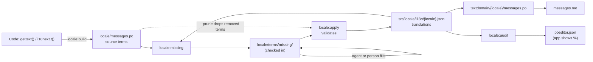
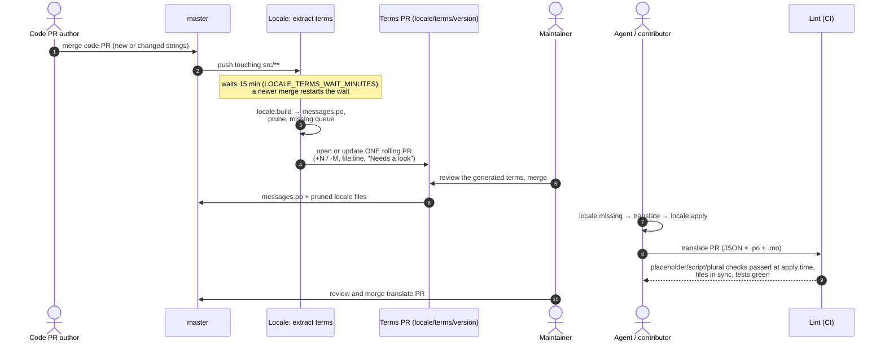
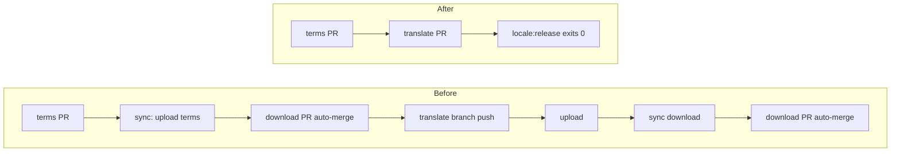

# Design: In-Repo Translations

Status: proposed in [#11424](https://github.com/ChurchCRM/CRM/pull/11424) (PR 1 of 2) for [#11416](https://github.com/ChurchCRM/CRM/issues/11416). Operator doc: [locale-pipeline.md](locale-pipeline.md). Release runbook: [release-process.md](release-process.md#phase-1-localization).

## TL;DR

The repo is now the only source of truth for translations, and POEditor is retired. Code PRs still produce one batched terms PR. Agents or contributors fill missing terms in a normal PR, with `npm run locale:missing` to find them and `npm run locale:apply` to write them. Lint fails when a locale's `.po`/`.mo` doesn't match its JSON. Releases no longer wait on upload or download syncs.

**What maintainers do now**

1. Merge the terms PR (`locale: new terms from code …`) after a quick review.
2. Have an agent run `/locale-translate --all`, or run `npm run locale:missing`, translate, then `npm run locale:apply`. Open the PR, review it, merge it.
3. Before a release, run `npm run locale:release -- --go` until it exits 0.
4. Never run `Locale: sync POEditor` after #11424 merges.

---

## 1. Goals and non-goals

| Goals | Non-goals |
|---|---|
| The repo is the only place translations live | A web translation UI. Weblate, which reads the repo, stays an option later |
| Missing terms are found from the repo, with no API or token | Changing how strings are written in code (`gettext()`, `i18next.t()`) |
| Translations are reviewed and merged like code | Changing the 15-minute terms batching |
| A reworded string is re-translated in the same PR, so no translation is lost | Supporting new languages as part of this change |
| Releases have no external round trips | Keeping POEditor in sync (a clean cut: no one-way upload) |

### Why POEditor was retired

| Then | Now |
|---|---|
| Volunteer translators worked in POEditor | Since Aug 1, **one person touched 8 terms** in POEditor |
| Humans did the translating | AI agents translate missing terms (`/locale-translate`) |
| Each change needed an upload, a download, waits, the `POEDITOR_TOKEN` secret and three workflows | One PR, reviewed in GitHub |
| Rewording a string dropped its translations in POEditor | The PR re-translates it (`locale:missing --term`) |

## 2. Architecture

### Source of truth

| File | Role | Written by |
|---|---|---|
| `locale/messages.po` | The **list of source terms** (English msgids, contexts, plurals) | `npm run locale:build` in the terms workflow |
| `src/locale/i18n/<locale>.json` | The **translations**, read by i18next in the browser | Agents and contributors, via `locale:apply` |
| `src/locale/textdomain/<locale>/LC_MESSAGES/messages.po` | gettext copy for PHP, **generated from the JSON** | `locale:apply` |
| `…/messages.mo` | Compiled `.po`, read by PHP | `locale:apply` (uses `gettext-parser`, no `msgfmt` needed) |
| `locale/terms/missing/<code>/*.json` | Queue of untranslated terms, **checked in** until translated (the terms PR writes it, a translate PR empties it) | `locale:missing`, filled by `locale-translate.js` |
| `src/locale/poeditor.json` | Completeness % per locale, shown in the app (renamed in PR 2) | `locale:audit` |

### Data flow

### Scripts

| Command | Does |
|---|---|
| `npm run locale:missing [-- --locale de] [-- --term "…"]` | Writes the terms each locale is missing: in `messages.po` but with no complete translation in the JSON. Keeps values already filled. `--term` queues a string that isn't extracted yet |
| `node locale/scripts/locale-translate.js --list / --prefill / --export / --apply-bulk` | Lets agents read and fill batches. Validates every value |
| `npm run locale:apply` | Moves filled batch values into the JSON, rebuilds the `.po` and `.mo`, and empties the batch. Rejected values stay in the batch with the reason |
| `npm run locale:apply -- --prune` | Also drops translations of terms no longer in `messages.po`. `locale:build` runs this |
| `npm run locale:apply -- --check` | Writes nothing. Exits 1 if any `.po`/`.mo` doesn't match its JSON |
| `npm run locale:audit` | Completeness from the repo → `poeditor.json` and `poeditor-audit.md` |
| `npm run locale:release [-- --go]` | Release check: terms PR open? extraction running? anything missing? `--go` extracts now, skipping the wait |
| `node locale/scripts/locale-add.js …` | Adds a language: adds it to `locales.json`, creates an empty JSON and a `.po` header, and prints the translate steps |

**Lint:** `npm run lint` includes **locale files in sync** (`locale-apply.js --check`, about 14 s), so a PR can't merge with stale `.po`/`.mo` files.

**Format rules:** `.po` entries that didn't change keep their exact text. New ones are appended in POEditor layout. Plural slots follow the locale's existing JSON forms, or CLDR for a new locale. On cutover, all 48 locales rebuild **byte-identical**.

## 3. End-to-end flow

| Step | Who | Output |
|---|---|---|
| Code merge | Developer | Strings in code |
| Batch wait (15 min, restarts on each merge) | `Locale: extract terms` | One extraction per burst |
| Terms PR | Workflow | `messages.po` diff, a list of new and removed terms with `file:line`, and **Needs a look** flags |
| Review | Maintainer | Fix odd strings in the code, not in the PR |
| Translate | Agent (`/locale-translate`) or contributor | Translate PR with JSON, `.po` and `.mo` |
| Merge | Maintainer | Ships in the next release |

## 4. Release workflow impact

| | Before | After |
|---|---|---|
| Phase 1 steps | 9 (1.0–1.8) | **4** (1.0–1.4) |
| External service | POEditor API, `POEDITOR_TOKEN` | None |
| Workflows | extract, sync, upload | **extract only** |
| Download PRs | Auto-merged by `GITHUB_TOKEN` | **Gone** |
| Translate branches | Never merged ("the push is the upload") | Merged as a normal PR |
| Reworded strings | Lost translations unless moved in POEditor | Re-translated in the same PR |
| Release-ready check | `locale:translate:list` plus open download PRs | `npm run locale:release` exits 0 |

**New Phase 1** ([release-process.md](release-process.md#phase-1-localization)):

| # | Step |
|---|---|
| 1.0 | `npm run locale:release -- --go`: extracts now, **skipping the 15-minute wait**, then stops at the terms PR or reports what's missing |
| 1.1 | `Locale: extract terms` opens or updates the terms PR, pruning removed terms |
| 1.2 | Review and merge the terms PR |
| 1.3 | Translate what's missing (`/locale-translate --all`) |
| 1.4 | Review and merge the translate PR, pull, re-run 1.0 |

**Gone:** the terms upload with `sync_terms` deletes, POEditor downloads, the daily 00:00 UTC sync, `Locale: upload translations`, auto-merged download PRs, and the deletion guard.

## 5. Contributor workflow

| Who | How |
|---|---|
| **Community translator** | Edit `src/locale/i18n/<locale>.json` (in the browser on GitHub is fine) and open a PR. A maintainer runs `npm run locale:apply` to rebuild the `.po`/`.mo`. See [CONTRIBUTING.md](../../CONTRIBUTING.md#translate) |
| **Maintainer / agent** | `locale-branch-manager.js --init` → `npm run locale:missing` → `/locale-translate` → `--commit-and-push` per locale (runs `locale:apply`) → open a PR |
| **Fixing a translation** | Put the corrected value in any batch file for that locale, then `npm run locale:apply` |
| **Rewording a string** | In the same code PR: `npm run locale:missing -- --term "New wording"`, translate, `npm run locale:apply` ([details](locale-pipeline.md#rewording-a-string)) |
| **English variants** (`en`, `en-au`, …) | Hand-write only the spellings that differ into `locale/terms/missing/<code>/<code>-1.json`, then `locale:apply` |
| **New language** | `locale-add.js`, then `locale:missing --locale <code>` and translate |

## 6. Quality gates

| Gate | Where | Catches |
|---|---|---|
| Placeholders | `locale:apply`, `locale-translate.js` (`translation-checks.js`) | `{{name}}` set differs, `%s`/`%d` count or order, mixed positional and plain |
| Script | same | Letters outside the locale's `scripts` (Latin always allowed for brand names) |
| Plural shape | same | Missing, extra or empty plural forms; a string where an object is required |
| Files in sync | `npm run lint` (CI and pre-push) | JSON edited without rebuilding the `.po`/`.mo` |
| Unit tests | `npm run locale:test`, also run in lint | `.po` rendering, plural forms, missing and obsolete detection, stable output |
| Terms review | Terms PR **Needs a look** | Code-like strings, HTML, whitespace, near-duplicates, rewordings that lose translations |
| Human review | Translate PR | Wording and tone (church vocabulary) |

## 7. Migration and cutover

| | PR 1: [#11424](https://github.com/ChurchCRM/CRM/pull/11424) | PR 2 (after PR 1 merges) |
|---|---|---|
| Scripts | `locale:missing`, `locale:apply`, repo-based audit and release, branch manager, `locale-add` | Delete `poeditor-*` scripts, `poeditor-terms`, `prune-uploaded-batches`, the download gate and check, and their tests. Move plural helpers out of `poeditor-plurals.js` |
| Workflows | POEditor sync and upload are manual only, with no auto-merge. Extract runs `locale:build` (extract, prune, missing queue) | Delete `locale-sync-poeditor.yml` and `locale-upload-missing.yml` |
| npm / env | `locale:missing`, `locale:apply`, the `gettext-parser` devDependency | Remove `locale:download`, `locale:upload:missing`, `POEDITOR_TOKEN` from `.env.example` |
| App | none | Rename `poeditor.json` (`LocaleInfo.php`, `system.php`, `biome.json`). Drop the `SystemConfig.php` link. Update the Cypress link check |
| Docs | Everything describes the repo flow | Leftover mentions |

**Verified before the cut:** master holds today's last download (#11423). All 3,505 values from today's two translate branches are on master. `locale:missing` reports nothing missing.

### Manual steps

| When | Step |
|---|---|
| Before merging PR 1 (optional) | If anyone edited POEditor recently, run `Locale: sync POEditor` once and merge its PR |
| Now | Cancel stuck run [43098324071](https://github.com/ChurchCRM/CRM/actions/runs/43098324071) |
| After PR 2 | Delete the `POEDITOR_TOKEN` repo secret, then archive POEditor project 77079 |
| Any time | Close #11422; delete leftover `locale/translate/*` and `locale/download/*` branches |

### Risks and rollback

| Risk | Mitigation |
|---|---|
| A POEditor download overwrites translations made in the repo | Triggers removed, auto-merge removed, PR 2 deletes the workflow |
| A stuck queued upload dispatches a sync | The download PR now stays open, so close it |
| `.po`/`.mo` drift from the JSON | Lint check. `locale:apply` rebuilds them deterministically |
| Contributor PRs fail lint (JSON only) | A maintainer runs `locale:apply` on the PR (see open questions) |
| Plural slot order differs for a new locale | Forms come from the existing JSON. A new locale falls back to CLDR; check its `Plural-Forms` header |

**Rollback:** revert #11424. That restores the triggers and auto-merge. POEditor still holds everything up to the cut, but repo-only translations made after the cut would have to be uploaded by hand. Once POEditor is archived (after PR 2), there is no rollback, by design.

## 8. Open questions

| Question | Options | Status |
|---|---|---|
| `src/v2/templates/user/user.php` has two English strings pointing to POEditor | A separate PR that changes the msgids and re-translates them in all locales | Needs a decision |
| Should **locale files in sync** stay a hard lint failure for JSON-only community PRs? | Keep it hard (a maintainer runs `locale:apply`) / downgrade to a warning / a bot pushes the rebuild | Undecided |
| Translations for unsupported languages in POEditor (sl, my, sr-cyrl, lv; each under 1.5%) are lost | Accept / export them once before archiving | Needs a decision |
